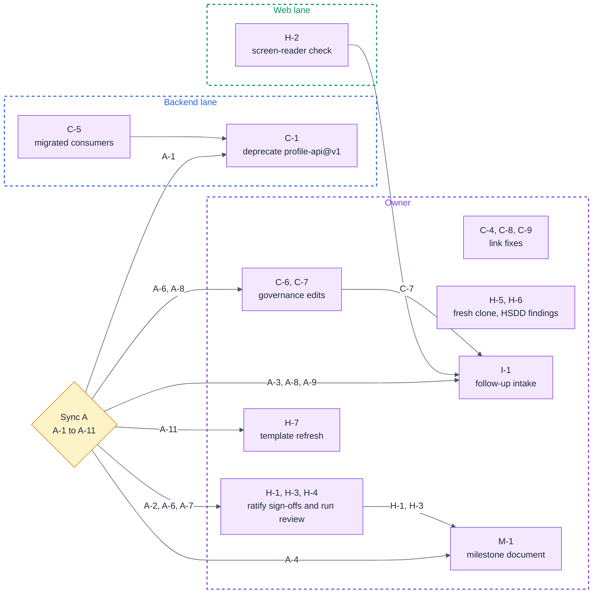

# simple-login · Execution Plan (2026-11-01)

**Created:** 2026-11-01 · **Supersedes:** [2026-10-30-execution-plan.md](2026-10-30-execution-plan.md)
**Repo baselines:** spec repo (`hsdd/`, a plain directory, no submodule) `0a618de` · implementation repo `meeting-rooms@0a618de` (branch `checkpoint/2026-11-01`, equal to `main`)
**Companion docs:** [2026-11-01-progress.md](2026-11-01-progress.md) · [atlas.md](atlas.md) · [2026-10-31-intake-prd-simple-login-v2.md](2026-10-31-intake-prd-simple-login-v2.md)

## Operating model

- **Lanes.** **Backend lane:** the backend developer; `simple-login.backend` and the four contract versions it produces. **Web lane:** the frontend developer; `simple-login.web`. **Owner:** the project owner (Purbo Mohamad); runs the checkpoint and the root-level governance skills, holds human sign-off, and holds `simple-login.integration`, for which PRD v2 Team and delivery names no lane.
- **Where prompts run.** From the project root (the directory holding `hsdd/`), on a branch off `main`, merged back to `main`. The HSDD tree is a plain directory, so a governance edit commits on the same branch as code. The 2026-10-30 plan's `feat/tutorial-update` does not exist in this repository (progress report F-20).
- **Legend.** 🤖 **delegate**: paste the prompt into an agent session, then check its *Validate* line by hand. 🤝 **interactive**: run the prompt with the agent; the human decides where it asks. 👤 **human-only**: execute from the briefing.
- **The owner proxy.** For the PRD v2 run the owner chose before the run that Claude takes every human stop. This plan's 👤 steps and Sync A decisions are written for the owner in person: they are how the proxy's answers come back to a human.

## Current state

The delta since [2026-10-30-execution-plan.md](2026-10-30-execution-plan.md):

- **PRD v2 is taken in and delivered.** `2026-10-31-intake-prd-simple-login-v2.md` routed it cross-node; an unattended `hsdd-auto` run executed its 19 handoffs (ADR-001 amended, ADR-002 new, booking-api@v1 new and `stable`, auth-api@v1 and profile-api@v2 touched, twelve phases appended); the twelve phases were built and merged on 2026-11-01. This checkpoint closed the intake record.
- **21 of 21 planned phases are done**, root `npm test` green at `0a618de` from a fresh install. No phase is planned or in progress.
- **The 2026-10-30 plan's steps:** C-2 is done (absorbed by S03, DEC-022) and the contract half of C-3 is done (S06, DEC-056); this checkpoint ticked both in that plan. C-3's spec half carries forward as C-9. C-1, C-4, H-1, H-2, I-1 and M-1 have not run and carry forward under their IDs.
- **Sync A has not met.** Its five decisions, A-1 to A-5, are still open and carry forward under their IDs with their questions unchanged; the facts under them are updated. This checkpoint adds A-6 to A-11, so Sync A grows to 60 minutes.
- **Open work is review and governance, not build:** ratifying 21 proxy sign-offs and the planning run's review sitting, landing one rejected display rule, deciding which dropped Learnings and web behaviors get work, and the lifecycle and link repairs carried from 2026-10-30.

## Ownership split

| | Backend lane | Web lane | Owner |
|---|---|---|---|
| **Nodes** | `simple-login.backend` | `simple-login.web` | `simple-login` (root); `simple-login.integration` (no lane named) |
| **Contracts (single-writer)** | `auth-api@v1`, `profile-api@v1`, `profile-api@v2`, `booking-api@v1` (producer `simple-login.backend`; edits through `hsdd-contract`, `former_consumers` through `hsdd-reconcile`) | none | none; ADR-001 and ADR-002 through `hsdd-adr`, OQ rows through `hsdd-reconcile` |
| **External tracks** | none | none | E-1 (product); E-2 and E-3 if A-10 opens them |

## Sync points

| Sync | When | Who | Agenda in one line |
|---|---|---|---|
| **Sync A** (gating) | Mon 2026-11-02, 60 min (proposed; the owner confirms the date) | owner, both developers | the 2026-10-30 agenda (A-1 to A-5) plus PRD v2's proxy decisions, a rejected display rule, dropped Learnings, web follow-ups, upstream asks and the template ([section](#sync-a--mon-2026-11-02-60-min-gating)) |
| **Weekly** | Mondays from 2026-11-09 (proposed), each after a Friday checkpoint | everyone | standing review of the newest plan |

## Plan graph



C-4, C-5, C-8, C-9, H-2, H-5 and H-6 depend on nothing and can run before Sync A. H-2 and the link fixes are Entry items of Sync A; H-2 is also a dependency of I-1. A-5 (guardrails) and A-10 (upstream asks) land in the next plan, not in a step.

## Sync A · Mon 2026-11-02, 60 min (gating)

**Why it gates:** C-1, C-6, C-7, H-1, H-3, H-4, H-7, I-1 and M-1 each wait on one of its decisions.

### Entry

- [ ] H-2's result is appended to this plan's change log: heard or not, for each message it lists.
- [ ] C-4, C-5, C-8 and C-9 are done, so the sync handles decisions only.
- [ ] Everyone has read the findings register in [2026-11-01-progress.md](2026-11-01-progress.md) and the "Decisions to look at first" table in `hsdd/auto/report/2026-10-31-intake-prd-simple-login-v2.md`.

### Agenda

A-1 to A-5 carry forward from [2026-10-30-execution-plan.md](2026-10-30-execution-plan.md) with their questions unchanged; this section is now their definition.

**A-1 · When does profile-api@v1 sunset?** (F-1) Every v1 consumer has migrated and the producer serves v2 only; its newest producing phase, `backend.4`, produces v2 only. hsdd-contract's policy is `deprecated` with a sunset date, then `retired`. Live options: **(a)** sunset on 2026-11-06, the next checkpoint, which then routes the retirement; **(b)** a later date, kept open for a reader outside the tree. Trade-off: C-5 moves the three migrated consumers to `former_consumers` before the sync, which removes the obstacle the 2026-10-30 plan saw under (a): a retirement is no longer blocked by a shipped phase still named as a consumer. (b) keeps a false five-field guarantee on the books longer, for a reader the tree does not list (`external_consumers` is absent). **Lands in:** `hsdd/contract/profile-api.md` (front matter `status`, `## Versioning`), through `hsdd-contract`.

**A-2 · Are the nine owner-proxy sign-offs accepted as the owner's?** (F-2) The nine phases before PRD v2. Live options: **(a)** the owner ratifies all nine as they stand; **(b)** the owner re-reviews the three full-review phases (`backend.2`, `web.3`, `integration.1`) in person and ratifies the six others; **(c)** the owner re-reviews all nine. Trade-off: (a) costs minutes but accepts three waivers and fourteen dropped Learnings unseen; (c) costs about one review sitting per phase; (b) spends human time where the tiers said review mattered. **Lands in:** each of the nine `hsdd/verify/simple-login.*.verification.md` `## Sign-off`, as a ratification or re-review line by the owner.

**A-3 · Do the residual verification gaps get work?** (F-6, F-7) F-6: no screen reader has heard any message in the product; it now spans the Login messages, Home's Cancel notice, Rooms' status line and Book's alert (H-2 brings the result). F-7: the AC-1.2 browser tests' blindness to whitespace. Live options: **(a)** waive both, with reasons, in the next execution plan; **(b)** route F-7, and F-6 for each message H-2 found unheard, through I-1; **(c)** route F-6 only where H-2 failed, and waive F-7. Trade-off: F-7's risk is a spacing-only edit to one constant that the web gate's own tests would not catch either, against process artifacts that outweigh a few changed lines (here, 1,400 lines of phase context per phase). An unheard expiry message fails AC-2.3 for a screen-reader user outright, and since PRD v2 the same pattern carries three more messages. **Lands in:** the intake record I-1 writes, or the next plan's waiver table.

**A-4 · Does the delivered campaign get a milestone document?** No milestone document exists; hsdd-milestone's precondition holds (every leaf-parent is phase-planned). Live options: **(a)** run `hsdd-milestone` now for the delivered scope, the PRD, update 1 and PRD v2 (21 phases): its gates are met at generation, and the next checkpoint seals it on the verification docs; **(b)** skip this campaign, and open the first milestone document with the next one. Trade-off: (a) costs one run and gives stakeholders an evidence-backed record that PRD v2 shipped, but its seal rests on the sign-offs, so it follows H-1 and H-3. (b) leaves the delivery recorded only in progress reports. Either way no campaign gate includes launch: PRD v2 Constraints keep the product on the laptop, so maintenance mode does not start. **Lands in:** `hsdd/management/YYYY-MM-DD-milestones.md` (through `hsdd-milestone`), or the next progress report's Milestone gate status line under (b).

**A-5 · Accept or reject proposed guardrails.** Guardrails 1 to 3 (2026-10-30) and 4 to 6 (proposed by this plan). Live options, per guardrail: accept, reject, or accept with amended wording. This checkpoint's data bears on guardrail 1: estimates ran 1.96 times low over twelve phases, so its factor of 1.6 would have undercounted (progress report, Velocity). **Lands in:** the next execution plan's Guardrails section. Accepted guardrails keep their numbers; rejected ones stay listed as rejected, since guardrails are append-only.

**A-6 · Are the twelve delegated PRD v2 sign-offs accepted as the owner's, and which dropped Learnings re-open?** (F-10, F-11, F-16) The proxy took ten waivers and dropped all 53 Learnings, 21 of them written `spec-updated`. Live options: **(a)** ratify all twelve as they stand, Learnings stay dropped; **(b)** ratify all twelve and re-open the Learnings where governance text now says less than the code: backend D7 (the bound of three attempts, READ COMMITTED), booking-api@v1's `DELETE` 400, the backend.6 and web.6 Verification lines, and web D1, D3, D4 and D10 (announcements, focus on a screen change, whose session a 401 ends); **(c)** re-review the eight full-review phases (`backend.6`, `backend.7`, `web.6` to `web.9`, `integration.3`, `integration.5`) in person, ratify the four others, and settle the Learnings in those sittings. Trade-off: (a) is minutes, and leaves D7 and the `DELETE` table describing a service that differs from the one shipped; (b) costs one 🤝 session (C-6) and keeps the governance text true; (c) costs about eight review sittings and is the only option where a human reads the code. **Lands in:** each of the twelve verification docs' `## Sign-off` (a ratification or re-review line by the owner); re-opened Learnings in the governance file each names, through C-6.

**A-7 · Is the planning run's review sitting accepted as the owner's?** (F-13) The proxy wrote 33 review lines over 231 decisions, including ADR-002's acceptance though no human stated its decision (DEC-037), the 8-hour longest booking (DEC-046) and the 365-day horizon (DEC-047). Live options: **(a)** ratify the 33 lines; **(b)** the owner reviews in person the nine decisions the report lists first (DEC-013, DEC-037, DEC-046, DEC-047, DEC-154, DEC-156, DEC-187, DEC-195, DEC-198) and ratifies the rest; **(c)** review all 33 in person. Trade-off: (a) leaves an accepted ADR and two product limits that no human chose; (b) is about an hour and covers every decision a consumer or product can see; a reversal under (b) or (c) is a change request through `hsdd-intake`, since the code has shipped. **Lands in:** `hsdd/judgement/decision-reviews.jsonl`, one line per decision reviewed, with the owner as reviewer.

**A-8 · Which room-local range form stands?** (F-12) The proxy's review disagreed with DEC-032 as applied: a range whose two ends fall on the same other date repeats it, `(Wed 4 Nov 16:30 to Wed 4 Nov 17:30 in London)`, and web.8 shipped exactly that. Live options: **(a)** keep the shipped form, and the owner withdraws the disagree with a review line; **(b)** the date once per range, `(Wed 4 Nov 16:30 to 17:30 in London)`: ADR-002 Decision 7 is amended (C-7), then a web change through I-1. Trade-off: (a) costs nothing and keeps one rule for every time off its line's date; (b) reads better on the one screen that shows room-local times, costs a small web phase (`formatRange` in `web/src/time/time.ts` and three pinned tests), and makes Decision 7 carry a second rule. **Lands in:** ADR-002 (through `hsdd-adr`) and I-1's intake record under (b); `hsdd/judgement/decision-reviews.jsonl` under (a).

**A-9 · Which web follow-ups get a change request?** (F-15) The proxy left them for a later intake: (1) Rooms keeps its list after a refused booking; (2) a failed refetch after a 201 replaces `Booked.`; (3) an `unavailable` Book does not refetch the date; (4) focus falls to the page on every screen change; (5) Rooms has no retry; (6) three wireframe differences on Rooms (the date input's format, no indent, the message's place). Live options: **(a)** one intake through I-1 for the items kept, with F-14's flaky test; **(b)** waive all six, and I-1 carries F-14 and whatever A-3 and A-8 keep. Trade-off: (1) is the only one a user meets without a network failure: a refused booking whose room still reads `(no bookings)`; (2) and (3) need a network failure in a one-second window; (4) to (6) are polish on a one-laptop demo. **Lands in:** the intake record I-1 writes, or the next plan's waiver table.

**A-10 · Which upstream asks does the owner raise?** (F-13) The run proposed four decisions upstream: RFC-001 still states version 1's in-memory, two-endpoint, no-database design (DEC-013), and the session answers its authors may revisit (DEC-018, DEC-019); PRD v2 Success dropped version 1's "Home in under 3 seconds", which integration.4 then removed from the AC-1.1 browser test (DEC-195). Live options: **(a)** raise both: E-2 asks RFC-001's authors for an amendment or a version-2 RFC, E-3 asks product whether PRD v2 keeps the 3-second target; **(b)** raise E-3 only, and record RFC-001 as overtaken in place (the root spec's Decisions already say so); **(c)** neither, recorded with reasons. Trade-off: E-3's answer can put a check back in the browser suite through `hsdd-intake`; E-2 changes no code and keeps a normative source consistent with the tree. **Lands in:** the next plan's External tracks; any answer enters the tree through `hsdd-intake`.

**A-11 · Is the tree's verification template refreshed?** (F-22) `hsdd/templates/verification.md` predates hsdd-config 0.11: its Sign-off has no delegated form, which the bundled copy gives (`{person} | {agent} for {person} (delegated)`) along with the rule that a delegated sign-off names the person it answers to. hsdd-config leaves a copy that has `## Learnings` as it is. Live options: **(a)** copy the bundled template over the tree's copy, verbatim (H-7); **(b)** keep the tree's copy. Trade-off: (a) makes the next delegated sign-off say whom it answers to by the template's own words, and touches no written doc; (b) keeps every phase's switch reporting the difference. Neither fixes the em dash in the title, which both copies carry (H-6 reports it upstream). **Lands in:** `hsdd/templates/verification.md`.

### Exit

- [ ] A-1 answered; the sunset date is handed to C-1 (lands in `hsdd/contract/profile-api.md`).
- [ ] A-2 answered; H-1's option chosen (lands in each of the nine verification docs' `## Sign-off`).
- [ ] A-3 answered; its kept items handed to I-1, or waived (lands in I-1's intake record, or the next plan's waiver table).
- [ ] A-4 answered; M-1 runs or is closed as not needed (lands in a milestone document, or the next progress report).
- [ ] A-5: each proposed guardrail, 1 to 6, accepted or rejected (lands in the next plan's Guardrails).
- [ ] A-6 answered; H-3's option chosen and C-6's list of re-opened Learnings fixed (lands in each of the twelve verification docs' `## Sign-off`, and the governance files C-6 edits).
- [ ] A-7 answered; H-4's scope chosen (lands in `hsdd/judgement/decision-reviews.jsonl`).
- [ ] A-8 answered; C-7 and I-1 run, or the withdrawal is written (lands in ADR-002 and an intake record, or `hsdd/judgement/decision-reviews.jsonl`).
- [ ] A-9 answered; its kept items handed to I-1, or waived (lands in I-1's intake record, or the next plan's waiver table).
- [ ] A-10 answered; E-2 and E-3 opened or recorded as not raised (lands in the next plan's External tracks).
- [ ] A-11 answered; H-7 runs or is closed as not needed (lands in `hsdd/templates/verification.md`).

### Unblocks

- **Backend lane:** C-1 starts with A-1's date, after C-5.
- **Web lane:** nothing waits. If A-3, A-8 or A-9 open a web change, its phase plan follows I-1.
- **Owner:** H-1 starts per A-2, H-3 and C-6 per A-6, H-4 per A-7, C-7 per A-8, H-7 per A-11; I-1 per A-3, A-8 and A-9, after H-2 (and C-7 under A-8 (b)); M-1 per A-4, after H-1 and H-3.

## Step tables

### C · governance repairs

| ID | Owner | Action | Depends | Finding | ☐ |
|---|---|---|---|---|---|
| C-1 | Backend 🤖 | Move profile-api@v1 to `deprecated` with A-1's sunset date. | Sync A (A-1), C-5 | F-1 | ☐ |
| C-4 | Owner 🤖 | Link OQ1's row to external track E-1. | none | F-5 | ☐ |
| C-5 | Backend 🤖 | Move profile-api@v1's three migrated consumers to `former_consumers`. | none | F-18 | ☐ |
| C-6 | Owner 🤝 | Apply the Learnings that A-6 re-opens through their owning skills. | Sync A (A-6) | F-11 | ☐ |
| C-7 | Owner 🤖 | Amend ADR-002 Decision 7 for a same-date room-local range if A-8 chooses (b). | Sync A (A-8) | F-12 | ☐ |
| C-8 | Owner 🤖 | Link ADR-001 and `simple-login.integration` both ways. | none | F-19 | ☐ |
| C-9 | Owner 🤝 | Settle the Consumes lines of `web.3` and `web.4` against auth-api@v1's consumers. | none | F-4 | ☐ |

### H · human steps

| ID | Owner | Action | Depends | Finding | ☐ |
|---|---|---|---|---|---|
| H-1 | Owner 👤 | Ratify or re-review the nine proxy sign-offs as A-2 decides. | Sync A (A-2) | F-2 | ☐ |
| H-2 | Web 👤 | Listen with VoiceOver for the product's four kinds of message. | none | F-6 | ☐ |
| H-3 | Owner 👤 | Ratify or re-review the twelve delegated sign-offs as A-6 decides. | Sync A (A-6) | F-10, F-16 | ☐ |
| H-4 | Owner 👤 | Review the planning run's decisions in person as A-7 decides. | Sync A (A-7) | F-13 | ☐ |
| H-5 | Owner 👤 | Run the deferred fresh-clone, time-zone and September checks. | none | F-17 | ☐ |
| H-6 | Owner 👤 | Report the HSDD findings upstream and recover the three named only by title. | none | F-22 | ☐ |
| H-7 | Owner 👤 | Copy the bundled verification template over the tree's copy if A-11 chooses (a). | Sync A (A-11) | F-22 | ☐ |

### I / M · follow-up work

| ID | Owner | Action | Depends | Finding | ☐ |
|---|---|---|---|---|---|
| I-1 | Owner 🤖 | Route the flaky test and the follow-ups Sync A keeps through one `hsdd-intake`. | Sync A (A-3, A-8, A-9), H-2, C-7 | F-6, F-7, F-12, F-14, F-15 | ☐ |
| M-1 | Owner 🤖 | Generate the milestone document if A-4 chooses it. | Sync A (A-4), H-1, H-3 | none | ☐ |

### Waived or closed without a step

| Finding | Disposition |
|---|---|
| **F-3** | **Closed.** ADR-001's `affects` names `simple-login` since S03 (`b304ae8`, DEC-022); the 2026-10-30 plan's C-2 is ticked. |
| **F-8** | **Waived** (2026-10-30, unchanged). Two signed docs cite tutorial screenshots outside the project; the gate evidence is `npm test`, re-run green today. Sync A may reopen it. |
| **F-20** | **Waived.** The repository starts at `e84ae36`, a copy of the tutorial's `execute/` at `885c906`, so the 2026-10-30 report's baselines and the nine earlier phases' per-phase history live in that source repository. Those phases were counted done there, on evidence this run re-proved (their tests are inside today's green `npm test`); history from `e84ae36` on is per-phase, one merge commit per phase. This plan's baselines restart the chain at `0a618de`. Historical documents are not rewritten. |
| **F-21** | **Waived.** The intake record is dated and outside the chain rules, and this skill only appends phases to its `## Produced` and closes it. Each touched or drafted contract's `## Versioning` cites the record, so nothing is lost; the gap is hsdd-auto's (H-6 reports it if upstream has not fixed it). |

## Step details

### C-1 · deprecate profile-api@v1 🤖 (Backend)

**Prompt:**

```
/hsdd-contract deprecate profile-api@v1 with sunset date {A-1's date from Sync A} per hsdd/management/2026-11-01-execution-plan.md (C-1, finding F-1). Every v1 consumer has a v2 phase with its verification doc on main (simple-login.web.4 replaces web.1 and web.3; simple-login.integration.2 replaces integration.1), C-5 has moved those three to former_consumers, and the producer has served profile-api@v2 only since simple-login.backend.3; its newest producing phase, simple-login.backend.4, produces v2 only. Set status: deprecated, record the sunset date and the reason in ## Versioning, keep the schema and fixtures, and regenerate the registry. Do not retire v1 in this run.
```

*Validate:* `hsdd/contract/profile-api.md` reads `status: deprecated` and its `## Versioning` names the sunset date; `hsdd/contract/INDEX.md` shows v1 as `deprecated`; root `npm test` is still green.

### C-4 · link OQ1 to E-1 🤖 (Owner)

**Prompt:**

```
/hsdd-reconcile link OQ1 to its external track per hsdd/management/2026-11-01-execution-plan.md (C-4, finding F-5). OQ1 in hsdd/spec/simple-login.md waits on "ext: product"; hsdd/conventions.md says to link the execution plan's E-track where one exists, and this plan carries E-1 for OQ1. Add the E-1 link, with this plan's filename, to OQ1's Waits on cell. Its status stays OPEN; nothing else changes.
```

*Validate:* OQ1's row in `hsdd/spec/simple-login.md` names `E-1` and `2026-11-01-execution-plan.md`, and still reads `OPEN`.

### C-5 · move profile-api@v1's migrated consumers 🤖 (Backend)

**Prompt:**

```
/hsdd-reconcile move the migrated consumers of profile-api@v1 per hsdd/management/2026-11-01-execution-plan.md (C-5, finding F-18). simple-login.web.1 and simple-login.web.3 migrated to profile-api@v2 in simple-login.web.4, and simple-login.integration.1 in simple-login.integration.2, each with its verification doc on main. Move those three phase ids from consumers to former_consumers in hsdd/contract/profile-api.md, creating the key, and delete none. Leave status as it is: the deprecation is C-1, after Sync A's A-1. Regenerate the registry.
```

*Validate:* `hsdd/contract/profile-api.md` front matter has `former_consumers` naming `simple-login.web.1`, `simple-login.web.3` and `simple-login.integration.1`, its `consumers` names none of them, and `status` still reads `stable`; the profile-api v1 row of `hsdd/contract/INDEX.md` matches.

### C-6 · apply the re-opened Learnings 🤝 (Owner)

Run each prompt only for the Learnings A-6 re-opened; under A-6 (a) tick this box as not needed.

**Prompt (node plans):**

```
/hsdd-phase-plan simple-login.backend and simple-login.web: apply the verification-doc Learnings that Sync A's A-6 re-opened, per hsdd/management/2026-11-01-execution-plan.md (C-6, finding F-11): {the re-opened Learnings, by doc and line}. Candidates: backend D7 states that a 23P01 or 40P01 reaching the store is answered "never by a 5xx", but the store (simple-login.backend.6) makes at most 3 attempts under the room's lock, then throws, and pins READ COMMITTED, which D7 does not name (hsdd/verify/simple-login.backend.6.verification.md, Learnings 1 and 3); the simple-login.backend.6 Verification line checks the race window for "deadlock detected" only, where the doc counted every ERROR line (Learning 4); the simple-login.web.6 Verification line says nothing outside web/src/time/ calls Intl.DateTimeFormat, which a shipped test file does (web.6 L1, L2); web D1 (a 401 ends only the session whose token received it), D3 or D10 (how a message is announced, role alert or status) and D4 (where focus goes on a screen change) per hsdd/verify/simple-login.web.7.verification.md and simple-login.web.8.verification.md Learnings. Record what the shipped code does; propose a code change only where I ask for one, and hand it to I-1, not to this session. Leave shipped phases' Scope text as written and note any change beside it.
```

**Prompt (contract):**

```
/hsdd-contract amend booking-api@v1 per hsdd/management/2026-11-01-execution-plan.md (C-6, finding F-11), only if Sync A's A-6 re-opened it: the DELETE /api/bookings/{id} table has no 400 row, while the service (simple-login.backend.7) answers 400 VALIDATION_FAILED to a DELETE whose body Fastify refuses, which only a body over 1 MiB reaches (hsdd/verify/simple-login.backend.7.verification.md, Learning 1). Classify the change against booking-api@v1's Versioning, ask me before anything other than a compatible clarification, keep the schema and fixtures valid, and regenerate the registry.
```

*Validate:* each Learning A-6 re-opened has a matching edit in the file it names (`git log -p` on `hsdd/spec/simple-login.backend.md`, `hsdd/spec/simple-login.web.md` or `hsdd/contract/booking-api.md` shows it), the edits cite this step, and root `npm test` is still green.

### C-7 · amend ADR-002 Decision 7 🤖 (Owner)

Only under A-8 (b); under (a) tick this box as not needed.

**Prompt:**

```
/hsdd-adr amend ADR-002 per hsdd/management/2026-11-01-execution-plan.md (C-7, finding F-12, Sync A's A-8 option (b)). Decision 7's first bullet gives every time off its line's date its own date, so on the Rooms screen a room-local range whose two ends fall on the same other date repeats it: "(Wed 4 Nov 16:30 to Wed 4 Nov 17:30 in London)", which simple-login.web.8 shipped. The owner's review of DEC-032 (hsdd/judgement/decision-reviews.jsonl) chose: a range whose two ends fall on the same other date shows that date once, "(Wed 4 Nov 16:30 to 17:30 in London)". State that rule with its example, as an amendment if the decision is kept, a superseding ADR if you judge it changed, and regenerate the registry. The web change goes through I-1, not this session.
```

*Validate:* `hsdd/adr/002-time-model.md` Decision 7 states the once-per-range rule with that example, and its `## Amendments` has a dated line citing this step (or a superseding ADR exists and `hsdd/adr/INDEX.md` lists it).

### C-8 · link ADR-001 and the integration node 🤖 (Owner)

**Prompt:**

```
/hsdd-adr ADR-001: add simple-login.integration to affects, per hsdd/management/2026-11-01-execution-plan.md (C-8, finding F-19). The node's Overview and simple-login.integration.3's Scope (f) rest on ADR-001's in-memory sessions (a restart of the service ends every token, auth-api@v1 G3), and integration.3's Success test asserts it, but the node's Governed by lists only ADR-002 and ADR-001's affects omits the node. Add the node to affects and ADR-001 to its Governed by, in hsdd/spec/simple-login.integration.md and in its embedded summary in hsdd/spec/simple-login.md, as your bidirectional-link rule says; leave the shipped phases' lines as written. This is a link fix; the decision does not change. Regenerate the registry.
```

*Validate:* the `affects` line of `hsdd/adr/001-session-tokens.md` names `simple-login.integration`, the node's `Governed by` in both spec files names ADR-001, and the ADR-001 row of `hsdd/adr/INDEX.md` matches.

### C-9 · the Consumes lines of web.3 and web.4 🤝 (Owner)

**Prompt:**

```
/hsdd-reconcile align the plans after the contract moved, per hsdd/management/2026-11-01-execution-plan.md (C-9, finding F-4). Since 2026-10-31 (S06, DEC-056, the 2026-10-30 plan's C-3) auth-api@v1's consumers names simple-login.web.3 and simple-login.web.4, whose App tests read its login-success fixture (web/src/App.test.tsx), but their Consumes lines in hsdd/spec/simple-login.web.md name only profile-api@v1 and profile-api@v2. Ask me whether the two shipped phases' Consumes lines gain auth-api@v1 or stay as written with a note in the node's plan; apply my answer and nothing else.
```

*Validate:* the two Consumes lines in `hsdd/spec/simple-login.web.md` name `auth-api@v1`, or a dated note beside them says why they do not; no other line changed.

### H-1 · ratify or re-review the nine pre-PRD-v2 sign-offs 👤 (Owner)

**Why:** the nine phases before PRD v2 are signed by an owner proxy, so their evidence chain stops at an agent; three waivers and fourteen dropped Learnings were decided without the owner (F-2).

**Do:**

- [ ] Take A-2's answer from Sync A.
- [ ] Under (b) or (c), for each phase in scope: read the phase's diff, run `npm test` from the project root, then add your own line under `## Sign-off` in its `hsdd/verify/simple-login.{phase}.verification.md`.
- [ ] Under (a), and for the phases (b) leaves out, append `- Ratified by Purbo Mohamad, {date}` under `## Sign-off` in each remaining doc.
- [ ] Confirm or reverse the three proxy waivers: the screen-reader pass in `simple-login.web.2.verification.md` and `simple-login.web.3.verification.md` (take H-2's result into account), and the `cancelled`-flag test in `simple-login.web.3.verification.md`.
- [ ] Commit the edits on a branch and merge it to `main`.

**Done when:** each of the nine verification docs carries a ratification or re-review line by the owner on `main`.

### H-2 · hear the product's messages with VoiceOver 👤 (Web)

**Why:** every message the product announces mounts with its content in a `role="alert"` or `role="status"` element, which screen readers often skip, and no one has listened: the Login check was waived twice in 2026-10 and the three PRD v2 messages were waived again on 2026-11-01 (F-6).

**Do:**

- [ ] Check that nothing listens on 3000 or 5173 (`lsof -nP -iTCP:3000 -iTCP:5173 -sTCP:LISTEN`), then run `npm run dev` from the project root (it starts PostgreSQL first).
- [ ] Open `http://localhost:5173` in Chrome with VoiceOver on (Cmd-F5).
- [ ] Login: sign in as `ayu` / `sunset-42` (a wrong password); listen for "Incorrect username or password."
- [ ] Sign in as `ayu` / `sunrise-42`. Stop `npm run dev` with Ctrl-C, start it again (a restart signs everyone out, ADR-001), reload the tab, and listen for "Your session has expired. Please sign in again."
- [ ] Book: sign in as `budi` / `harbor-17`, press `Book a room`, book a free quarter hour later today, and listen for "Booked."; book the same time again and listen for the overlap message.
- [ ] Rooms' status line: run `npm --prefix backend run db:down`, change the date on Rooms, and listen for the message that replaces the list; run `npm --prefix backend run db:up` after.
- [ ] Home's Cancel notice: open Home in two tabs, cancel the booking in the first, press Cancel on it in the second, and listen for "That booking was already cancelled."
- [ ] Stop `npm run dev` and check that both ports are free again.
- [ ] Append the result to this plan's `## Change log`, one entry per message (for example `- 2026-11-02: H-2: Booked. heard; expiry message not heard`), then tick Sync A's first Entry box. A published plan accepts only those two edits.

**Done when:** Sync A's first Entry box is ticked, and the change log carries a heard-or-not result for each of the six messages above.

### H-3 · ratify or re-review the twelve delegated sign-offs 👤 (Owner)

**Why:** each PRD v2 phase was signed by Claude for the owner; the proxy took ten waivers and dropped 53 Learnings, two of them it called owner decisions (F-10), and two docs leave Outstanding items without a disposition (F-16).

**Do:**

- [ ] Take A-6's answer from Sync A.
- [ ] Under (c), for each full-review phase (`backend.6`, `backend.7`, `web.6`, `web.7`, `web.8`, `web.9`, `integration.3`, `integration.5`): read the phase's merge diff (`git diff {merge}^1 {merge}`; the merges are listed in `git log --first-parent main`), run `npm test`, and add your own line under `## Sign-off` in its `hsdd/verify/simple-login.{phase}.verification.md`.
- [ ] Under (a) or (b), and for the four phases (c) leaves out, append `- Ratified by Purbo Mohamad, {date}` under `## Sign-off` in each remaining doc.
- [ ] Confirm or reverse the ten waivers: backend.4 (the `docker compose` plugin branch), backend.6 (the retry bound), web.7 (the wireframe's indent), web.8 (Safari, Firefox, screen reader), web.9 (iOS zoom, screen reader, Safari and Firefox focus), integration.4 (VoiceOver, the laptop's zone), integration.5 (the clock-change skip branch).
- [ ] Give a disposition to each Outstanding item that has none: in `simple-login.integration.3.verification.md` the service's inherited zone and whether the twenty requests overlap inside the service; in `simple-login.integration.5.verification.md` Outstanding 2 (the flaky test, routed to I-1).
- [ ] Under (b), write the list of re-opened Learnings into this plan's change log for C-6.
- [ ] Commit the edits on a branch and merge it to `main`.

**Done when:** each of the twelve verification docs carries a ratification or re-review line by the owner on `main`, and the three Outstanding items each have a disposition.

### H-4 · review the planning run's decisions 👤 (Owner)

**Why:** the run that planned PRD v2 recorded 231 decisions and only the proxy reviewed them, so an accepted ADR and two product limits rest on no human's choice (F-13).

**Do:**

- [ ] Take A-7's answer from Sync A.
- [ ] Read `hsdd/auto/report/2026-10-31-intake-prd-simple-login-v2.md`: "Decisions to look at first", "Upstream" and "Assumptions about the owner's intent".
- [ ] For each decision in A-7's scope, read its entry in `hsdd/judgement/decisions.jsonl` and append one line to `hsdd/judgement/decision-reviews.jsonl` with yourself as reviewer (`agree` or `disagree`, a reason, and for a disagree your preferred answer and its impact), as the report's "How to review" says.
- [ ] For DEC-032, write A-8's answer.
- [ ] For each disagree that changes shipped behavior or a governance file, add a line to this plan's change log naming it, for I-1 or the next checkpoint.
- [ ] Commit on a branch and merge it to `main`.

**Done when:** `hsdd/judgement/decision-reviews.jsonl` on `main` carries a line with the owner as reviewer for each decision in A-7's scope.

### H-5 · the deferred fresh-clone, time-zone and September checks 👤 (Owner)

**Why:** three docs deferred the fresh-clone check and one the laptop's zone change to a run outside the tree, and web.6's September check was marked verified on other months (F-17). This checkpoint's fresh install covered only part of the first.

**Do:**

- [ ] Stop `npm run dev` if it runs, and run `colima stop`.
- [ ] Clone the repository's `main` into an empty directory and `cd` into it.
- [ ] Run `colima start`, `npm run install:all`, then `npm test`: exit 0, with backend 299, replay 46, web 387 and the build, runner 3, browser 85 as at `0a618de` (or the counts of a later `main`).
- [ ] Set macOS's time zone to one that is neither account's (System Settings, General, Date & Time; for example Los Angeles), run `npm test` again, then `npm run dev`, sign in as `budi`, and check that Home's booking times match those before the change; restore the zone.
- [ ] In Chrome, as `budi`, book a room on a September date within 365 days (for example 2027-09-15), then on Home check the booking line's date against `node -e "console.log(new Intl.DateTimeFormat('en-GB',{weekday:'short',day:'numeric',month:'short',timeZone:'UTC'}).format(new Date('2027-09-15')))"`.
- [ ] Append the three results to this plan's change log.

**Done when:** the change log carries the fresh-clone gate result, the zone-change comparison and the September date as Chrome shows it beside Node's.

### H-6 · report the HSDD findings 👤 (Owner)

**Why:** the build carried findings about HSDD itself to this checkpoint, and three exist only as titles in sign-offs (F-22).

**Do:**

- [ ] In the HSDD repository, outside this tree, record: the em dash in the bundled verification template's title line; phase contexts that link no input document, so PRD v2's Screens wireframe reached no web phase (web.7, web.8, integration.5); deferred Outstanding items that never reach the receiving phase's context (integration.4); and, unless already fixed there, hsdd-auto's `## Produced` naming no contract for this intake (F-21).
- [ ] From the build run's own report or session, recover the three findings named only by title: "hsdd-config rule disagreement" (`simple-login.backend.6.verification.md` Sign-off), "Gate-backtick" (`simple-login.backend.7.verification.md` Sign-off), "plan-header" (`simple-login.integration.3.verification.md` Sign-off); record each upstream, or note it as lost.
- [ ] Append one line to this plan's change log naming where each finding went.

**Done when:** the change log line names, for each finding above, where it was recorded or that it was lost.

### H-7 · refresh the verification template 👤 (Owner)

**Why:** the tree's template has no delegated sign-off form, so twelve delegated sign-offs were written against a template that does not describe them (F-22).

**Do:**

- [ ] Take A-11's answer; under (b) tick this box as not needed.
- [ ] Under (a), copy `.claude/skills/hsdd-config/templates/verification.md` over `hsdd/templates/verification.md` with `cp`, never retyped; written verification docs are not touched.
- [ ] Commit on a branch and merge it to `main`.

**Done when:** `diff .claude/skills/hsdd-config/templates/verification.md hsdd/templates/verification.md` prints nothing on `main`, or the box is ticked as not needed.

### I-1 · route the follow-ups through one intake 🤖 (Owner)

**Prompt:**

```
/hsdd-intake follow-ups from hsdd/management/2026-11-01-execution-plan.md (I-1). Authority: a ticket raised by the 2026-11-01 checkpoint and Sync A's answers to A-3, A-8 and A-9: {the kept items}. Always included (F-14): web/src/App.test.tsx "checks a stored session and shows Home (AC-2.2)" saw 1 authorization header where it expected 2 in simple-login.integration.5's first gate attempt and passed in every gate since; the root npm test can fail on it. Candidates, only where Sync A kept them: F-7, the two AC-1.2 tests in e2e/login.spec.ts match "Incorrect username or password." with Playwright's exact: true, which collapses whitespace; F-6, each message H-2 found unheard ({H-2's result}); F-12 under A-8 (b), Rooms shows a room-local range's date once when both ends fall on the same other date, per ADR-002 Decision 7 as C-7 amended it (formatRange in web/src/time/time.ts and the tests that pin the old form); F-15 items A-9 kept: Rooms reloads the date after a refused booking, Booked. stays after a failed refetch, an unavailable Book refetches the date, focus after a screen change, a retry on Rooms, the wireframe differences.
```

*Validate:* a new `hsdd/management/*-intake-*.md` record exists with its class and handoff prompts, cites this plan, and includes F-14. If Sync A kept nothing beyond F-14, the record carries F-14 alone.

### M-1 · generate the milestone document 🤖 (Owner)

**Prompt:**

```
/hsdd-milestone generate the milestone document for the simple-login campaign (the PRD, update 1 and PRD v2, 21 phases) with hsdd/management/2026-11-01-progress.md as its Basis, per hsdd/management/2026-11-01-execution-plan.md (M-1, Sync A's A-4).
```

*Validate:* `hsdd/management/YYYY-MM-DD-milestones.md` exists, and its `**Basis:**` line names `2026-11-01-progress.md`. If A-4 chose (b), no document exists and this box is ticked as not needed.

## External tracks

| Track | Owner | Status | What happens on answer | Gates |
|---|---|---|---|---|
| E-1 · deployment beyond a laptop | owner, asking product | open since 2026-10-29, not yet asked; PRD v2 keeps delivery on the laptop | the answer (one origin behind a reverse proxy, or two origins with CORS) enters the tree through `hsdd-intake`, and the deployment campaign it opens is the first whose gate can include launch | no phase (OQ1: nothing is contingent on it) |
| E-2 · RFC-001 for version 2 | owner, asking RFC-001's authors | proposed; opens on A-10 (a) | an amended RFC-001, or an RFC for version 2, replaces the statements the root spec's Decisions record as overtaken (DEC-013, DEC-018, DEC-019) | no phase |
| E-3 · the 3-second target | owner, asking product | proposed; opens on A-10 (a) or (b) | if product restores "Home in under 3 seconds" to PRD v2 Success, a change request through `hsdd-intake` puts the check back in the AC-1.1 browser test (DEC-195) | no phase |

## Timeline

No milestone document exists to align to (A-4).

| Week | Backend lane | Web lane | Owner |
|---|---|---|---|
| **Sun 2026-11-01** | none | none | this checkpoint |
| **Mon 2026-11-02 to Fri 2026-11-06** | C-5 before Sync A; C-1 after it | H-2 before Sync A; a web phase only if I-1 opens one | C-4, C-8, C-9, H-5 and H-6 before Sync A; Sync A on Monday; then H-1, H-3, H-4, C-6, C-7, H-7, I-1 and M-1 as decided; next checkpoint on Friday 2026-11-06 |

## Guardrails

Imported from [2026-10-30-execution-plan.md](2026-10-30-execution-plan.md) under their numbers; none has been decided (A-5). Every guardrail below is *proposed*.

1. *(proposed)* **A size estimate counts the tests a test-first phase will write.** Until a checkpoint recalibrates, multiply a source-only estimate by 1.6. Lesson: four of nine phases passed the ~400-line PE ceiling, and estimates ran 1.64 times low (2026-10-30 progress report, Velocity).
2. *(proposed)* **A browser assertion for a criterion that says "exactly" matches the whole raw text with an anchored pattern, never Playwright's `exact: true`.** That option normalizes whitespace. Lesson: integration.2's review finding; F-7 is the same gap in AC-1.2.
3. *(proposed)* **A producer phase that turns the root gate red by design names, in its plan, the consumer phases that turn it green, and they land in the same window.** Lesson: backend.3 left `npm test` red from 13:16 to 13:39 on 2026-10-30. The window was planned and named in both plans, so nobody mistook it for a regression.
4. *(proposed)* **A sign-off that changes a Learning's disposition rewrites that Learning's own disposition, so the doc states one.** Lesson: 21 Learnings read `spec-updated` while their sign-offs dropped them, and no governance file changed (2026-11-01 progress report, F-11).
5. *(proposed)* **A review that disagrees with a decision lands, before the next phase that implements the decision starts, as an amendment to the decision's artifact or as a withdrawn review line.** Lesson: the proxy rejected DEC-032's repeated date at 01:56 on 2026-11-01, and web.8 shipped it at 04:53 (F-12).
6. *(proposed)* **An Outstanding item is deferred only to a phase id or to a step of the current execution plan; a deferral to anything else is a waiver and says so.** Lesson: three verification docs deferred the fresh-clone check to "the tutorial's fresh-clone run", which nothing in the tree tracks (F-17).

## Change log

- 2026-11-01: first publication.
