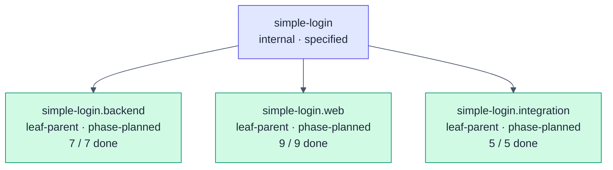
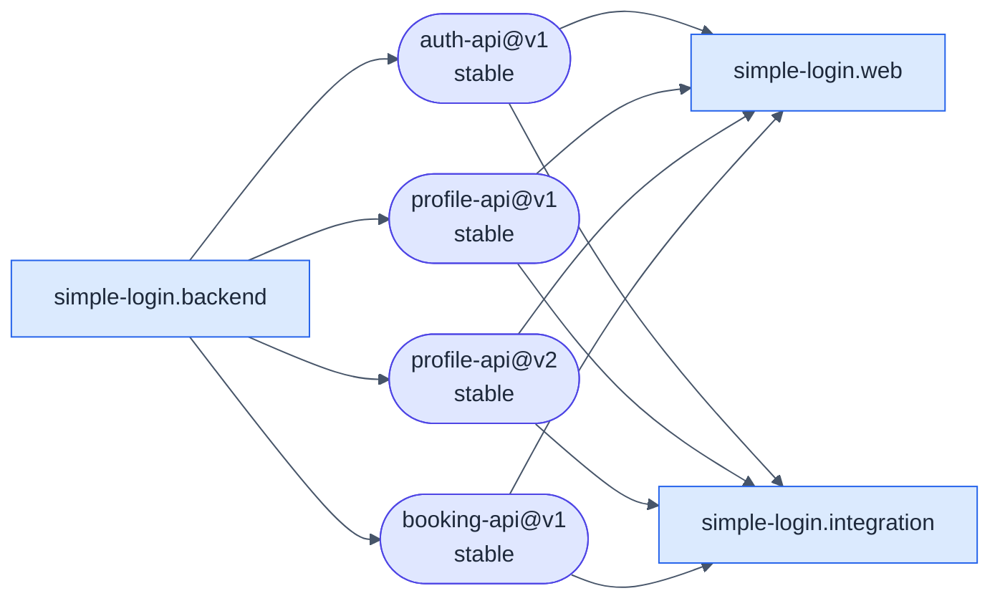
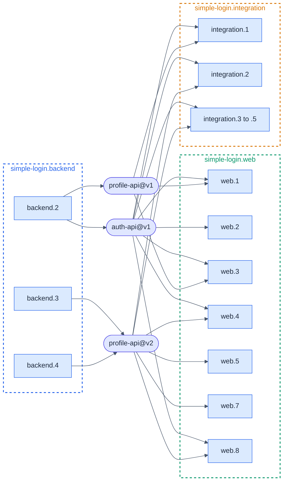
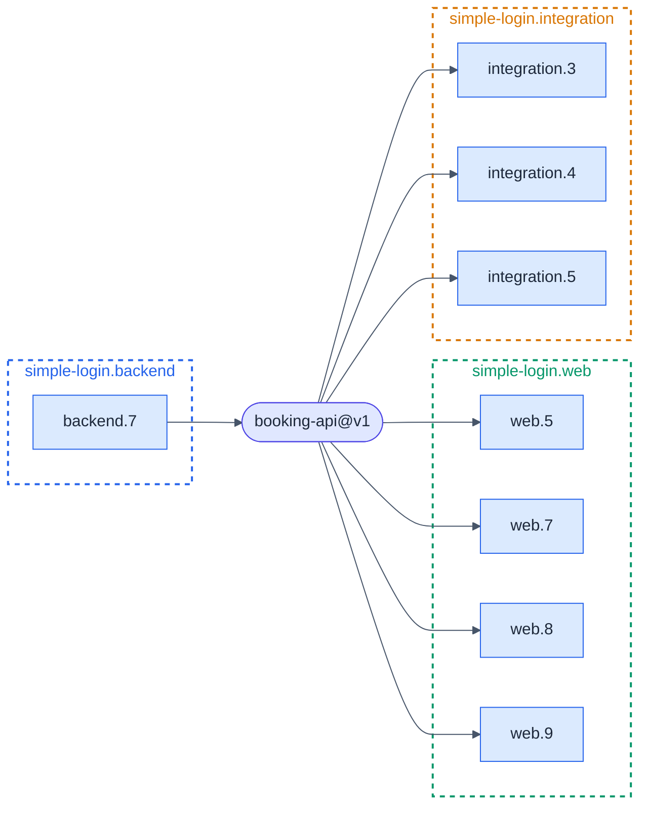

# simple-login · Atlas

**Generated:** 2026-11-01 by `hsdd-checkpoint`. Regenerated whole at every
checkpoint; never hand-patched.
**Derived from:** `hsdd/spec/` + `hsdd/contract/` + `hsdd/adr/` at spec-repo
`0a618de` · `hsdd/verify/` for **done** · each implementation repo's
`openspec/changes/` (absent: coding method `superpowers`) and `hsdd-context/`
for **in-progress** · `meeting-rooms@0a618de` for every implementation repo
(one).
If this file disagrees with those artifacts, this file is wrong, and the fix is
to regenerate it.

**Done**, pinned: a verification doc at `hsdd/verify/{phase-id}.verification.md`
on spec-repo main (here `main`). **In-progress:** a phase with an
`openspec/changes/` entry or an `hsdd-context/` file and no such doc.

## 1 · The tree

No node is as-built or promoted: the tree was specified greenfield.

### Phase status per node

| Node | Phase | Name | Tier | Status | Evidence |
|---|---|---|---|---|---|
| `simple-login.backend` | `simple-login.backend.1` | Service skeleton, domain types, contract replay rig | gate-only | done | `hsdd/verify/simple-login.backend.1.verification.md` |
| | `simple-login.backend.2` | Sign-in, sessions and the two endpoints | full-review | done | `hsdd/verify/simple-login.backend.2.verification.md` |
| | `simple-login.backend.3` | Phone number in the profile (profile-api@v2) | spot-check | done | `hsdd/verify/simple-login.backend.3.verification.md` |
| | `simple-login.backend.4` | Time zones, booking types, PostgreSQL and the booking replay rig | gate-only | done | `hsdd/verify/simple-login.backend.4.verification.md` |
| | `simple-login.backend.5` | Booking rules (pure core) | spot-check | done | `hsdd/verify/simple-login.backend.5.verification.md` |
| | `simple-login.backend.6` | The booking store on PostgreSQL | full-review | done | `hsdd/verify/simple-login.backend.6.verification.md` |
| | `simple-login.backend.7` | Booking endpoints, the service on its database (booking-api@v1) | full-review | done | `hsdd/verify/simple-login.backend.7.verification.md` |
| `simple-login.web` | `simple-login.web.1` | App skeleton, API client, session storage | spot-check | done | `hsdd/verify/simple-login.web.1.verification.md` |
| | `simple-login.web.2` | Login screen | spot-check | done | `hsdd/verify/simple-login.web.2.verification.md` |
| | `simple-login.web.3` | Home screen and the session flow | full-review | done | `hsdd/verify/simple-login.web.3.verification.md` |
| | `simple-login.web.4` | Phone number on Home | spot-check | done | `hsdd/verify/simple-login.web.4.verification.md` |
| | `simple-login.web.5` | Booking API client, the time zone in the profile, the test rig | spot-check | done | `hsdd/verify/simple-login.web.5.verification.md` |
| | `simple-login.web.6` | Time functions (pure core) | full-review | done | `hsdd/verify/simple-login.web.6.verification.md` |
| | `simple-login.web.7` | Home: time zone, my bookings and Cancel | full-review | done | `hsdd/verify/simple-login.web.7.verification.md` |
| | `simple-login.web.8` | Rooms on a date, moving between screens | full-review | done | `hsdd/verify/simple-login.web.8.verification.md` |
| | `simple-login.web.9` | Booking form | full-review | done | `hsdd/verify/simple-login.web.9.verification.md` |
| `simple-login.integration` | `simple-login.integration.1` | End-to-end run and browser test | full-review | done | `hsdd/verify/simple-login.integration.1.verification.md` |
| | `simple-login.integration.2` | Phone number end to end | spot-check | done | `hsdd/verify/simple-login.integration.2.verification.md` |
| | `simple-login.integration.3` | PostgreSQL rig, booking replay and the Success tests | full-review | done | `hsdd/verify/simple-login.integration.3.verification.md` |
| | `simple-login.integration.4` | Home in the browser: time zone, my bookings, cancelling | spot-check | done | `hsdd/verify/simple-login.integration.4.verification.md` |
| | `simple-login.integration.5` | Rooms and booking in the browser, clock-change days included | full-review | done | `hsdd/verify/simple-login.integration.5.verification.md` |

| Node | Phases | Done | In progress | Planned | Contingent |
|---|---:|---:|---:|---:|---:|
| `simple-login.backend` | 7 | 7 | 0 | 0 | 0 |
| `simple-login.web` | 9 | 9 | 0 | 0 | 0 |
| `simple-login.integration` | 5 | 5 | 0 | 0 | 0 |
| **Total** | **21** | **21** | **0** | **0** | **0** |

Open questions: `OQ1` (root, `OPEN`, `ext: product`) gates no phase.

### Retired

none

## 2 · The contract graph

### Overview (node level)

### Detail: `simple-login`, sign-in and the profile (phase level)

Edges follow each contract's `produced_by` and `consumers` front matter. The
phase-level graph is split in two to stay under ~20 nodes.

### Detail: `simple-login`, booking (phase level)

| Contract | Status | Compatibility | Producer | Consumers | Validation |
|---|---|---|---|---|---|
| `auth-api@v1` | stable | versioned | `simple-login.backend.2` | `web.1`, `web.2`, `web.3`, `web.4`, `web.8`, `integration.1` to `integration.5` (10) | `hsdd/contract/schema/auth-api.schema.json`, `hsdd/contract/fixture/auth-api/` (5) |
| `profile-api@v1` | stable | versioned | `simple-login.backend.2` | `web.1`, `web.3`, `integration.1` (3; all three have migrated to v2) | `hsdd/contract/schema/profile-api.schema.json`, `hsdd/contract/fixture/profile-api/` (5) |
| `profile-api@v2` | stable | additive-only | `simple-login.backend.3`, `simple-login.backend.4` | `web.4`, `web.5`, `web.7`, `web.8`, `integration.2` to `integration.5` (8) | `hsdd/contract/schema/profile-api.v2.schema.json`, `hsdd/contract/fixture/profile-api.v2/` (5) |
| `booking-api@v1` | stable | versioned | `simple-login.backend.7` | `web.5`, `web.7`, `web.8`, `web.9`, `integration.3` to `integration.5` (7) | `hsdd/contract/schema/booking-api.schema.json`, `hsdd/contract/fixture/booking-api/` (35) |

All four carry `phase_ids: final`; none lists `former_consumers` or
`external_consumers`. `web.6` and `backend.5` and `backend.6` produce and
consume no contract.

## 3 · ADR coverage map

| ADR | Status | `affects` (front matter) | Carries `Governed by` |
|---|---|---|---|
| `ADR-001` · Session tokens (amended 2026-10-31) | accepted | `simple-login`, `simple-login.backend`, `simple-login.web`, `auth-api@v1`, `profile-api@v1`, `profile-api@v2`, `booking-api@v1` | nodes `simple-login`, `simple-login.backend`, `simple-login.web`; phases `backend.1` to `backend.4`, `backend.7`, `web.1` to `web.5`, `web.7` to `web.9`; contracts `auth-api@v1`, `profile-api@v1`, `profile-api@v2`, `booking-api@v1` |
| `ADR-002` · Time model (2026-10-31) | accepted | `simple-login`, `simple-login.backend`, `simple-login.web`, `simple-login.integration`, `profile-api@v2`, `booking-api@v1` | nodes `simple-login`, `simple-login.backend`, `simple-login.web`, `simple-login.integration`; phases `backend.4` to `backend.7`, `web.5` to `web.9`, `integration.3` to `integration.5`; contracts `profile-api@v2`, `booking-api@v1` |

Every id in each `affects` carries the matching `Governed by`.
`simple-login.integration` and its phases carry no `Governed by: [ADR-001]`,
though the node's text cites ADR-001 (progress report F-19).
`simple-login.integration.1` and `.2` carry no `Governed by` at all.
