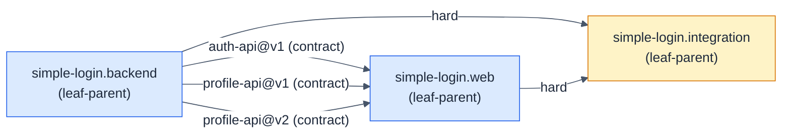

# simple-login: Simple Login

- **Kind:** internal
- **Purpose:** let a registered user sign in with a username and password, see their own profile, find a free meeting room and book it, see and cancel their own bookings, and sign out, with every time shown in their own time zone
- **Owns:** the whole product: the built-in accounts, sign-in, sessions, the profile view, the pre-loaded rooms, booking and cancelling, the PostgreSQL 17 database that keeps the bookings, and the API between the service and the web app
- **Does not own:** editing a booking, recurring bookings, attendees and invitations, reminders, managing rooms, sign-up, password reset, profile editing, multi-factor sign-in, rate limiting, deployment beyond the laptop (out of scope in PRD v2 Scope)
- **Consumes:** none
- **Produces:** none
- **Governed by:** [ADR-001, ADR-002]
- **Sources:** hsdd/context/prd-simple-login.md, hsdd/context/rfc-simple-login.md, hsdd/context/update-1-add-phone.md
- **Decomposes into:** simple-login.backend, simple-login.web, simple-login.integration
- **Isolation strategy:** the children meet only at auth-api@v1, profile-api@v1, profile-api@v2 and booking-api@v1; each child builds and tests against those contracts' schemas and fixtures, and only the integration node runs both for real

## Overview

A user signs in on a Login screen and lands on a Home screen that shows
their display name, username, email, phone number, time zone and join
date, lists their bookings that have not ended, and lets them cancel one or
sign out. On a Rooms screen they pick a date, see every room's bookings on
it, and book a room; the aim is a free room found and booked in under a
minute (PRD v2 Goal). Every time on screen is in the user's own time zone.
Accounts are built in, the rooms of the Jakarta and London offices are
pre-loaded, and bookings are kept in PostgreSQL 17. The product is two
deployables, a backend HTTP service and a web single-page app, joined by an
HTTP API whose endpoints its contracts define; PRD v2 fixes no number of
endpoints.

Normalized from the sources:

- **Primary flows:** sign in (US-1), see my profile with my time zone
  (US-2), sign out (US-3), find a free room on a date (US-4), book a room
  (US-5), see and cancel my bookings (US-6), as PRD v2 User stories number
  them.
- **Hard constraints:** bookings are kept in PostgreSQL 17, run on the
  laptop with Docker Compose (Colima on macOS), and survive a restart of
  the service; tests that read or write bookings run against a real
  PostgreSQL, never a mock or an in-memory stand-in (PRD v2 Constraints); a
  room is never booked twice for the same time, not even when two people
  book it at the same moment, and every time on screen is in the user's own
  time zone (PRD v2 Goal); accounts are built in, with no sign-up, and rooms
  are pre-loaded, never managed in the app (PRD v2 Users, Rooms); local
  laptop only.
- **Success criteria:** in a scripted test, 20 simultaneous attempts to
  book the same room for the same time produce exactly one booking; every
  acceptance criterion passes in a scripted test, including on London's
  clock-change days; restarting the service keeps every booking (PRD v2
  Success).
- **Assumption:** "same message, never says which was wrong" (AC-1.2)
  extends to timing, as the RFC's section 4 states.

## Sources

- `hsdd/context/prd-simple-login.md` · PRD (approved) · product scope, user
  stories US-1 to US-3 with their acceptance criteria, screens, demo
  accounts, team and delivery, success criteria
- `hsdd/context/rfc-simple-login.md` · accepted RFC · the API and its error
  envelope, the session model, password storage, the backend and frontend
  stacks, testing approach, repository layout, security notes

## Decomposition axis

The PRD answers "who builds what?": one backend developer builds the
service, one frontend developer builds the web app, and they ship
separately. The split therefore follows the stack: a backend node and a web
node, joined by the API as contracts. Inside each node one person owns
everything, so no further split is needed and both are leaf-parents.

The children exchange contracts, so the tree also gets
`simple-login.integration`, a leaf-parent with `hard` edges to both, which
proves the real pieces work together.

## Child nodes

| Node | Kind | Purpose | Consumes | Produces |
|------|------|---------|----------|----------|
| simple-login.backend | leaf-parent | authenticate built-in users and serve the signed-in user's profile over HTTP | none | auth-api@v1, profile-api@v1, profile-api@v2 |
| simple-login.web | leaf-parent | the Login and Home screens in the browser | auth-api@v1, profile-api@v1, profile-api@v2 | none |
| simple-login.integration | leaf-parent | prove the real service and the real web app work together, end to end | auth-api@v1, profile-api@v1, profile-api@v2 | none |

### simple-login.backend: Backend service

- **Kind:** leaf-parent
- **Purpose:** authenticate built-in users and serve over HTTP the signed-in user's profile with their time zone and the bookings of the pre-loaded meeting rooms (each room's bookings in a time range, booking a room, the user's own bookings, cancelling one), keeping the bookings in PostgreSQL 17
- **Owns:** the built-in accounts with their time zones, password verification, the session store, the pre-loaded rooms, the bookings, the PostgreSQL 17 database that keeps them, its Docker Compose service and that service's Compose file, `POST /api/login`, `GET /api/me`, `GET /api/rooms`, `GET /api/me/bookings`, `POST /api/bookings`, `DELETE /api/bookings/{id}`, the `backend/` directory
- **Does not own:** screens, where the browser keeps the token, the dev proxy
- **Consumes:** none
- **Produces:** [auth-api@v1, profile-api@v1, profile-api@v2]
- **Governed by:** [ADR-001, ADR-002]
- **Sources:** hsdd/context/prd-simple-login.md (US-1, US-2, Demo accounts, Scope), hsdd/context/rfc-simple-login.md (§2 API, §3 Session model, §4 Passwords, §5 Backend stack, §7 Testing, §9 Security notes), hsdd/context/update-1-add-phone.md (Change: AC-2.1 amended, AC-2.4; Demo accounts; Scope)
- **Decomposes into:** phases (see hsdd-phase-plan)
- **Isolation strategy:** Fastify `app.inject()` with an injected clock and random source; tests that read or write bookings run against a real PostgreSQL 17, never a mock or an in-memory stand-in (PRD v2 Constraints); the gate replays the auth-api, profile-api and booking-api fixtures against the real routes, the injected clock reading each booking-api fixture's `clock` and the database holding exactly its `given` bookings; no browser, and the service itself opens no port

### simple-login.web: Web app

- **Kind:** leaf-parent
- **Purpose:** let a user sign in, see their profile and sign out in the browser
- **Owns:** the Login screen, the Home screen, the API client, token storage in the browser, the Vite dev proxy, the `web/` directory
- **Does not own:** accounts, password checks, sessions on the server
- **Consumes:** [auth-api@v1, profile-api@v1, profile-api@v2]
- **Produces:** none
- **Governed by:** [ADR-001, ADR-002]
- **Sources:** hsdd/context/prd-simple-login.md (US-1, US-2, US-3, Screens), hsdd/context/rfc-simple-login.md (§1 Summary, §2 API, §6 Frontend stack, §7 Testing), hsdd/context/update-1-add-phone.md (AC-2.1 amended, AC-2.4, Screen, Scope)
- **Decomposes into:** phases (see hsdd-phase-plan)
- **Isolation strategy:** `fetch` is stubbed with the auth-api and profile-api fixtures; the backend never needs to run

### simple-login.integration: End-to-end integration

- **Kind:** leaf-parent
- **Purpose:** prove the real service and the real web app work together, end to end
- **Owns:** the root `package.json` scripts, the end-to-end browser test, the run instructions
- **Does not own:** any code under `backend/` or `web/`
- **Consumes:** [auth-api@v1, profile-api@v1, profile-api@v2]
- **Produces:** none
- **Governed by:** [ADR-002]
- **Sources:** hsdd/context/prd-simple-login.md (Success, Team and delivery, Demo accounts), hsdd/context/rfc-simple-login.md (§1 Summary, §7 Testing, §8 Repository layout), hsdd/context/update-1-add-phone.md (Change: AC-2.1 amended, AC-2.4; Demo accounts)
- **Decomposes into:** phases (see hsdd-phase-plan)
- **Isolation strategy:** none by design: its edges are `hard`, so it runs the real service and the real web app and drives a real browser against them

## Dependency DAG

| From | To | Type | Carried by |
|------|----|------|------------|
| simple-login.backend | simple-login.web | contract | auth-api@v1 |
| simple-login.backend | simple-login.web | contract | profile-api@v1 |
| simple-login.backend | simple-login.web | contract | profile-api@v2 |
| simple-login.backend | simple-login.integration | hard | the running service |
| simple-login.web | simple-login.integration | hard | the running web app |

## Dev flow

- **Lane 1 (backend developer):** simple-login.backend, from the moment the
  contracts are `stable`.
- **Lane 2 (frontend developer):** simple-login.web, in parallel with lane
  1. Its edges are `contract`, so it builds against the fixtures and never
  waits for the backend to ship.
- **Join:** simple-login.integration starts when both lanes have shipped
  (its edges are `hard`).

## Contract matrix

| Contract | Kind | Producer | Consumers |
|----------|------|----------|-----------|
| auth-api@v1 | api | simple-login.backend | simple-login.web, simple-login.integration |
| profile-api@v1 | api | simple-login.backend | simple-login.web, simple-login.integration |
| profile-api@v2 | api | simple-login.backend | simple-login.web, simple-login.integration |

## Decisions

- **ADR-001 (proposed here, accepted from RFC §3):** opaque bearer tokens in
  an in-memory session store, a fixed 30-minute lifetime, sign-out on the
  client. Its 2026-10-31 amendments keep all three under PRD v2: sessions
  never go into PostgreSQL, so a restart of the service signs every user out
  and keeps every booking, and there is still no logout endpoint. It spans
  the backend, the web app and every contract that issues or takes the
  token, so it is an ADR, not a node-local `D{n}`. Materialized by hsdd-adr
  as `hsdd/adr/001-session-tokens.md`.
- **ADR-002 (proposed by the intake record for PRD v2, DEC-009; accepted by
  the unattended run for the owner's review, DEC-037):** a booking's start
  and end are instants, UTC strings on the wire and `timestamptz` in
  PostgreSQL; the user's zone is the account's IANA name, served with the
  profile, and each room carries its office's; the web app converts and
  formats every time; the backend's clock decides whether a booking has
  started or ended. PRD v2's Goal puts every time on screen in the user's
  own zone, which binds all three children, the profile and the booking
  API, so it is an ADR, not a node-local `D{n}`. Materialized by hsdd-adr as
  `hsdd/adr/002-time-model.md`.
- Node-local choices stay in RFC-001 and the node specs that own them:
  Fastify and scrypt, and what is chosen about PostgreSQL 17 (driver,
  schema, migrations, how exactly one of two overlapping bookings wins), in
  simple-login.backend, whose developer owns the database (PRD v2 Team and
  delivery); React, Vite and sessionStorage, and how the app moves between
  its screens (its D4), in simple-login.web. PostgreSQL 17 under Docker
  Compose is a PRD v2 constraint, not an engineering choice, so it has no
  ADR (DEC-010, DEC-012).
- RFC-001 was written for version 1. Its two-endpoint API (RFC-001 §1,
  §3), its "no database" (RFC-001 §3) and its two screens without a router
  (RFC-001 §6) are overtaken by PRD v2: booking-api, ADR-001's amendments,
  this spec's hard constraints and the web's D4 hold there instead. Its
  authors are asked to amend it or write an RFC for version 2 (DEC-013).

## Open questions

| ID | Question | Status | Waits on | Affects |
|----|----------|--------|----------|---------|
| OQ1 | How is the product deployed beyond a laptop: one origin behind a proxy, or two origins with CORS? | OPEN | ext: product | simple-login.integration, simple-login.web |

### OQ1: Deployment beyond a laptop

The PRD scopes delivery to a local demo, and the RFC (section 9) relies on
the Vite dev proxy so the browser sees one origin and CORS stays off. A real
deployment must choose one origin behind a reverse proxy, or two origins
with CORS enabled on the service. Nothing in v1 is contingent on it; it is
recorded so the next change that deploys the product starts from a named
question.
