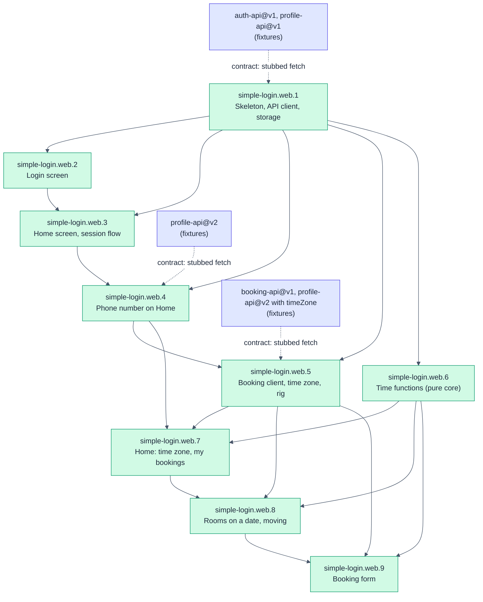

# simple-login.web: Web app

- **Kind:** leaf-parent
- **Purpose:** let a user sign in, see their profile and time zone, find a free meeting room on a date and book it, see and cancel their own bookings, and sign out in the browser, showing every time in the user's own time zone
- **Owns:** the Login screen, the Home screen with the user's time zone and their bookings with Cancel, the Rooms screen with its date and its booking form, the API client, token storage in the browser, turning instants into dates and times in the user's time zone and back, and their display format (ADR-002), the Vite dev proxy, the `web/` directory
- **Does not own:** accounts, password checks, sessions on the server
- **Consumes:** [auth-api@v1, profile-api@v1, profile-api@v2]
- **Produces:** none
- **Governed by:** [ADR-001, ADR-002]
- **Sources:** hsdd/context/prd-simple-login.v2.md (US-1, US-2, US-3, US-4, US-5, US-6, Screens, Demo accounts, Rooms, Scope, Team and delivery), hsdd/context/rfc-simple-login.md (§1 Summary, §2 API, §6 Frontend stack, §7 Testing)
- **Decomposes into:** phases (see hsdd-phase-plan)
- **Isolation strategy:** `fetch` is stubbed with the auth-api, profile-api and booking-api fixtures; the backend never needs to run; the time functions are tested on their own on London's clock-change days, and every test runs with `TZ` set to a zone that is neither account's nor UTC (ADR-002)

## Overview

A React 19 single-page app in TypeScript, built with Vite, with three
screens (PRD v2 Screens). Login signs a user in (PRD v2 US-1). Home shows
the signed-in user's display name, username, email, phone number, time zone
and join date, lists their bookings that have not ended, soonest first,
lets them cancel one that has not started, and offers Book a room, which
opens Rooms, and Sign out (PRD v2 US-2, US-3, US-6). Rooms lists every room
with its office and seats and, for a date the user picks, each room's
bookings on that date; its form books a room for a start, an end and a
title (PRD v2 US-4, US-5). How the app moves between its screens is its
phase plan's D4, with D5 for a stored session the backend cannot check. The
token lives in `sessionStorage`. In development the Vite server proxies
`/api` to the backend on port 3000, so the browser sees one origin.

Every time the app shows is in the user's own time zone, which it takes
from the profile's `timeZone` only, never from the browser; for a profile
without one it shows no time (PRD v2 AC-2.5, profile-api@v2 G5). The app
does every conversion between an instant and a date or time, in pure
functions that take the zone as an argument (ADR-002): a picked date
becomes the instants from its start up to the start of the next date, never
taken as 24 hours, so London's 23-hour and 25-hour clock-change days come
out right (PRD v2 AC-4.2, AC-4.4); the form offers that date's quarter-hour
instants (PRD v2 AC-5.2); on Rooms, a booking of a room in another zone
also shows the room's local times (PRD v2 AC-4.3). The backend's clock and
answer decide whether a booking is made or cancelled; the browser's clock
only picks the date Rooms opens on (ADR-002). The app writes PRD v2
AC-5.3's overlap message from the refusal's room name and instants, never
from `error.message` (booking-api@v1 G18). The node knows the backend only
through auth-api@v1 and profile-api@v1, which simple-login.web.4 replaces
with profile-api@v2, and booking-api@v1.

## Phase Plan

**Default gate:** `npm --prefix web run gate`

| Phase | Name | Tier | Size | Depends on | Collides with |
|------:|------|------|------|------------|---------------|
| simple-login.web.1 | App skeleton, API client, session storage | spot-check | ~10 files (~300 lines), ≤6 tasks | none | none |
| simple-login.web.2 | Login screen | spot-check | ~4 files (~220 lines), ≤5 tasks | 1 | none |
| simple-login.web.3 | Home screen and the session flow | full-review | ~5 files (~300 lines), ≤6 tasks | 1, 2 | none |
| simple-login.web.4 | Phone number on Home | spot-check | ~9 files (~70 lines), ≤4 tasks | 1, 3 | none |
| simple-login.web.5 | Booking API client, the time zone in the profile, the test rig | spot-check | ~8 files (~400 lines), ≤7 tasks | 1, 4 | none |
| simple-login.web.6 | Time functions (pure core) | full-review | ~2 files (~340 lines), ≤6 tasks | 1 | none |
| simple-login.web.7 | Home: time zone, my bookings and Cancel | full-review | ~8 files (~385 lines), ≤7 tasks | 4, 5, 6 | 8, 9 |
| simple-login.web.8 | Rooms on a date, moving between screens | full-review | ~8 files (~400 lines), ≤7 tasks | 5, 6, 7 | 7, 9 |
| simple-login.web.9 | Booking form | full-review | ~5 files (~360 lines), ≤7 tasks | 5, 6, 8 | 7, 8 |

Ordering policy: `interfaces-first` (from `hsdd/conventions.md`). Phase 1
is the typed boundary to the backend (the API client and its fixtures) and
the browser storage behind it; phases 2 and 3 are the screens; phase 3 also
composes the app. Commands run from the repository root (the directory
holding `hsdd/`).

Appended 2026-10-30 for hsdd/management/2026-10-30-intake-add-phone.md
(append mode: web.1 to web.3 have shipped and are unchanged). Under the
same policy, simple-login.web.4 moves the typed boundary to profile-api@v2
and then the Home screen onto it, in one phase: split, the two halves would
be adjacent spot-check phases over the same contract, below the sizing
floor. Its process artifacts will still outweigh a ~70-line diff (the
floor's smell), but its only neighbour, web.3, has shipped and is never
reopened, so it stays one small phase.

Appended 2026-11-01 for
hsdd/management/2026-10-31-intake-prd-simple-login-v2.md (append mode:
web.1 to web.4 have shipped and are unchanged). Under the same policy,
simple-login.web.5 is the typed boundary: booking-api@v1's client and
types, `timeZone` in the profile, the fixture stub for booking-api@v1 and
the ambient zone every test runs in. simple-login.web.6 is ADR-002's pure
time core, with no screen and no contract; web.5 and web.6 can run in
parallel. simple-login.web.7 (Home), simple-login.web.8 (Rooms and the
moves between screens) and simple-login.web.9 (the booking form) are the
screens, each wiring the app for what it adds, as web.3 composed the app
with Home; they run in that order on the files they share. The web lane
builds against booking-api@v1's fixtures and never waits for the backend.

Sizing floor, append: no two adjacent appended phases are merge
candidates. web.5 and web.6 differ in tier; each adjacent full-review pair
consumes different contracts, and merged it would come to 700 lines or
more, over one review sitting.

### Decisions

- **D1. Expiry is noticed when a request that carries the token answers
  401 `UNAUTHORIZED`:** `GET /api/me` on load or reload, and every
  booking-api@v1 call (Home's list and Cancel, Rooms' list and Book). Any
  such 401 clears the session and shows Login with the PRD v2 AC-2.3
  message; the app runs no timer of its own. profile-api@v2 G7 and
  booking-api@v1 G16 make an expired token indistinguishable from an
  unknown one, and a client clock can drift. Trade-off: a user idle on a
  screen past expiry keeps seeing it until their next request. (Revised
  2026-11-01 for hsdd/management/2026-10-31-intake-prd-simple-login-v2.md;
  it named only `GET /api/me` and profile-api@v1 before.)
- **D2. The session lives in `sessionStorage`** under one key,
  `simple-login.session`, as `{ token, expiresAt }` (RFC §6).
- **D3. One message per failure.** `INVALID_CREDENTIALS` shows "Incorrect
  username or password." (PRD v2 AC-1.2); a 401 on `/api/me` shows "Your
  session has expired. Please sign in again." (PRD v2 AC-2.3); a network
  failure or an unexpected status shows "Could not reach the server.
  Please try again."
  `VALIDATION_FAILED` (`invalid-input`) shows the AC-1.2 message; the form
  cannot send such a request, so it means credentials that match nothing.
  (Added at the simple-login.web.2 gate, 2026-10-30.)
- **D4. No router and no URL per screen** (RFC-001 §6): the screen is a
  function of the app state. Signed out shows Login. Signed in shows Home
  or Rooms, held in memory only, so signing in and a reload show Home: only
  the session is stored (D2). Home's Book a room shows Rooms, which opens
  on today in the user's zone each time; Rooms' Home button shows Home,
  which fetches the user's bookings again; Sign out is on Home (PRD v2
  Screens). (Revised 2026-11-01 for
  hsdd/management/2026-10-31-intake-prd-simple-login-v2.md; with two
  screens it read "the screen is a function of the session value".)
- **D5. A network failure while checking a stored session keeps the
  session** and shows Login with the D3 network message; the next load
  retries it. Only a 401 clears it (D1). (Added at the simple-login.web.3
  gate, 2026-10-30.)
- **D6. One module of pure time functions, on `Intl` alone** (ADR-002
  Decisions 4 and 7). `web/src/time/` takes the zone as an argument in
  every function, reads wall dates and times only through
  `Intl.DateTimeFormat` (`en-GB`, `hourCycle: 'h23'`), and finds the start
  of a date by scanning quarter-hour instants around UTC midnight, so no
  offset and no clock-change date is written down. No library and no
  polyfill: Node.js 24 has no global `Temporal` (ADR-002 Consequences), and
  `Intl` covers every rule (hsdd/auto/experiments/web-time-display/).
  Nothing else in `web/src` converts a time, and no code reads `Date`'s
  local getters or parses a date-time without `Z`. (Added 2026-11-01.)
- **D7. A profile without a usable time zone still signs the user in.**
  The backend and the web app ship separately (PRD v2 Team and delivery),
  so a backend that predates the field sends a profile without `timeZone`
  (profile-api@v2 G5). The web's `Profile` holds `timeZone` as received, or
  none when it is absent; a non-string is a malformed 200, `unavailable`,
  as in web.4. Without one, Home shows its other rows, the Time zone row
  reads `Not available`, and one line, `Bookings need your time zone, which
  is not available.`, takes the place of My bookings and Book a room; no
  booking request is sent and no time is shown. A name `Intl` refuses
  counts as absent, so no format call can throw; `Intl` accepts an offset
  such as `+07:00`, so this guards against a crash, not against a name
  that is not IANA's. (Added 2026-11-01.)
- **D8. The rooms query is written, not encoded:**
  `/api/rooms?from={from}&to={to}` with the two `toISOString()` instants
  as they are, never through `URLSearchParams`. The request then equals
  the fixtures' paths and the stub keeps its exact match; booking-api@v1
  accepts both forms. (Added 2026-11-01.)
- **D9. Cancel is offered on every listed booking, and the backend
  decides** (ADR-002 Decision 5, booking-api@v1 G7). My bookings include
  one in progress (booking-api@v1 G14); its Cancel gets `BOOKING_STARTED`
  and D10's message. The browser's clock hides nothing on Home. (Added
  2026-11-01.)
- **D10. One message per booking answer,** as D3 is for sign-in, chosen
  by `error.code` and never taken from `error.message` (booking-api@v1
  G18). Book: a 201 shows `Booked.`; `BOOKING_CONFLICT` shows PRD v2
  AC-5.3's sentence, `{roomName} is already booked from {start} to
  {end}.`, written from `error.conflict` (ADR-002 Decision 7);
  `BOOKING_STARTED` `That time has already started.`; `BOOKING_TOO_LONG`
  `A booking can last at most 8 hours.`; `BOOKING_TOO_FAR_AHEAD` `A booking
  can start at most 365 days ahead.`; `VALIDATION_FAILED` `That booking is
  not valid. Check the times and the title.` Cancel: `BOOKING_STARTED`
  `That booking has already started, so it cannot be cancelled.`;
  `BOOKING_NOT_FOUND` `That booking was already cancelled.` (another tab
  cancelled it, booking-api@v1 G11); `BOOKING_NOT_YOURS` `You can cancel
  only your own bookings.` An empty list reads `(no bookings)` (PRD v2
  Screens). A 401 anywhere is D1; a network failure or an unexpected answer
  shows D3's network message on the screen that asked, and the session is
  kept, as in D5. (Added 2026-11-01.)
- **D11. The form offers only times it can foresee are bookable; the
  backend still decides** (ADR-002 Decisions 4 and 5, booking-api@v1 G9,
  G10). Starts: the picked date's quarter-hour instants, from the start of
  the date up to, not including, the start of the next, that are later
  than the browser's clock. Ends: the quarter-hour instants after the
  start, up to whichever comes first, start + 8 hours of elapsed time or
  the start of the next date. The date input is not capped: a date more
  than 365 days ahead gets `BOOKING_TOO_FAR_AHEAD`, and a past date still
  lists its bookings. A date with no start left reads `No times left on
  this date.` (Added 2026-11-01.)

### simple-login.web.1: App skeleton, API client, session storage

- **Consumes:** [auth-api@v1, profile-api@v1]
- **Produces:** none
- **Governed by:** [ADR-001]
- **Scope:** the `web/` package (React 19, TypeScript, Vite, Vitest with jsdom and Testing Library; `npm run gate` = `tsc --noEmit`, then `vitest run`, then `vite build`); the Vite dev proxy from `/api` to the backend's development address, `http://127.0.0.1:3000` (auth-api@v1); the API client, `signIn(username, password)` and `fetchProfile(token)`, returning a result value (a session or a profile, or a failure reason: `invalid-credentials`, `invalid-input`, `unauthorized`, `unavailable`) decided by status and `error.code`, never by message; the session store over `sessionStorage` (D2); a test helper that answers stubbed `fetch` calls with the auth-api and profile-api fixture responses; a placeholder `App`.
- **Size estimate:** ~10 files (~300 lines), <= 6 OpenSpec tasks
- **Gate:** `npm --prefix web run gate`
- **Verification:** the client's tests feed every one of the ten fixtures through the stub and get the right result; `npm --prefix web run dev` serves the placeholder page.
- **Review tier:** spot-check
- **Dependencies:** none (builds against the contracts' fixtures, not the backend)

### simple-login.web.2: Login screen

- **Consumes:** [auth-api@v1]
- **Produces:** none
- **Governed by:** [ADR-001]
- **Scope:** the Login screen per the PRD wireframe: username and password fields, a Sign in button disabled while either field is empty (AC-1.3), busy while the request is in flight; on success it hands the session to its parent (AC-1.1); on `invalid-credentials` it shows the AC-1.2 message and keeps the typed username; on `unavailable` the D3 network message; it also shows a notice its parent passes in (phase 3 uses it for the expiry message). The username is sent as typed (auth-api@v1 matches it exactly). Its own stylesheet.
- **Size estimate:** ~4 files (~220 lines), <= 5 OpenSpec tasks
- **Gate:** `npm --prefix web run gate`
- **Verification:** component tests cover AC-1.1 to AC-1.3 against the auth-api fixtures; the screen matches the PRD wireframe.
- **Review tier:** spot-check
- **Dependencies:** simple-login.web.1 (the API client and its fixture stub)

### simple-login.web.3: Home screen and the session flow

- **Consumes:** [profile-api@v1]
- **Produces:** none
- **Governed by:** [ADR-001]
- **Scope:** the Home screen per the PRD wireframe: "Hello, {displayName}", username, email, member since as a long date ("14 March 2024"), and Sign out (AC-2.1); the app composition: on load, a stored session is checked with `fetchProfile` and shows Home (AC-2.2); `unauthorized` clears the session and shows Login with the expiry message (AC-2.3, D1); signing in stores the session and shows Home; Sign out clears it and shows Login (AC-3.1). Its own stylesheet.
- **Size estimate:** ~5 files (~300 lines), <= 6 OpenSpec tasks
- **Gate:** `npm --prefix web run gate`
- **Verification:** with `fetch` stubbed by the fixtures, the app walks Login, Home, reload, Home, Sign out, Login; the unauthorized fixture shows the expiry message; nothing but the token and its expiry is ever written to storage.
- **Review tier:** full-review
- **Dependencies:** simple-login.web.1 (API client, session store), simple-login.web.2 (the Login screen)

### simple-login.web.4: Phone number on Home

- **Consumes:** [profile-api@v2]
- **Produces:** none
- **Governed by:** [ADR-001]
- **Scope:** per hsdd/management/2026-10-30-intake-add-phone.md, the web app moves from profile-api@v1 to profile-api@v2 and Home shows the signed-in user's phone number (AC-2.1 amended, AC-2.4). The `Profile` type gains `phone`; `fetchProfile` requires it as a string, so a 200 without it is `unavailable` like any other malformed 200 (web.1), and it keeps ignoring fields it does not know (profile-api@v2). Home gains a `Phone` row between Email and Member since, per the request's Screen, showing `phone` as plain text exactly as received, never reformatted. The fixture stub loads `profile-api.v2`, and every test that reads a profile fixture (the client and its every-fixture guard, the stub's own listing, Home, the session flow, App) moves to the v2 fixtures; afterwards no web test reads `hsdd/contract/fixture/profile-api/`, so v1's retirement cannot break this node's gate. Login, the session flow, storage and the messages do not change (D1 to D5 stand).
- **Size estimate:** ~9 files (~70 lines, mostly tests), <= 4 OpenSpec tasks
- **Gate:** node default
- **Verification:** with `fetch` stubbed by the profile-api@v2 fixtures, Home shows `+62 812 3456 7890` for Ayu and `+62 813 9876 5432` for Budi, character for character, in the request's row order; the screen matches the request's Screen at 360 px; the load check and the walk behave as in web.3.
- **Review tier:** spot-check
- **Dependencies:** simple-login.web.1 (the API client and its fixture stub), simple-login.web.3 (the Home screen and the App tests); across nodes, profile-api@v2 through its fixtures only (drafted 2026-10-30, `stable` once hsdd-reconcile drains the three plans), never the backend

### simple-login.web.5: Booking API client, the time zone in the profile, the test rig

- **Consumes:** [booking-api@v1, profile-api@v2]
- **Produces:** none
- **Governed by:** [ADR-001, ADR-002]
- **Scope:** per hsdd/management/2026-10-31-intake-prd-simple-login-v2.md. The typed boundary for PRD v2; no screen changes. (1) Types in `web/src/api/types.ts`, written from booking-api@v1's Interface: `Room` (`id`, `name`, `office`, `timeZone`, `seats`, and its `bookings`) and `Booking` (`id`, `roomId`, `roomName`, `title`, `start`, `end`, the instants kept as the strings received), and one union of failure reasons per call. `Profile` gains `timeZone`, the name as received or none when it is absent; a `timeZone` that is present and not a string makes the 200 malformed, `unavailable`, and the other six fields (`id`, `username`, `displayName`, `email`, `phone`, `memberSince`) stay required strings, as they are (D7). (2) Four functions in `web/src/api/client.ts`, each over the existing `send` and a pure decider that reads only the status and `error.code`, never `error.message`, and ignores fields it does not know (booking-api@v1 G18). `fetchRooms(token, from, to)` sends `GET /api/rooms?from={from}&to={to}` with the instants unencoded (D8); a 200 gives the rooms in the order received (G13). `fetchMyBookings(token)` sends `GET /api/me/bookings`; a 200 gives the bookings in the order received (G14), with no client sort. Both fail as `unauthorized` (401 `UNAUTHORIZED`) or `unavailable` (anything else, a 400 included). `bookRoom(token, { roomId, start, end, title })` sends `POST /api/bookings` with `Content-Type: application/json` and a body of exactly those four fields, the title as typed; a 201 gives the `Booking`; it fails as `unauthorized`, `invalid` (400 `VALIDATION_FAILED`), `too-long` (422 `BOOKING_TOO_LONG`), `started` (422 `BOOKING_STARTED`), `too-far-ahead` (422 `BOOKING_TOO_FAR_AHEAD`), `conflict` carrying the decoded `error.conflict` booking (409 `BOOKING_CONFLICT`; a 409 without one that decodes is `unavailable`, G6), or `unavailable`. `cancelBooking(token, id)` sends `DELETE /api/bookings/{id}`; a 204 means done; it fails as `unauthorized`, `not-found` (404 `BOOKING_NOT_FOUND`), `not-yours` (403 `BOOKING_NOT_YOURS`), `started` (422 `BOOKING_STARTED`), or `unavailable`. Every call sends `Authorization: Bearer {token}`. `send` reads no body from a 204. A 200 or 201 whose body lacks a field a type needs, or holds an instant that is not equal to its own `toISOString()` (G1), is `unavailable`, so no time without `Z` reaches the time functions. (3) The fixture stub in `web/src/test/fetchStub.ts`: the `booking-api` set (35 fixtures) joins `auth-api` and `profile-api.v2`; a fixture's `clock` and `given` are typed and never sent; a 204 is answered with no body (`new Response(null, { status: 204 })`, since a 204 with any body throws); one route may be given several fixtures, answered in the order given with the last one repeating (a list fetched before and after a Cancel); and a helper answers a call at a path the test names with a fixture's `response` unchanged, for a Cancel on a listed booking whose id no cancel fixture names, the status and body staying the fixture's. (4) The ambient zone (ADR-002 Consequences): the `test` script becomes `TZ=Asia/Kolkata vitest run` and `gate` becomes `tsc --noEmit && TZ=Asia/Kolkata vitest run && vite build`; a guard test fails unless `Intl.DateTimeFormat().resolvedOptions().timeZone` is `Asia/Calcutta` or `Asia/Kolkata` (Node.js 24 reports the first). The Vite proxy already sends `/api` to `http://127.0.0.1:3000`, booking-api@v1's development address; its comment names booking-api@v1 as well.
- **Size estimate:** ~8 files (~400 lines, about half of them tests), <= 7 OpenSpec tasks
- **Gate:** node default
- **Verification:** the client's tests feed every one of the 35 booking-api@v1 fixtures through its function and name the result each gives; `me-ayu` and `me-budi` decode to their profiles, now with `Asia/Jakarta` and `Europe/London`, and the three profile-api@v2 401 fixtures to `unauthorized`; a 200 profile without `timeZone` decodes with none, and one with `"timeZone": 7` is `unavailable`; `npm --prefix web run gate` passes with the ambient-zone guard among its tests; no client code reads `error.message`.
- **Review tier:** spot-check
- **Dependencies:** simple-login.web.1 (shipped: `send`, the deciders, the fixture stub), simple-login.web.4 (shipped: `Profile` on profile-api@v2 and the `profile-api.v2` fixture set); across nodes, booking-api@v1's schema and fixtures only (`stable` once hsdd-reconcile has confirmed its consumers, H17 and H19), never the backend

### simple-login.web.6: Time functions (pure core)

- **Consumes:** none
- **Produces:** none
- **Governed by:** [ADR-002]
- **Scope:** per hsdd/management/2026-10-31-intake-prd-simple-login-v2.md. One module, `web/src/time/time.ts`, of pure functions per D6. Each takes the zone, an IANA name, as an argument and uses `Intl` only: never the ambient zone, `Date`'s local getters, a date-time string without `Z`, a hand-coded offset or a clock-change date. Dates are `YYYY-MM-DD` strings and instants `toISOString()` strings. `dayRange(date, zone)` gives the instant that starts `date` in `zone` and the instant that starts the next date, never the first plus 24 hours (ADR-002 Decision 4; PRD v2 AC-4.2, AC-4.4). `todayIn(now, zone)` gives the date the instant `now` falls on in `zone` (the date Rooms opens on, ADR-002 Decision 5). `startOptions(date, zone, now)` and `endOptions(start, date, zone)` give the form's instants per D11. `formatTime(instant, zone, lineDate)` writes `HH:mm` on a 24-hour clock (`09:00`); when the instant's date in `zone` is not `lineDate`, the date comes first as `en-GB` writes weekday, day and month (`Fri 6 Nov 02:00`); when another instant of `zone` shows the same wall date and time (the hour the clocks repeat), the zone's `en-GB` short name follows (`01:30 BST`, `01:30 GMT`). `formatRange(start, end, zone, lineDate)` writes `{start} to {end}`, and `formatDate(date)` writes `Thu 5 Nov` (ADR-002 Decision 7). `sameZone(a, b)` compares two zone names as strings (the room's local times show when the names differ, ADR-002 Decision 7); `asTimeZone(name)` gives the name when `Intl` accepts it and none otherwise (D7). The tests pin these values (hsdd/auto/experiments/web-time-display/): `dayRange` gives `2026-11-05T00:00:00.000Z` to `2026-11-06T00:00:00.000Z` for 2026-11-05 in `Europe/London`, `2026-11-04T17:00:00.000Z` to `2026-11-05T17:00:00.000Z` for 2026-11-05 in `Asia/Jakarta`, `2027-03-28T00:00:00.000Z` to `2027-03-28T23:00:00.000Z` (23 hours) for 2027-03-28 in London, and `2027-10-30T23:00:00.000Z` to `2027-11-01T00:00:00.000Z` (25 hours) for 2027-10-31 in London. 2027-03-28 in London has 92 quarter-hour instants and no label from `01:00` to `01:45`; 2027-10-31 has 100, labelled `00:45`, `01:00 BST`, `01:15 BST`, `01:30 BST`, `01:45 BST`, `01:00 GMT`, `01:15 GMT`, `01:30 GMT`, `01:45 GMT`, `02:00` around the change; a Jakarta date has 96. `todayIn` gives 2026-11-04 for `2026-11-04T16:59:59.999Z` and 2026-11-05 for `2026-11-04T17:00:00.000Z` in Jakarta. With `now` at `2026-11-05T02:00:00.000Z`, `startOptions` for 2026-11-05 in Jakarta gives 59 starts from `09:15`, and none for 2026-11-04. `endOptions` that day gives 32 ends from `09:00`, `09:15` to `17:00`, and 8 from `22:00`, `22:15` to `Fri 6 Nov 00:00`; from `01:30 BST` on 2027-10-31 in London they run `01:45 BST`, `01:00 GMT` and on to `08:30`. A London booking from 16:00 to 19:00 on 5 November, for a Jakarta user with 2026-11-05 as the line's date, reads `23:00 to Fri 6 Nov 02:00`. In London with 2027-10-31 as the line's date, `2027-10-30T23:00:00.000Z` to `2027-10-31T00:30:00.000Z` reads `00:00 to 01:30 BST`, `2027-10-31T01:00:00.000Z` to `2027-10-31T01:30:00.000Z` reads `01:00 GMT to 01:30 GMT`, and `2027-10-31T23:30:00.000Z` to `2027-11-01T00:00:00.000Z` reads `23:30 to Mon 1 Nov 00:00`. `asTimeZone('Mars/Olympus')` gives none.
- **Size estimate:** ~2 files (~340 lines, most of them tests), <= 6 OpenSpec tasks
- **Gate:** node default
- **Verification:** each clock-change test names its date and its expected count; `web/src/time/` imports nothing but its own types and names no zone outside its tests; nowhere in `web/src` outside `web/src/time/` calls `getHours`, `getDate`, a `toLocale` method or `Intl.DateTimeFormat`.
- **Review tier:** full-review
- **Dependencies:** simple-login.web.1 (shipped: the `web/` package and its gate). Runs beside simple-login.web.5; its tests pass in any ambient zone, which web.5's gate then fixes to `Asia/Kolkata`.

### simple-login.web.7: Home: time zone, my bookings and Cancel

- **Consumes:** [booking-api@v1, profile-api@v2]
- **Produces:** none
- **Governed by:** [ADR-001, ADR-002]
- **Scope:** per hsdd/management/2026-10-31-intake-prd-simple-login-v2.md. Home as PRD v2 Screens draws it. Its rows, in this order: Username, Email, Phone, Time zone, Member since; Time zone shows `timeZone` exactly as received (`Europe/London`), or `Not available` without one (PRD v2 AC-2.1, AC-2.5; D7). Under them, `My bookings` (PRD v2 US-6): when Home shows, `fetchMyBookings` with the session's token; each booking in the order received (soonest first, booking-api@v1 G14) as two lines, `{date}  {start} to {end}`, where `{date}` is the start's date in the user's zone written by `formatDate` (`Thu 5 Nov`) and the range is `formatRange` in the user's zone with that date as the line's date, never in the room's zone (ADR-002 Decision 7), then `{roomName} · {title}` with a `Cancel` button (AC-6.1). The title is shown as received. With no booking the section reads `(no bookings)`. Cancel is on every listed booking (D9): pressing it sends `cancelBooking` with the booking's `id`, that button busy and the others still usable; a 204 fetches the list again, so the booking leaves it (AC-6.2); `started`, `not-found` and `not-yours` show their D10 messages above the list and fetch it again. `unauthorized` from the list or a Cancel calls the parent's `onSessionExpired` (D1); `unavailable` shows D3's network message in the My bookings section and keeps the session. Without a usable zone (D7) there is no list and no request, only D7's line. The copy goes into `messages.ts` (D10). App gives Home the session's token, the profile's zone and `onSessionExpired`, which clears the stored session and shows Login with the expiry message through a new flow event, `session-expired`, taken in the signed-in state (D1). The load check, sign-in and Sign out stay as D1 to D5 have them; Book a room is web.8's.
- **Size estimate:** ~8 files (~385 lines, about half of them tests), <= 7 OpenSpec tasks
- **Gate:** node default
- **Verification:** with `fetch` stubbed by `me-budi` and `my-bookings-budi`, Home shows `Europe/London` between Phone and Member since, then, in this order, `Thu 5 Nov  09:00 to 10:00` with `Merapi · Ongoing sync`, `Thu 5 Nov  10:00 to 11:00` with `Thames · Design review`, `Thu 5 Nov  10:00 to 10:30` with `Kew · Quick check` and `Thu 12 Nov  10:00 to 11:00` with `Merapi · Next week`, each with Cancel; `me-ayu` shows `Asia/Jakarta` (PRD v2 Demo accounts), and `my-bookings-none` shows `(no bookings)`. Cancel on Design review sends `DELETE /api/bookings/00000000-0000-4000-8000-000000000011`, answered with `cancel-my-booking`'s 204 at that path; the list is then fetched again and answered by `my-bookings-none`. The answers of `cancel-started`, `cancel-unknown` and `cancel-someone-elses` at that path show `That booking has already started, so it cannot be cancelled.`, `That booking was already cancelled.` and `You can cancel only your own bookings.` Through App, a stored session answered by `me-budi` and `my-bookings-expired-token` lands on Login with `Your session has expired. Please sign in again.` and nothing stored; a profile without `timeZone` shows `Not available` and sends no bookings request.
- **Review tier:** full-review
- **Collides with:** [simple-login.web.8, simple-login.web.9], on App.tsx, session/flow.ts and HomeScreen.tsx with web.8 and on messages.ts with web.9
- **Dependencies:** simple-login.web.4 (shipped: Home with its Phone row, App and the session flow on profile-api@v2), simple-login.web.5 (`fetchMyBookings`, `cancelBooking`, `Profile.timeZone`, the stub's ordered answers and its answer-at-a-path helper), simple-login.web.6 (`formatRange`, `formatDate`, `asTimeZone`)

### simple-login.web.8: Rooms on a date, moving between screens

- **Consumes:** [auth-api@v1, profile-api@v2, booking-api@v1]
- **Produces:** none
- **Governed by:** [ADR-001, ADR-002]
- **Scope:** per hsdd/management/2026-10-31-intake-prd-simple-login-v2.md. The Rooms screen as PRD v2 Screens draws it, without its booking form (web.9), and the app's moves between screens (D4). Rooms has a heading, `Rooms on`, with a date input holding a `YYYY-MM-DD` date in the user's zone (PRD v2 AC-4.2), which opens on `todayIn` of the browser's clock read once when Rooms shows (ADR-002 Decision 5), and a `Home` button. For the date, `fetchRooms` with `dayRange(date, zone)` (D8); changing the date fetches again. Every room comes in the order received (booking-api@v1 G13) as `{name} · {office} · {seats} seats` (AC-4.1), then each of its bookings in the order received (earliest first) as `{start} to {end}  {title}`, `formatRange` in the user's zone with the picked date as the line's date. When the room's `timeZone` is not the user's (`sameZone`, names compared), a second line follows, `({start} to {end} in {office})`, in the room's zone with the same line's date (AC-4.3, ADR-002 Decision 7). A room with no booking reads `(no bookings)` (D10). While a fetch is in flight the list reads `Loading…`; `unauthorized` calls `onSessionExpired` (D1); `unavailable` shows D3's network message in place of the list and keeps the date. Moving between screens (D4): the flow's signed-in state gains which screen shows, Home or Rooms; sign-in and the load check show Home; Home gains `Book a room` beside Sign out (PRD v2 Screens), offered only with a usable zone (D7), which shows Rooms; Rooms' `Home` shows Home, which fetches the bookings again; a 401 on either screen clears the stored session and shows Login with the expiry message, through the flow's `session-expired` event (D1). Only the session is stored (D2), so a reload on Rooms shows Home. Rooms has its own stylesheet.
- **Size estimate:** ~8 files (~400 lines, about half of them tests), <= 7 OpenSpec tasks
- **Gate:** node default
- **Verification:** for a London user (`me-budi`) with the browser's clock at `2026-11-05T09:30:00.000Z`, Rooms opens on 2026-11-05, sends `GET /api/rooms?from=2026-11-05T00:00:00.000Z&to=2026-11-06T00:00:00.000Z`, and with `rooms-on-a-date` shows PRD v2 Screens' lines: `Merapi · Jakarta · 8 seats`, `02:00 to 03:00  Sprint planning`, `(09:00 to 10:00 in Jakarta)`; `Bromo · Jakarta · 4 seats`, `(no bookings)`; `Thames · London · 10 seats`, `10:00 to 11:00  Design review`; `Kew · London · 4 seats`, `(no bookings)` (PRD v2 Rooms). For a user in `Asia/Jakarta` with the clock at `2026-11-04T18:00:00.000Z`, `rooms-range-edges` shows Merapi's `06:00 to 07:00  Planning` and `08:00 to 08:30  Standup`, Bromo's `23:45 to Fri 6 Nov 00:15  Wrap-up`, and Kew's `Wed 4 Nov 23:30 to 00:30  Handover` with `(Wed 4 Nov 16:30 to Wed 4 Nov 17:30 in London)`. Picking 2027-10-31 as the London user sends `from=2027-10-30T23:00:00.000Z&to=2027-11-01T00:00:00.000Z`, and `rooms-on-a-clock-change-day` shows Thames's `00:00 to 01:30 BST  Midnight launch`, `01:00 GMT to 01:30 GMT  After the change` and `23:30 to Mon 1 Nov 00:00  Last slot` (PRD v2 AC-4.4). `rooms-no-token`'s 401 lands on Login with the expiry message and nothing stored. The App test walks Login (`login-success`), Home, Book a room, Rooms, Home, Sign out, Login, and a reload on Rooms shows Home. At 360 px wide each room and booking line stays on its own line.
- **Review tier:** full-review
- **Collides with:** [simple-login.web.7, simple-login.web.9], on App.tsx, session/flow.ts and HomeScreen.tsx with web.7 and on the Rooms screen's files with web.9
- **Dependencies:** simple-login.web.5 (`fetchRooms`), simple-login.web.6 (`dayRange`, `todayIn`, `formatRange`, `sameZone`), simple-login.web.7 (Home's new props and the flow's `session-expired` event)

### simple-login.web.9: Booking form

- **Consumes:** [booking-api@v1]
- **Produces:** none
- **Governed by:** [ADR-001, ADR-002]
- **Scope:** per hsdd/management/2026-10-31-intake-prd-simple-login-v2.md. The booking form under the Rooms list, as PRD v2 Screens draws it: `Book: room [Thames v] start [10:00 v] end [11:00 v] title [ ] [ Book ]` and a message beside it (PRD v2 US-5, AC-5.1). It is its own component, given the token, the user's zone, the picked date, the rooms received and the browser's clock, so its tests send no rooms request. Room: a select of the rooms received, by name, opening on the first. Start and end: selects of D11's instants for the picked date, labelled by `formatTime` with the picked date as the line's date, so the hour London's clocks repeat offers `01:30 BST` and `01:30 GMT` as two choices and the hour they skip offers none (ADR-002 Decision 4; PRD v2 AC-4.4, AC-5.2); the start opens on the first start offered and the end on the first end after it, and the end list follows the chosen start. With no start left the form reads `No times left on this date.` Title: a text field. Book is disabled while no start is left, and while the title has no character that is not whitespace or more than 80 characters, counted as code points (`[...title].length`, never `.length` or `maxLength`, which count UTF-16 units) (AC-5.6, booking-api@v1 G8); the title is sent exactly as typed, never trimmed. Pressing Book sends `bookRoom` once, the button busy until it settles. The answers, per D10: a 201 shows `Booked.`, clears the title and tells Rooms to fetch the date again, so the booking shows under its room; `conflict` shows `{roomName} is already booked from {start} to {end}.`, written from `error.conflict`'s `roomName`, `start` and `end` with `formatRange` in the user's zone and the picked date as the line's date, never from `error.message` (AC-5.3, AC-5.4, booking-api@v1 G18); `started`, `too-long`, `too-far-ahead` and `invalid` show their D10 messages; `unauthorized` calls `onSessionExpired` (D1); `unavailable` shows D3's network message. After a refusal the choices stay as they were. Rooms renders the form below the list once the rooms have loaded.
- **Size estimate:** ~5 files (~360 lines, about half of them tests), <= 7 OpenSpec tasks
- **Gate:** node default
- **Verification:** for a user in `Asia/Jakarta` with the clock at `2026-11-04T12:00:00.000Z` and 2026-11-05 picked, choosing Merapi, `09:00`, `10:00` and `Sprint planning` sends exactly `book-a-room`'s request body and shows `Booked.`; `book-overlap`'s answer shows `Merapi is already booked from 09:00 to 10:00.` For a London user with the clock at `2027-10-01T09:00:00.000Z` and 2027-10-31 picked, choosing Thames, `01:30 BST` and `01:30 GMT` sends exactly `book-in-the-repeated-hour`'s body. `book-title-80-characters`'s title (80 code points, 81 UTF-16 units) is accepted and sent unchanged, while `book-title-too-long`'s (81 code points) and three spaces keep Book disabled. With the clock at `2026-11-05T01:50:00.000Z`, `book-started`'s answer to `09:00` shows `That time has already started.`; `book-too-far-ahead`'s answer (2027-11-04, `00:15` to `01:15`, clock `2026-11-04T00:00:00.000Z`) shows `A booking can start at most 365 days ahead.`; `book-unknown-token`'s 401 calls `onSessionExpired`. With the clock at `2026-11-05T02:00:00.000Z` the starts for 2026-11-05 in Jakarta begin at `09:15`, and 2026-11-04 reads `No times left on this date.`
- **Review tier:** full-review
- **Collides with:** [simple-login.web.7, simple-login.web.8], on messages.ts with web.7 and on the Rooms screen's files with web.8
- **Dependencies:** simple-login.web.5 (`bookRoom`), simple-login.web.6 (`startOptions`, `endOptions`, `formatTime`, `formatRange`), simple-login.web.8 (the Rooms screen, its picked date and its rooms)

### Phase dependency graph

## Governance updates (pending reconcile)

> Reconciled 2026-10-29 by hsdd-reconcile. Drained entries are in git history.

> Reconciled 2026-10-30 by hsdd-reconcile. Drained entries are in git history.

> Emitted by hsdd-phase-plan on 2026-11-01 (append: simple-login.web.5
> to simple-login.web.9, per
> hsdd/management/2026-10-31-intake-prd-simple-login-v2.md; D1 and D4
> revised, D6 to D11 added). Drained by hsdd-reconcile; do not apply by
> hand.

- confirm `booking-api@v1` consumers: [simple-login.web.5, simple-login.web.7, simple-login.web.8, simple-login.web.9]
  - Replaces this node's provisional `simple-login.web.5` with the four phases whose tests stub `fetch` with booking-api@v1's fixtures: web.5 builds the client against all 35, and web.7 to web.9 drive the screens with them. web.6 reads no fixture. simple-login.integration confirms its own consumer phases (H18).
  - With this node's side confirmed, the contract's `phase_ids` and `status` still wait on simple-login.integration's plan (H18, H19).
- confirm `profile-api@v2` consumers: [simple-login.web.4, simple-login.web.5, simple-login.web.7, simple-login.web.8]
  - web.5 decodes `timeZone` and runs all five fixtures through the client; web.7's Home and App tests and web.8's App walk read `me-ayu` and `me-budi`, which carry `timeZone` since 2026-10-31. simple-login.web.4 stays: it shipped against v2.
- confirm `auth-api@v1` consumers: [simple-login.web.1, simple-login.web.2, simple-login.web.3, simple-login.web.4, simple-login.web.8]
  - web.8's App walk signs in through `login-success`, as web.3's and web.4's App tests do (auth-api@v1 Versioning, 2026-10-31). No other appended phase reads an auth-api@v1 fixture.
