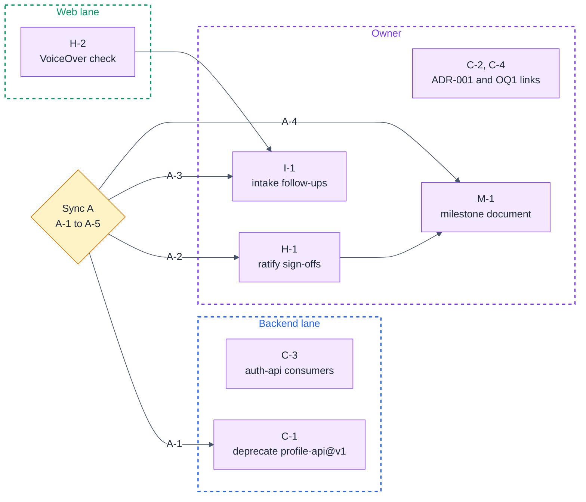

# simple-login · Execution Plan (2026-10-30)

**Created:** 2026-10-30 · **Supersedes:** none (first execution plan on this project; no earlier plan exists)
**Repo baselines:** spec repo (`hsdd/`, a plain directory, no submodule) `a82f99a` · implementation repo `execute@a82f99a` (branch `feat/tutorial-update`)
**Companion docs:** [2026-10-30-progress.md](2026-10-30-progress.md) · [atlas.md](atlas.md) · [2026-10-30-intake-add-phone.md](2026-10-30-intake-add-phone.md)

## Operating model

- **Lanes.** **Backend lane:** the backend developer; `simple-login.backend` and the contracts it produces. **Web lane:** the frontend developer; `simple-login.web`. **Owner:** the project owner; runs the checkpoint and the root-level governance skills, and holds human sign-off. `simple-login.integration` has no lane named in the specs; it runs after both lanes ship.
- **Where prompts run.** From the project root (the directory holding `hsdd/`), on `feat/tutorial-update`. The HSDD tree is a plain directory, so a governance edit commits on the same branch as code.
- **Legend.** 🤖 **delegate**: paste the prompt into an agent session, then check its *Validate* line by hand. 🤝 **interactive**: run the prompt with the agent; the human decides where it asks. 👤 **human-only**: execute from the briefing.

## Current state

The delta from nothing, since no earlier plan exists:

- **Nine of nine planned phases are done:** verification doc on main, root `npm test` green at `a82f99a`.
- **Update 1 is delivered.** `2026-10-30-intake-add-phone.md` was closed by this checkpoint.
- **No phase is planned or in progress.** The tree waits for its next change request.
- **Open work is lifecycle and process, not build:** profile-api@v1's deprecation, ratifying nine proxy sign-offs, two small verification gaps, three link fixes.

## Ownership split

| | Backend lane | Web lane | Owner |
|---|---|---|---|
| **Nodes** | `simple-login.backend` | `simple-login.web` | `simple-login` (root); `simple-login.integration` (no lane named) |
| **Contracts (single-writer)** | `auth-api@v1`, `profile-api@v1`, `profile-api@v2` (producer `simple-login.backend`; edits through `hsdd-contract`) | none | none; ADR-001 through `hsdd-adr`, OQ rows through `hsdd-reconcile` |
| **External tracks** | none | none | E-1 (answer comes from product) |

## Sync points

| Sync | When | Who | Agenda in one line |
|---|---|---|---|
| **Sync A** (gating) | Mon 2026-11-02, 30 min (proposed; the owner confirms the date) | owner, both developers | v1 sunset, sign-off ratification, verification follow-ups, milestone document, guardrails ([section](#sync-a--mon-2026-11-02-30-min-gating)) |
| **Weekly** | Mondays from 2026-11-09 (proposed), each after a Friday checkpoint | everyone | standing review of the newest plan |

## Plan graph



C-2, C-3 and C-4 depend on nothing and can run before Sync A. H-2 is an Entry item of Sync A and a dependency of I-1.

## Sync A · Mon 2026-11-02, 30 min (gating)

**Why it gates:** C-1, H-1, I-1 and M-1 each wait on one of its decisions.

### Entry

- [ ] H-2's result is appended to this plan's change log: announced or not, for each of the two messages.
- [ ] C-2, C-3 and C-4 are done, so the sync handles decisions only.
- [ ] Everyone has read the findings register in [2026-10-30-progress.md](2026-10-30-progress.md).

### Agenda

**A-1 · When does profile-api@v1 sunset?** (F-1) Every v1 consumer has migrated, and the producer serves v2 only. hsdd-contract's policy is `deprecated` with a sunset date, then `retired`. Live options: **(a)** sunset on 2026-11-06, the next checkpoint, which then routes the retirement; **(b)** a later date, kept open for a reader outside the tree. Trade-off: (a) clears the graph fastest, but the retirement must also deal with the `consumers` list, which still names the shipped phases `web.1`, `web.3` and `integration.1`, since the retirement-health check reads any named consumer as live. (b) keeps a false five-field guarantee on the books longer, for a reader the tree does not list (`external_consumers` is absent). **Lands in:** `hsdd/contract/profile-api.md` (front matter `status`, `## Versioning`), through `hsdd-contract`.

**A-2 · Are the nine owner-proxy sign-offs accepted as the owner's?** (F-2) Live options: **(a)** the owner ratifies all nine as they stand; **(b)** the owner re-reviews the three full-review phases (`backend.2`, `web.3`, `integration.1`) in person and ratifies the six gate-only and spot-check ones; **(c)** the owner re-reviews all nine. Trade-off: (a) costs minutes but accepts three waivers and fourteen dropped Learnings unseen; (c) costs about one review sitting per phase; (b) spends human time where the tiers said review mattered. **Lands in:** each `hsdd/verify/simple-login.*.verification.md` `## Sign-off`, as a ratification or re-review line by the owner.

**A-3 · Do the two residual verification gaps get work?** (F-6, F-7) F-6 is whether a screen reader announces the Login messages (H-2 brings the result). F-7 is the AC-1.2 browser tests' blindness to whitespace. Live options: **(a)** waive both, with reasons, in the next execution plan; **(b)** one change request through `hsdd-intake` for F-7, and for F-6 if H-2 found a message unannounced; **(c)** route F-6 only if it failed, and waive F-7. Trade-off: F-7's risk is a spacing-only edit to one constant (`web/src/messages.ts`), which the web gate's own tests would not catch either, against a phase whose process artifacts will outweigh a few changed lines. An unannounced expiry message fails AC-2.3 for a screen-reader user outright. **Lands in:** a new intake record `hsdd/management/YYYY-MM-DD-intake-{slug}.md` (through `hsdd-intake`), or the next plan's waiver table.

**A-4 · Does the delivered campaign get a milestone document?** No milestone document exists. hsdd-milestone's precondition holds (every leaf-parent is phase-planned), and this checkpoint recommends running it. Live options: **(a)** run `hsdd-milestone` now: its gates are met at generation, and the next checkpoint seals it on the verification docs, which gives stakeholders an evidence-backed record that the PRD and update 1 shipped; **(b)** skip this campaign, and open the first milestone document with the next one. Trade-off: (a) costs one run, and its seal rests on the sign-offs, so it follows H-1. (b) leaves the delivery recorded only in progress reports. Either way no campaign gate includes launch (the PRD scopes delivery to a local demo), so the project is not launched and maintenance mode does not start. A deployment campaign starting from OQ1 would be the one whose gate includes launch. **Lands in:** `hsdd/management/YYYY-MM-DD-milestones.md` (through `hsdd-milestone`), or the next progress report's Milestone gate status line under (b).

**A-5 · Accept or reject proposed guardrails 1 to 3.** Live options, per guardrail: accept, reject, or accept with amended wording. **Lands in:** the next execution plan's Guardrails section. Accepted guardrails keep their numbers; rejected ones stay listed as rejected, since guardrails are append-only.

### Exit

- [ ] A-1 answered; the sunset date is handed to C-1 (lands in `hsdd/contract/profile-api.md`).
- [ ] A-2 answered; H-1's option chosen (lands in each verification doc's `## Sign-off`).
- [ ] A-3 answered; I-1 runs or is closed as not needed (lands in an intake record, or the next plan's waiver table).
- [ ] A-4 answered; M-1 runs or is closed as not needed (lands in a milestone document, or the next progress report).
- [ ] A-5: each proposed guardrail accepted or rejected (lands in the next plan's Guardrails).

### Unblocks

- **Backend lane:** C-1 starts with A-1's date.
- **Web lane:** nothing waits. If A-3 opens a web change, its phase plan follows I-1.
- **Owner:** H-1 starts per A-2, and I-1 per A-3. M-1 starts per A-4, after H-1.

## Step tables

### C · governance repairs

| ID | Owner | Action | Depends | Finding | ☐ |
|---|---|---|---|---|---|
| C-1 | Backend 🤖 | Move profile-api@v1 to `deprecated` with A-1's sunset date. | Sync A (A-1) | F-1 | ☐ |
| C-2 | Owner 🤖 | Add `simple-login` to ADR-001's `affects`. | none | F-3 | ☐ |
| C-3 | Backend 🤝 | Add the web phases that read auth-api@v1's fixtures to its `consumers`. | none | F-4 | ☐ |
| C-4 | Owner 🤖 | Link OQ1's row to external track E-1. | none | F-5 | ☐ |

### H · human steps

| ID | Owner | Action | Depends | Finding | ☐ |
|---|---|---|---|---|---|
| H-1 | Owner 👤 | Ratify or re-review the nine proxy sign-offs as A-2 decides. | Sync A (A-2) | F-2 | ☐ |
| H-2 | Web 👤 | Check with VoiceOver that both Login messages are announced. | none | F-6 | ☐ |

### I / M · follow-up work

| ID | Owner | Action | Depends | Finding | ☐ |
|---|---|---|---|---|---|
| I-1 | Owner 🤖 | Route the verification follow-ups that A-3 keeps through `hsdd-intake`. | Sync A (A-3), H-2 | F-6, F-7 | ☐ |
| M-1 | Owner 🤖 | Generate the milestone document if A-4 chooses it. | Sync A (A-4), H-1 | none | ☐ |

### Waived or closed without a step

| Finding | Disposition |
|---|---|
| **F-8** | **Waived.** integration.1 and integration.2 cite tutorial screenshots under `walkthrough/screens/`, which sit beside the project root, not under it. They illustrate; the gate evidence is `npm test`, which this checkpoint re-ran green at `a82f99a`. Correcting the path would edit two signed verification docs for no gain in evidence. Sync A may reopen it. |
| **F-9** | **Closed.** This run wrote the first progress report, execution plan and atlas. |

## Step details

### C-1 · deprecate profile-api@v1 🤖 (Backend)

**Prompt:**

```
/hsdd-contract deprecate profile-api@v1 with sunset date {A-1's date from Sync A} per hsdd/management/2026-10-30-execution-plan.md (C-1, finding F-1). Every v1 consumer has a v2 phase with its verification doc on main (simple-login.web.4 replaces web.1 and web.3; simple-login.integration.2 replaces integration.1), and the producer has served profile-api@v2 only since simple-login.backend.3. Set status: deprecated, record the sunset date and the reason in ## Versioning, keep the schema and fixtures, and regenerate the registry. Do not retire v1 in this run.
```

*Validate:* `hsdd/contract/profile-api.md` reads `status: deprecated`, and its `## Versioning` names the sunset date; `hsdd/contract/INDEX.md` shows v1 as `deprecated`; root `npm test` is still green.

### C-2 · link ADR-001 to the root node 🤖 (Owner)

**Prompt:**

```
/hsdd-adr ADR-001: add simple-login to affects, per hsdd/management/2026-10-30-execution-plan.md (C-2, finding F-3). hsdd/spec/simple-login.md carries Governed by: [ADR-001] and proposed the ADR in its Decisions section, but ADR-001's affects lists only simple-login.backend, simple-login.web and the three contracts. This is a link fix; the decision does not change. Regenerate the registry.
```

*Validate:* the `affects` line of `hsdd/adr/001-session-tokens.md` names `simple-login`, and the ADR-001 row of `hsdd/adr/INDEX.md` matches it.

### C-3 · complete auth-api@v1's consumers 🤝 (Backend)

**Prompt:**

```
/hsdd-contract amend auth-api@v1 consumers per hsdd/management/2026-10-30-execution-plan.md (C-3, finding F-4). simple-login.web.3 and simple-login.web.4 read auth-api@v1's login-success fixture in web/src/App.test.tsx (the sign-in step of the walk), and web.3's verification doc says it consumes auth-api@v1, but the contract's consumers list names only web.1, web.2, integration.1 and integration.2, and neither phase's Consumes line names it. Propose the consumers change (compatible metadata; the version stays v1). Ask me whether the shipped phases' Consumes lines in hsdd/spec/simple-login.web.md are corrected too or left as written with a note. Regenerate the registry.
```

*Validate:* `consumers` in `hsdd/contract/auth-api.md` includes `simple-login.web.3` and `simple-login.web.4`, and the auth-api row of `hsdd/contract/INDEX.md` counts 6; or the session recorded why the list stays at 4.

### C-4 · link OQ1 to E-1 🤖 (Owner)

**Prompt:**

```
/hsdd-reconcile link OQ1 to its external track per hsdd/management/2026-10-30-execution-plan.md (C-4, finding F-5). OQ1 in hsdd/spec/simple-login.md waits on "ext: product"; hsdd/conventions.md says to link the execution plan's E-track where one exists, and this plan opens E-1 for OQ1. Add the E-1 link (with the plan's filename) to OQ1's Waits on cell. Its status stays OPEN; nothing else changes.
```

*Validate:* OQ1's row in `hsdd/spec/simple-login.md` names `E-1` and `2026-10-30-execution-plan.md`, and still reads `OPEN`.

### H-1 · ratify or re-review the sign-offs 👤 (Owner)

**Why:** every phase is signed by an owner proxy, so the evidence chain stops at an agent. Three waivers and fourteen dropped Learnings were decided without the owner (F-2).

**Do:**

- [ ] Take A-2's answer from Sync A.
- [ ] Under (b) or (c), re-run the review in person for each phase in scope: read the phase's diff, run `npm test` from the project root, then add your own line under `## Sign-off` in its `hsdd/verify/simple-login.{phase}.verification.md`.
- [ ] Under (a), and for the phases (b) leaves out, append `- Ratified by {your name}, {date}` under `## Sign-off` in each remaining verification doc.
- [ ] Confirm or reverse the three proxy waivers: the screen-reader pass in `simple-login.web.2.verification.md` and `simple-login.web.3.verification.md` (take H-2's result into account), and the `cancelled`-flag test in `simple-login.web.3.verification.md`.
- [ ] Commit the verification-doc edits on `feat/tutorial-update`.

**Done when:** each of the nine verification docs carries a ratification or re-review line by the owner, committed on `feat/tutorial-update`.

### H-2 · VoiceOver check of the Login messages 👤 (Web)

**Why:** the Login screen's message slot mounts with its content, and a live region inserted that way is often not announced, so a screen-reader user may never hear AC-2.3's expiry message. The check was waived twice and listed for the owner (F-6).

**Do:**

- [ ] Check that nothing listens on 3000 or 5173 (`lsof -nP -iTCP:3000 -iTCP:5173 -sTCP:LISTEN`), then run `npm run dev` from the project root.
- [ ] Open `http://localhost:5173` in Safari with VoiceOver on (Cmd-F5).
- [ ] Sign in as `ayu` / `sunset-42` (a wrong password) and listen for "Incorrect username or password."
- [ ] Sign in as `ayu` / `sunrise-42`. Stop `npm run dev` with Ctrl-C, start it again (a restart signs everyone out, per ADR-001), and reload the tab.
- [ ] Listen for "Your session has expired. Please sign in again." on arrival at Login.
- [ ] Stop `npm run dev` and check that both ports are free again.
- [ ] Append the result to this plan's `## Change log` (for example `- 2026-11-02: H-2: expiry message announced; AC-1.2 message not announced`), then tick Sync A's first Entry box. A published plan accepts only those two edits.

**Done when:** Sync A's first Entry box is ticked, and the change log carries both results.

### I-1 · route the verification follow-ups 🤖 (Owner)

**Prompt:**

```
/hsdd-intake verification follow-ups from hsdd/management/2026-10-30-execution-plan.md (I-1), keeping only what Sync A's A-3 kept: {the kept items}. Authority: a ticket raised by the 2026-10-30 checkpoint. F-7: the two AC-1.2 tests in e2e/login.spec.ts match "Incorrect username or password." with Playwright's exact: true, which collapses whitespace, so a message with changed spacing passes; simple-login.integration.2 closed the same gap for the phone number with an anchored raw-text pattern. F-6 (only if H-2 found a message unannounced): the Login screen's message slot mounts with its content, so VoiceOver does not read the expiry message (AC-2.3) or the AC-1.2 message; result from H-2: {H-2's result}.
```

*Validate:* a new `hsdd/management/*-intake-*.md` record exists with its class and handoff prompts. If A-3 waived both, no record exists, this box is ticked as not needed, and the next plan's waiver table names F-6 and F-7.

### M-1 · generate the milestone document 🤖 (Owner)

**Prompt:**

```
/hsdd-milestone generate the milestone document for the simple-login campaign (the PRD and update 1, nine phases) with hsdd/management/2026-10-30-progress.md as its Basis, per hsdd/management/2026-10-30-execution-plan.md (M-1, Sync A's A-4).
```

*Validate:* `hsdd/management/YYYY-MM-DD-milestones.md` exists, and its `**Basis:**` line names `2026-10-30-progress.md`. If A-4 chose (b), no document exists and this box is ticked as not needed.

## External tracks

| Track | Owner | Status | What happens on answer | Gates |
|---|---|---|---|---|
| E-1 · deployment beyond a laptop | owner, asking product | open since 2026-10-29, not yet asked | the answer (one origin behind a reverse proxy, or two origins with CORS) enters the tree through `hsdd-intake`, and the deployment campaign it opens is the first whose gate can include launch | no phase (OQ1: nothing in v1 is contingent on it) |

## Timeline

No milestone document exists to align to (A-4).

| Week | Backend lane | Web lane | Owner |
|---|---|---|---|
| **Fri 2026-10-30** | none | none | this checkpoint |
| **Mon 2026-11-02 to Fri 2026-11-06** | C-3 before Sync A; C-1 after it | H-2 before Sync A | C-2 and C-4 before Sync A; Sync A on Monday; then H-1, I-1 and M-1 as decided; next checkpoint on Friday 2026-11-06 |

## Guardrails

None existed before this plan; numbering starts at 1. All three are *proposed* and are decided at Sync A (A-5).

1. *(proposed)* **A size estimate counts the tests a test-first phase will write.** Until a checkpoint recalibrates, multiply a source-only estimate by 1.6. Lesson: four of nine phases passed the ~400-line PE ceiling, and estimates ran 1.64 times low (progress report, Velocity).
2. *(proposed)* **A browser assertion for a criterion that says "exactly" matches the whole raw text with an anchored pattern, never Playwright's `exact: true`.** That option normalizes whitespace. Lesson: integration.2's review finding; F-7 is the same gap in AC-1.2.
3. *(proposed)* **A producer phase that turns the root gate red by design names, in its plan, the consumer phases that turn it green, and they land in the same window.** Lesson: backend.3 left `npm test` red from 13:16 to 13:39 on 2026-10-30. The window was planned and named in both plans, so nobody mistook it for a regression.

## Change log

- 2026-10-30: first publication (adoption run).
