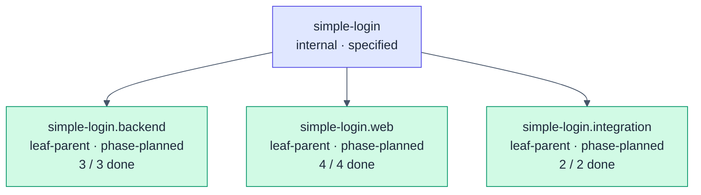
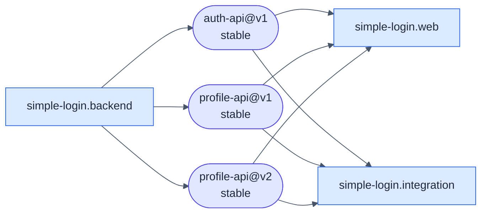
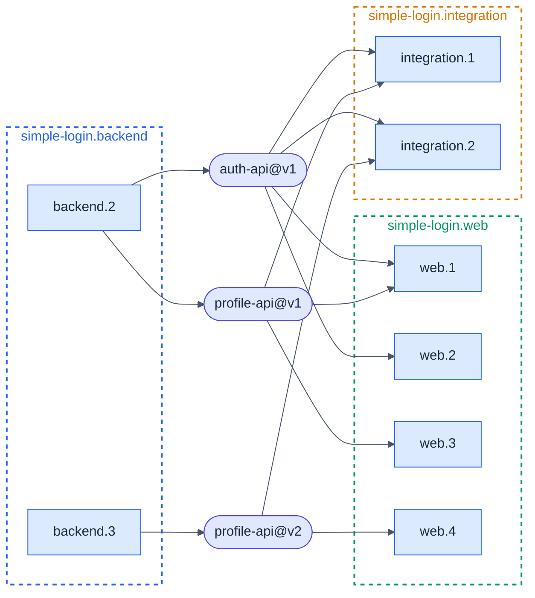

# simple-login · Atlas

**Generated:** 2026-10-30 by `hsdd-checkpoint`. Regenerated whole at every
checkpoint; never hand-patched.
**Derived from:** `hsdd/spec/` + `hsdd/contract/` + `hsdd/adr/` at spec-repo
`a82f99a` · `hsdd/verify/` for **done** · each implementation repo's
`openspec/changes/` (absent: coding method `superpowers`) and `hsdd-context/`
for **in-progress** · `execute@a82f99a` for every implementation repo (one).
If this file disagrees with those artifacts, this file is wrong, and the fix is
to regenerate it.

**Done**, pinned: a verification doc at `hsdd/verify/{phase-id}.verification.md`
on spec-repo main (here `feat/tutorial-update`). **In-progress:** a phase with an
`openspec/changes/` entry or an `hsdd-context/` file and no such doc.

## 1 · The tree

No node is as-built or promoted: the tree was specified greenfield.

### Phase status per node

| Node | Phase | Name | Tier | Status | Evidence |
|---|---|---|---|---|---|
| `simple-login.backend` | `simple-login.backend.1` | Service skeleton, domain types, contract replay rig | gate-only | done | `hsdd/verify/simple-login.backend.1.verification.md` |
| | `simple-login.backend.2` | Sign-in, sessions and the two endpoints | full-review | done | `hsdd/verify/simple-login.backend.2.verification.md` |
| | `simple-login.backend.3` | Phone number in the profile (profile-api@v2) | spot-check | done | `hsdd/verify/simple-login.backend.3.verification.md` |
| `simple-login.web` | `simple-login.web.1` | App skeleton, API client, session storage | spot-check | done | `hsdd/verify/simple-login.web.1.verification.md` |
| | `simple-login.web.2` | Login screen | spot-check | done | `hsdd/verify/simple-login.web.2.verification.md` |
| | `simple-login.web.3` | Home screen and the session flow | full-review | done | `hsdd/verify/simple-login.web.3.verification.md` |
| | `simple-login.web.4` | Phone number on Home | spot-check | done | `hsdd/verify/simple-login.web.4.verification.md` |
| `simple-login.integration` | `simple-login.integration.1` | End-to-end run and browser test | full-review | done | `hsdd/verify/simple-login.integration.1.verification.md` |
| | `simple-login.integration.2` | Phone number end to end | spot-check | done | `hsdd/verify/simple-login.integration.2.verification.md` |

| Node | Phases | Done | In progress | Planned | Contingent |
|---|---:|---:|---:|---:|---:|
| `simple-login.backend` | 3 | 3 | 0 | 0 | 0 |
| `simple-login.web` | 4 | 4 | 0 | 0 | 0 |
| `simple-login.integration` | 2 | 2 | 0 | 0 | 0 |
| **Total** | **9** | **9** | **0** | **0** | **0** |

Open questions: `OQ1` (root, `OPEN`, `ext: product`) gates no phase.

### Retired

none

## 2 · The contract graph

### Overview (node level)

### Detail: `simple-login` (phase level)

Edges follow each contract's `produced_by` and `consumers` front matter.

| Contract | Status | Compatibility | Producer | Consumers | Validation |
|---|---|---|---|---|---|
| `auth-api@v1` | stable | versioned | `simple-login.backend.2` | `web.1`, `web.2`, `integration.1`, `integration.2` | `hsdd/contract/schema/auth-api.schema.json`, `hsdd/contract/fixture/auth-api/` (5) |
| `profile-api@v1` | stable | versioned | `simple-login.backend.2` | `web.1`, `web.3`, `integration.1` | `hsdd/contract/schema/profile-api.schema.json`, `hsdd/contract/fixture/profile-api/` (5) |
| `profile-api@v2` | stable | additive-only | `simple-login.backend.3` | `web.4`, `integration.2` | `hsdd/contract/schema/profile-api.v2.schema.json`, `hsdd/contract/fixture/profile-api.v2/` (5) |

All three carry `phase_ids: final`; none lists `external_consumers`.

## 3 · ADR coverage map

| ADR | Status | `affects` (front matter) | Carries `Governed by: [ADR-001]` |
|---|---|---|---|
| `ADR-001` · Session tokens | accepted | `simple-login.backend`, `simple-login.web`, `auth-api@v1`, `profile-api@v1`, `profile-api@v2` | nodes `simple-login`, `simple-login.backend`, `simple-login.web`; phases `backend.1` to `backend.3`, `web.1` to `web.4`; contracts `auth-api@v1`, `profile-api@v1`, `profile-api@v2` |

`simple-login.integration` and its two phases carry no `Governed by`. `simple-login` carries `Governed by: [ADR-001]` and is absent from `affects`.
