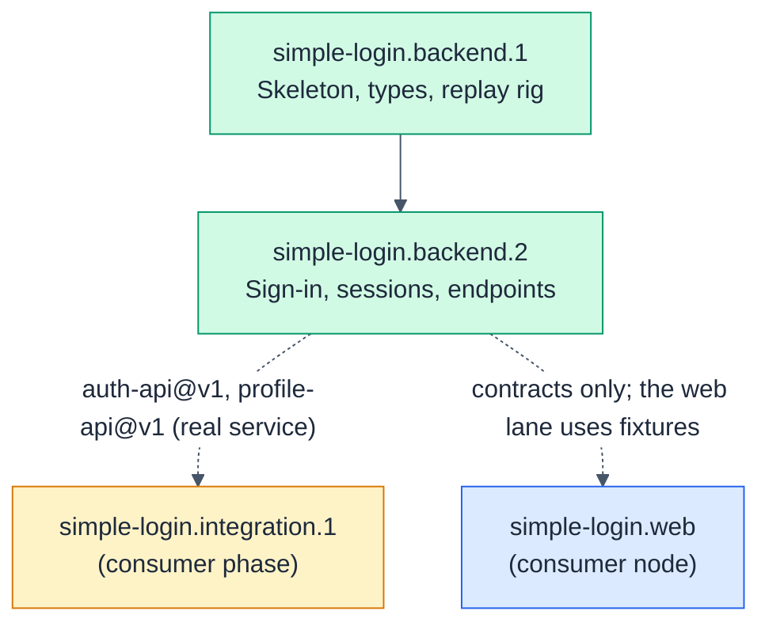

# simple-login.backend: Backend service

- **Kind:** leaf-parent
- **Purpose:** authenticate built-in users and serve the signed-in user's profile over HTTP
- **Owns:** the built-in accounts, password verification, the session store, `POST /api/login`, `GET /api/me`, the `backend/` directory
- **Does not own:** screens, where the browser keeps the token, the dev proxy
- **Consumes:** none
- **Produces:** [auth-api@v1, profile-api@v1]
- **Governed by:** [ADR-001]
- **Sources:** hsdd/context/prd-simple-login.md (US-1, US-2, Demo accounts, Scope), hsdd/context/rfc-simple-login.md (§2 API, §3 Session model, §4 Passwords, §5 Backend stack, §7 Testing, §9 Security notes)
- **Decomposes into:** phases (see hsdd-phase-plan)
- **Isolation strategy:** Fastify `app.inject()` with an injected clock and random source; the gate replays the auth-api and profile-api fixtures against the real routes; no browser and no open port needed

## Overview

A Fastify service on Node.js 24, written in TypeScript. It holds the two
demo accounts from the PRD in memory, checks passwords against scrypt
hashes, issues opaque bearer tokens with a fixed 30-minute lifetime
(ADR-001), and answers exactly two endpoints. Everything it promises the
web app is in auth-api@v1 and profile-api@v1; nothing else about it is
visible outside this node.

## Phase Plan

**Default gate:** `npm --prefix backend run gate`

| Phase | Name | Tier | Size | Depends on |
|------:|------|------|------|------------|
| simple-login.backend.1 | Service skeleton, domain types, contract replay rig | gate-only | ~8 files (~250 lines), ≤5 tasks | none |
| simple-login.backend.2 | Sign-in, sessions and the two endpoints | full-review | ~9 files (~380 lines), ≤7 tasks | 1 |

Ordering policy: `interfaces-first` (from `hsdd/conventions.md`). Phase 1
holds the types, the account data and the test rig with no business logic;
phase 2 is the logic behind both endpoints and the composition that serves
them. Commands run from the repository root (the directory holding `hsdd/`).

Sizing floor. The first draft had three phases: skeleton (gate-only),
password and session logic (full-review), HTTP routes (full-review). The
last two share a tier, consume the same contracts (none), no third phase
depends on one without the other, and together they fit seven tasks, so
they merged into phase 2. Phases 1 and 2 stay separate on a tier boundary:
scaffolding that only needs its gate to pass, versus security logic that
needs a full review.

### Decisions

- **D1. Usernames match exactly:** case-sensitive, no trimming. `Ayu` is
  not `ayu`. Consumers can observe this, so it is emitted as an `amend`
  below rather than kept node-local.
- **D2. The service listens on `127.0.0.1`, port `PORT` or 3000** (RFC §1).
  The web app's dev proxy must point at the same address, and neither
  contract says where the service runs, so it is emitted as an `amend`.

### simple-login.backend.1: Service skeleton, domain types, contract replay rig

- **Consumes:** none
- **Produces:** none
- **Governed by:** [ADR-001]
- **Scope:** the `backend/` package (TypeScript on Node 24, Fastify 5, Vitest, Ajv; `npm run gate` = `tsc --noEmit` then `vitest run`); domain types (account, profile, session, the error envelope, a result type); the two built-in accounts from the PRD with their scrypt salt and hash as data (no verification logic); a `buildApp(deps)` factory taking a clock and a random source, with no routes yet; and the contract replay rig: a test helper that loads each fixture under `hsdd/contract/fixture/{auth-api,profile-api}/`, fills the `{{token:…}}` and `{{expired-token:…}}` placeholders through hooks the caller supplies, sends the request through `app.inject()`, and checks the response by the fixture's `replay` mode against `hsdd/contract/schema/{slug}.schema.json`. Its own tests prove every fixture validates against its schema and that the account data equals the `me-ayu` and `me-budi` fixture bodies.
- **Size estimate:** ~8 files (~250 lines), <= 5 OpenSpec tasks
- **Gate:** `npm --prefix backend run gate`
- **Verification:** `npm --prefix backend run gate` passes from a clean checkout after `npm --prefix backend install`; the replay rig reports all ten fixtures as schema-valid.
- **Review tier:** gate-only
- **Dependencies:** none

### simple-login.backend.2: Sign-in, sessions and the two endpoints

- **Consumes:** none
- **Produces:** [auth-api@v1, profile-api@v1]
- **Governed by:** [ADR-001]
- **Scope:** password verification with scrypt and `timingSafeEqual`, running one comparison against a dummy hash when the username is unknown (RFC §4); the in-memory session store: 32 random bytes base64url per token, a fixed 30-minute expiry from the injected clock, lookup that rejects unknown and expired tokens (ADR-001); `POST /api/login` and `GET /api/me` exactly as the contracts state, with every error in the envelope, including a body that is not JSON or not `application/json` (400 `VALIDATION_FAILED`, never Fastify's default error shape); usernames matched per D1; `backend/src/server.ts` started by `npm --prefix backend start`, listening per D2; no password or token in any log line (RFC §9); and a `replay` script that runs the replay rig from phase 1 against the real routes.
- **Size estimate:** ~9 files (~380 lines), <= 7 OpenSpec tasks
- **Gate:** `npm --prefix backend run gate` plus contract replay for auth-api and profile-api: `npm --prefix backend run replay`
- **Verification:** with the service running, `curl` signs in as `ayu`, fetches `/api/me` with the token and gets Ayu's profile; a wrong password and an unknown user return byte-identical 401 bodies; a token stops working after 30 minutes (proven by the injected clock in tests, not by waiting).
- **Review tier:** full-review
- **Dependencies:** simple-login.backend.1 (domain types, account data, `buildApp`, the replay rig)

### Phase dependency graph

## Governance updates (pending reconcile)

> Reconciled 2026-10-29 by hsdd-reconcile. Drained entries are in git history.
