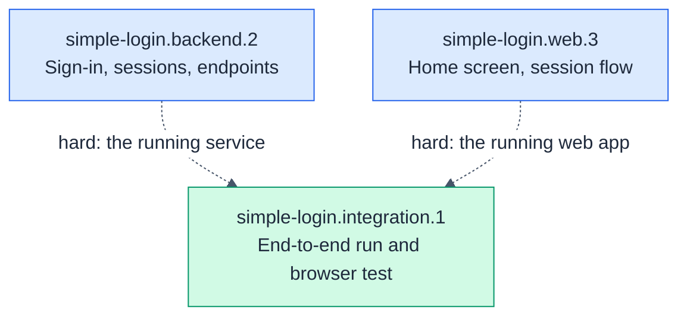

# simple-login.integration: End-to-end integration

- **Kind:** leaf-parent
- **Purpose:** prove the real service and the real web app work together, end to end
- **Owns:** the root `package.json` scripts, the end-to-end browser test, the run instructions
- **Does not own:** any code under `backend/` or `web/`
- **Consumes:** [auth-api@v1, profile-api@v1]
- **Produces:** none
- **Sources:** hsdd/context/prd-simple-login.md (Success, Team and delivery, Demo accounts), hsdd/context/rfc-simple-login.md (§1 Summary, §7 Testing, §8 Repository layout)
- **Decomposes into:** phases (see hsdd-phase-plan)
- **Isolation strategy:** none by design: its edges are `hard`, so it runs the real service and the real web app and drives a real browser against them

## Overview

The node that turns two independently tested halves into one product. It
starts the real backend and the real web app, replays the contract fixtures
through the dev proxy, and drives a browser through every acceptance
criterion in the PRD. It also owns the one command a newcomer runs to start
everything.

## Phase Plan

| Phase | Name | Tier | Size | Depends on |
|------:|------|------|------|------------|
| simple-login.integration.1 | End-to-end run and browser test | full-review | ~6 files (~280 lines), ≤6 tasks | simple-login.backend.2, simple-login.web.3 |

Ordering policy: `interfaces-first` (from `hsdd/conventions.md`). The node
is one composition phase, so the policy only fixes its place: last, after
both producers have shipped. Commands run from the repository root (the
directory holding `hsdd/`).

### simple-login.integration.1: End-to-end run and browser test

- **Consumes:** [auth-api@v1, profile-api@v1]
- **Produces:** none
- **Scope:** the root `package.json`: `install:all` (installs `backend/` and `web/`), `dev` (starts the real backend and the web dev server together, and Ctrl-C stops both; a small Node script, no extra dependency), and `test` (backend gate, backend replay, web gate, then `e2e`); a Playwright suite (Chromium, or the installed Chrome) whose `webServer` starts the real backend and the real web dev server; browser tests for AC-1.1, AC-1.2, AC-1.3, AC-2.1, AC-2.2, AC-2.3 (seeded with a token the backend never issued, which profile-api@v1 guarantees answers like an expired one), AC-3.1, and the PRD's success metric (Home within 3 seconds of Sign in); a contract replay through the dev proxy: every `exact` fixture request sent to the web dev server's `/api` gets the fixture's response, with tokens from real sign-ins; a `README.md` with the run instructions and the demo accounts. The backend's development address is `http://127.0.0.1:3000` (auth-api@v1).
- **Size estimate:** ~6 files (~280 lines), <= 6 OpenSpec tasks
- **Gate:** `npm test`
- **Verification:** from a fresh clone, `npm run install:all && npm run dev`, open `http://localhost:5173`, sign in as `ayu`, see the profile, reload, still signed in, sign out; then the same with a wrong password.
- **Review tier:** full-review
- **Dependencies:** simple-login.backend.2 (hard: the real service), simple-login.web.3 (hard: the complete web app)

### Phase dependency graph

## Governance updates (pending reconcile)

> Reconciled 2026-10-29 by hsdd-reconcile. Drained entries are in git history.
