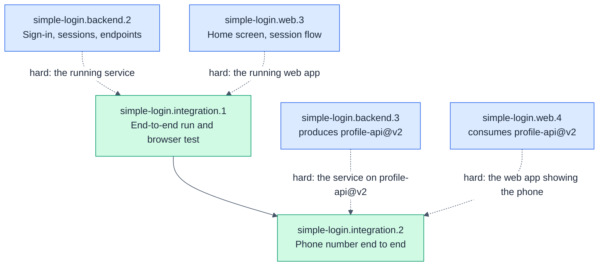

# simple-login.integration: End-to-end integration

- **Kind:** leaf-parent
- **Purpose:** prove the real service and the real web app work together, end to end
- **Owns:** the root `package.json` scripts, the end-to-end browser test, the run instructions
- **Does not own:** any code under `backend/` or `web/`
- **Consumes:** [auth-api@v1, profile-api@v1]
- **Produces:** none
- **Sources:** hsdd/context/prd-simple-login.md (Success, Team and delivery, Demo accounts), hsdd/context/rfc-simple-login.md (§1 Summary, §7 Testing, §8 Repository layout), hsdd/context/update-1-add-phone.md (Change: AC-2.1 amended, AC-2.4; Demo accounts)
- **Decomposes into:** phases (see hsdd-phase-plan)
- **Isolation strategy:** none by design: its edges are `hard`, so it runs the real service and the real web app and drives a real browser against them

## Overview

The node that turns two independently tested halves into one product. It
starts the real backend and the real web app, replays the contract fixtures
through the dev proxy, and drives a browser through every acceptance
criterion in the PRD. It also owns the one command a newcomer runs to start
everything.

## Phase Plan

| Phase | Name | Tier | Size | Depends on |
|------:|------|------|------|------------|
| simple-login.integration.1 | End-to-end run and browser test | full-review | ~6 files (~280 lines), ≤6 tasks | simple-login.backend.2, simple-login.web.3 |
| simple-login.integration.2 | Phone number end to end | spot-check | ~4 files (~35 lines), ≤4 tasks | simple-login.integration.1, simple-login.backend.3, simple-login.web.4 |

Ordering policy: `interfaces-first` (from `hsdd/conventions.md`). The node
is one composition phase, so the policy only fixes its place: last, after
both producers have shipped. Commands run from the repository root (the
directory holding `hsdd/`).

Update 1 (2026-10-30, `hsdd/management/2026-10-30-intake-add-phone.md`)
appends simple-login.integration.2 under the same policy: one more
composition phase, again last, after the profile-api@v2 producer phase
(simple-login.backend.3) and the web app's v2 phase (simple-login.web.4)
have shipped. Both ids are the provisional ones in profile-api@v2's front
matter.

- simple-login.integration.2 sits below the sizing floor (its process
  artifacts will outweigh a ~35-line diff) and has no merge partner: the
  only adjacent phase, simple-login.integration.1, has shipped and is never
  rewritten, and the work cannot move to another node, because this node
  owns the browser suite.
- Its tier is spot-check, not integration.1's full-review: the dev runner,
  the backend fixture and the Playwright config are unchanged; the phase
  adds assertions against a clear contract and retargets one fixture
  directory.

### simple-login.integration.1: End-to-end run and browser test

- **Consumes:** [auth-api@v1, profile-api@v1]
- **Produces:** none
- **Scope:** the root `package.json`: `install:all` (installs `backend/` and `web/`), `dev` (starts the real backend and the web dev server together, and Ctrl-C stops both; a small Node script, no extra dependency), and `test` (backend gate, backend replay, web gate, then `e2e`); a Playwright suite (Chromium, or the installed Chrome) whose `webServer` starts the real backend and the real web dev server; browser tests for AC-1.1, AC-1.2, AC-1.3, AC-2.1, AC-2.2, AC-2.3 (seeded with a token the backend never issued, which profile-api@v1 guarantees answers like an expired one), AC-3.1, and the PRD's success metric (Home within 3 seconds of Sign in); a contract replay through the dev proxy: every `exact` fixture request sent to the web dev server's `/api` gets the fixture's response, with tokens from real sign-ins; a `README.md` with the run instructions and the demo accounts. The backend's development address is `http://127.0.0.1:3000` (auth-api@v1).
- **Size estimate:** ~6 files (~280 lines), <= 6 OpenSpec tasks
- **Gate:** `npm test`
- **Verification:** from a fresh clone, `npm run install:all && npm run dev`, open `http://localhost:5173`, sign in as `ayu`, see the profile, reload, still signed in, sign out; then the same with a wrong password.
- **Review tier:** full-review
- **Dependencies:** simple-login.backend.2 (hard: the real service), simple-login.web.3 (hard: the complete web app)

### simple-login.integration.2: Phone number end to end

- **Consumes:** [auth-api@v1, profile-api@v2]
- **Produces:** none
- **Scope:** per hsdd/management/2026-10-30-intake-add-phone.md. The browser suite proves the amended AC-2.1 and the new AC-2.4 against the real service and the real web app: the AC-2.1 test also sees Ayu's phone number; a new AC-2.4 test matches each built-in account's number as the whole text, exactly as profile-api@v2's `200` fixtures carry it (`+62 812 3456 7890` for `ayu`, `+62 813 9876 5432` for `budi`), so a reformatted number fails; the Budi test also sees Budi's number and not Ayu's. The proxy replay moves from `hsdd/contract/fixture/profile-api/` to `hsdd/contract/fixture/profile-api.v2/` (still every `exact` fixture: four of auth-api@v1, five of profile-api@v2). Its exact `200` replays prove the backend stores the numbers the change request names, and the browser tests prove the web app shows them unchanged; together they are AC-2.4's "exactly as the account stores it". The expired-token stand-in (a backend restart) and the AC-2.3 test now rest on profile-api@v2's guarantee that every rejection gives the same 401 body; comments that cite profile-api@v1 move to v2. The `README.md` names profile-api@v2 where it names the replayed contracts, and its demo-accounts table gains each account's phone number. Selectors stay on visible text, never web-internal markup or storage. The root `package.json` scripts and `scripts/` do not change.
- **Size estimate:** ~4 files (~35 lines), <= 4 OpenSpec tasks
- **Gate:** `npm test`
- **Verification:** signed in as `ayu`, Home shows `+62 812 3456 7890` with the other details, and as `budi` shows `+62 813 9876 5432`; a web app that reformats the number (spaces dropped, say) fails the AC-2.4 test; every other criterion behaves as in simple-login.integration.1 (update 1: nothing else in the PRD changes).
- **Review tier:** spot-check
- **Dependencies:** simple-login.integration.1 (shipped: the browser rig, the proxy replay, `npm test`); simple-login.backend.3 (hard: the real service serving profile-api@v2); simple-login.web.4 (hard: the web app showing the phone number). Land it with simple-login.backend.3: once the backend serves profile-api@v2, integration.1's replay of profile-api@v1's `exact` `200` fixtures fails on the new `phone` field (profile-api@v2, Versioning), so the root `npm test` is red until this phase merges.

### Phase dependency graph

## Governance updates (pending reconcile)

> Reconciled 2026-10-29 by hsdd-reconcile. Drained entries are in git history.

> Emitted by hsdd-phase-plan on 2026-10-30. Drained by hsdd-reconcile;
> do not apply by hand.

- confirm `auth-api@v1` consumers: [simple-login.integration.2]
  - The browser suite signs in through the real `POST /api/login`, and the
    proxy replay fills the `{{token:…}}` and `{{expired-token:…}}`
    placeholders with real sign-ins.
- confirm `profile-api@v2` consumers: [simple-login.integration.2]
  - Matches the draft's provisional entry for this node.
  - This plan's hard dependencies use the draft's other provisional ids,
    `simple-login.backend.3` (`produced_by`) and `simple-login.web.4`
    (`consumers`). If reconcile finalizes different ids, integration.2's
    Dependencies line, its summary-table row and the graph need the same
    rename.
- note: `simple-login.integration.2` is this node's migration off
  `profile-api@v1`. Once it ships, no phase of this node reads
  `hsdd/contract/fixture/profile-api/`; `simple-login.integration.1` stays
  in v1's `consumers` as history. Input for moving v1 to `deprecated`.
  - The node header's `- **Consumes:**` line in this file, and this node's
    child-table row, node section and contract-matrix entry in
    `hsdd/spec/simple-login.md`, still name `profile-api@v1`; this plan
    leaves them as hsdd-spec wrote them. The root spec's copy of this
    node's `- **Sources:**` also lacks `hsdd/context/update-1-add-phone.md`,
    which this file's header now carries.
  - Sequencing: once `simple-login.backend.3` serves v2, integration.1's
    replay of v1's `exact` `200` fixtures fails and the root `npm test` is
    red until integration.2 merges. profile-api@v2's Versioning already
    says "this intake ships them together"; land the three phases on one
    root merge.
