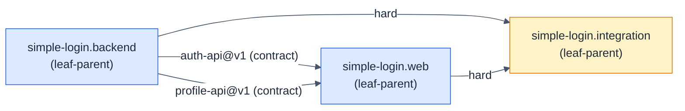

# simple-login: Simple Login

- **Kind:** internal
- **Purpose:** let a registered user sign in with a username and password, see their own profile, and sign out
- **Owns:** the whole product: sign-in, sessions, the profile view, the two-endpoint API between them
- **Does not own:** sign-up, password reset, profile editing, persistence (out of scope in the PRD)
- **Consumes:** none
- **Produces:** none
- **Governed by:** [ADR-001]
- **Sources:** hsdd/context/prd-simple-login.md, hsdd/context/rfc-simple-login.md
- **Decomposes into:** simple-login.backend, simple-login.web, simple-login.integration
- **Isolation strategy:** the children meet only at auth-api@v1 and profile-api@v1; each child builds and tests against those contracts' schemas and fixtures, and only the integration node runs both for real

## Overview

A user signs in on a Login screen, lands on a Home screen that shows their
display name, username, email and join date, and can sign out. Accounts are
built in; nothing is persisted. The product is two deployables, a backend
HTTP service and a web single-page app, joined by an API of exactly two
endpoints (`POST /api/login`, `GET /api/me`).

Normalized from the sources:

- **Primary flows:** sign in (US-1), see my profile (US-2), sign out (US-3).
- **Hard constraints:** no database; exactly two endpoints; built-in demo
  accounts; local laptop only.
- **Success criteria:** Home within 3 seconds of Sign in; every acceptance
  criterion passes in a scripted test.
- **Assumption:** "same message, never says which was wrong" (AC-1.2)
  extends to timing, as the RFC's section 4 states.

## Sources

- `hsdd/context/prd-simple-login.md` · PRD (approved) · product scope, user
  stories US-1 to US-3 with their acceptance criteria, screens, demo
  accounts, team and delivery, success criteria
- `hsdd/context/rfc-simple-login.md` · accepted RFC · the API and its error
  envelope, the session model, password storage, the backend and frontend
  stacks, testing approach, repository layout, security notes

## Decomposition axis

The PRD answers "who builds what?": one backend developer builds the
service, one frontend developer builds the web app, and they ship
separately. The split therefore follows the stack: a backend node and a web
node, joined by the API as contracts. Inside each node one person owns
everything, so no further split is needed and both are leaf-parents.

The children exchange contracts, so the tree also gets
`simple-login.integration`, a leaf-parent with `hard` edges to both, which
proves the real pieces work together.

## Child nodes

| Node | Kind | Purpose | Consumes | Produces |
|------|------|---------|----------|----------|
| simple-login.backend | leaf-parent | authenticate built-in users and serve the signed-in user's profile over HTTP | none | auth-api@v1, profile-api@v1 |
| simple-login.web | leaf-parent | the Login and Home screens in the browser | auth-api@v1, profile-api@v1 | none |
| simple-login.integration | leaf-parent | prove the real service and the real web app work together, end to end | auth-api@v1, profile-api@v1 | none |

### simple-login.backend: Backend service

- **Kind:** leaf-parent
- **Purpose:** authenticate built-in users and serve the signed-in user's profile over HTTP
- **Owns:** the built-in accounts, password verification, the session store, `POST /api/login`, `GET /api/me`, the `backend/` directory
- **Does not own:** screens, where the browser keeps the token, the dev proxy
- **Consumes:** none
- **Produces:** [auth-api@v1, profile-api@v1]
- **Governed by:** [ADR-001]
- **Sources:** hsdd/context/prd-simple-login.md (US-1, US-2, Demo accounts, Scope), hsdd/context/rfc-simple-login.md (§2 API, §3 Session model, §4 Passwords, §5 Backend stack, §7 Testing, §9 Security notes)
- **Decomposes into:** phases (see hsdd-phase-plan)
- **Isolation strategy:** Fastify `app.inject()` with an injected clock and random source; the gate replays the auth-api and profile-api fixtures against the real routes; no browser and no open port needed

### simple-login.web: Web app

- **Kind:** leaf-parent
- **Purpose:** let a user sign in, see their profile and sign out in the browser
- **Owns:** the Login screen, the Home screen, the API client, token storage in the browser, the Vite dev proxy, the `web/` directory
- **Does not own:** accounts, password checks, sessions on the server
- **Consumes:** [auth-api@v1, profile-api@v1]
- **Produces:** none
- **Governed by:** [ADR-001]
- **Sources:** hsdd/context/prd-simple-login.md (US-1, US-2, US-3, Screens), hsdd/context/rfc-simple-login.md (§1 Summary, §2 API, §6 Frontend stack, §7 Testing)
- **Decomposes into:** phases (see hsdd-phase-plan)
- **Isolation strategy:** `fetch` is stubbed with the auth-api and profile-api fixtures; the backend never needs to run

### simple-login.integration: End-to-end integration

- **Kind:** leaf-parent
- **Purpose:** prove the real service and the real web app work together, end to end
- **Owns:** the root `package.json` scripts, the end-to-end browser test, the run instructions
- **Does not own:** any code under `backend/` or `web/`
- **Consumes:** [auth-api@v1, profile-api@v1]
- **Produces:** none
- **Sources:** hsdd/context/prd-simple-login.md (Success, Team and delivery, Demo accounts), hsdd/context/rfc-simple-login.md (§1 Summary, §7 Testing, §8 Repository layout)
- **Decomposes into:** phases (see hsdd-phase-plan)
- **Isolation strategy:** none by design: its edges are `hard`, so it runs the real service and the real web app and drives a real browser against them

## Dependency DAG

| From | To | Type | Carried by |
|------|----|------|------------|
| simple-login.backend | simple-login.web | contract | auth-api@v1 |
| simple-login.backend | simple-login.web | contract | profile-api@v1 |
| simple-login.backend | simple-login.integration | hard | the running service |
| simple-login.web | simple-login.integration | hard | the running web app |

## Dev flow

- **Lane 1 (backend developer):** simple-login.backend, from the moment the
  contracts are `stable`.
- **Lane 2 (frontend developer):** simple-login.web, in parallel with lane
  1. Its edges are `contract`, so it builds against the fixtures and never
  waits for the backend to ship.
- **Join:** simple-login.integration starts when both lanes have shipped
  (its edges are `hard`).

## Contract matrix

| Contract | Kind | Producer | Consumers |
|----------|------|----------|-----------|
| auth-api@v1 | api | simple-login.backend | simple-login.web, simple-login.integration |
| profile-api@v1 | api | simple-login.backend | simple-login.web, simple-login.integration |

## Decisions

- **ADR-001 (proposed here, accepted from RFC §3):** opaque bearer tokens in
  an in-memory session store, a fixed 30-minute lifetime, sign-out on the
  client. It spans both nodes and both contracts, so it is an ADR, not a
  node-local `D{n}`. Materialized by hsdd-adr as `hsdd/adr/001-session-tokens.md`.
- Node-local choices (Fastify, React, Vite, sessionStorage, scrypt) stay in
  the RFC and the node specs that own them.

## Open questions

| ID | Question | Status | Waits on | Affects |
|----|----------|--------|----------|---------|
| OQ1 | How is the product deployed beyond a laptop: one origin behind a proxy, or two origins with CORS? | OPEN | ext: product | simple-login.integration, simple-login.web |

### OQ1: Deployment beyond a laptop

The PRD scopes delivery to a local demo, and the RFC (section 9) relies on
the Vite dev proxy so the browser sees one origin and CORS stays off. A real
deployment must choose one origin behind a reverse proxy, or two origins
with CORS enabled on the service. Nothing in v1 is contingent on it; it is
recorded so the next change that deploys the product starts from a named
question.
