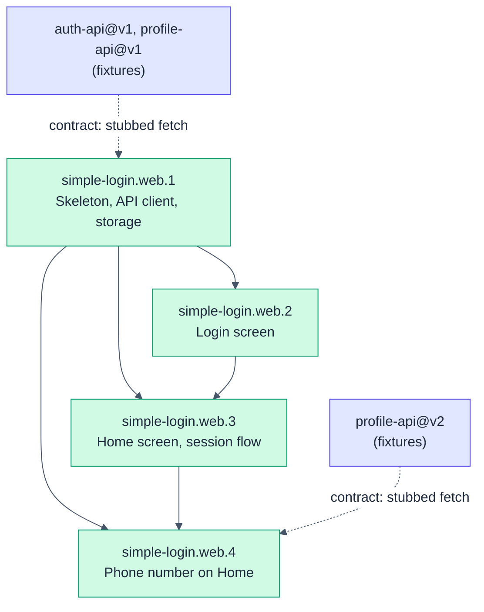

# simple-login.web: Web app

- **Kind:** leaf-parent
- **Purpose:** let a user sign in, see their profile and sign out in the browser
- **Owns:** the Login screen, the Home screen, the API client, token storage in the browser, the Vite dev proxy, the `web/` directory
- **Does not own:** accounts, password checks, sessions on the server
- **Consumes:** [auth-api@v1, profile-api@v1, profile-api@v2]
- **Produces:** none
- **Governed by:** [ADR-001]
- **Sources:** hsdd/context/prd-simple-login.md (US-1, US-2, US-3, Screens), hsdd/context/rfc-simple-login.md (§1 Summary, §2 API, §6 Frontend stack, §7 Testing), hsdd/context/update-1-add-phone.md (AC-2.1 amended, AC-2.4, Screen, Scope)
- **Decomposes into:** phases (see hsdd-phase-plan)
- **Isolation strategy:** `fetch` is stubbed with the auth-api and profile-api fixtures; the backend never needs to run

## Overview

A React 19 single-page app in TypeScript, built with Vite. Two screens and
no router: the app is a function of the session value (no token shows
Login, a token shows Home, except while the backend cannot be reached:
see D5). The token lives in `sessionStorage`. In
development the Vite server proxies `/api` to the backend on port 3000, so
the browser sees one origin. The node knows the backend only through
auth-api@v1 and profile-api@v1, which simple-login.web.4 replaces with
profile-api@v2.

## Phase Plan

**Default gate:** `npm --prefix web run gate`

| Phase | Name | Tier | Size | Depends on |
|------:|------|------|------|------------|
| simple-login.web.1 | App skeleton, API client, session storage | spot-check | ~10 files (~300 lines), ≤6 tasks | none |
| simple-login.web.2 | Login screen | spot-check | ~4 files (~220 lines), ≤5 tasks | 1 |
| simple-login.web.3 | Home screen and the session flow | full-review | ~5 files (~300 lines), ≤6 tasks | 1, 2 |
| simple-login.web.4 | Phone number on Home | spot-check | ~9 files (~70 lines), ≤4 tasks | 1, 3 |

Ordering policy: `interfaces-first` (from `hsdd/conventions.md`). Phase 1
is the typed boundary to the backend (the API client and its fixtures) and
the browser storage behind it; phases 2 and 3 are the screens; phase 3 also
composes the app. Commands run from the repository root (the directory
holding `hsdd/`).

Appended 2026-10-30 for hsdd/management/2026-10-30-intake-add-phone.md
(append mode: web.1 to web.3 have shipped and are unchanged). Under the
same policy, simple-login.web.4 moves the typed boundary to profile-api@v2
and then the Home screen onto it, in one phase: split, the two halves would
be adjacent spot-check phases over the same contract, below the sizing
floor. Its process artifacts will still outweigh a ~70-line diff (the
floor's smell), but its only neighbour, web.3, has shipped and is never
reopened, so it stays one small phase.

### Decisions

- **D1. Expiry is noticed when `GET /api/me` answers 401,** on load or
  reload; the app runs no timer of its own. profile-api@v1 makes an expired
  token indistinguishable from an unknown one, and a client clock can
  drift. Trade-off: a user idle on Home past expiry keeps seeing the page
  until the next load.
- **D2. The session lives in `sessionStorage`** under one key,
  `simple-login.session`, as `{ token, expiresAt }` (RFC §6).
- **D3. One message per failure.** `INVALID_CREDENTIALS` shows "Incorrect
  username or password." (AC-1.2); a 401 on `/api/me` shows "Your session
  has expired. Please sign in again." (AC-2.3); a network failure or an
  unexpected status shows "Could not reach the server. Please try again."
  `VALIDATION_FAILED` (`invalid-input`) shows the AC-1.2 message; the form
  cannot send such a request, so it means credentials that match nothing.
  (Added at the simple-login.web.2 gate, 2026-10-30.)
- **D4. No router** (RFC §6): the screen is a function of the session value.
- **D5. A network failure while checking a stored session keeps the
  session** and shows Login with the D3 network message; the next load
  retries it. Only a 401 clears it (D1). (Added at the simple-login.web.3
  gate, 2026-10-30.)

### simple-login.web.1: App skeleton, API client, session storage

- **Consumes:** [auth-api@v1, profile-api@v1]
- **Produces:** none
- **Governed by:** [ADR-001]
- **Scope:** the `web/` package (React 19, TypeScript, Vite, Vitest with jsdom and Testing Library; `npm run gate` = `tsc --noEmit`, then `vitest run`, then `vite build`); the Vite dev proxy from `/api` to the backend's development address, `http://127.0.0.1:3000` (auth-api@v1); the API client, `signIn(username, password)` and `fetchProfile(token)`, returning a result value (a session or a profile, or a failure reason: `invalid-credentials`, `invalid-input`, `unauthorized`, `unavailable`) decided by status and `error.code`, never by message; the session store over `sessionStorage` (D2); a test helper that answers stubbed `fetch` calls with the auth-api and profile-api fixture responses; a placeholder `App`.
- **Size estimate:** ~10 files (~300 lines), <= 6 OpenSpec tasks
- **Gate:** `npm --prefix web run gate`
- **Verification:** the client's tests feed every one of the ten fixtures through the stub and get the right result; `npm --prefix web run dev` serves the placeholder page.
- **Review tier:** spot-check
- **Dependencies:** none (builds against the contracts' fixtures, not the backend)

### simple-login.web.2: Login screen

- **Consumes:** [auth-api@v1]
- **Produces:** none
- **Governed by:** [ADR-001]
- **Scope:** the Login screen per the PRD wireframe: username and password fields, a Sign in button disabled while either field is empty (AC-1.3), busy while the request is in flight; on success it hands the session to its parent (AC-1.1); on `invalid-credentials` it shows the AC-1.2 message and keeps the typed username; on `unavailable` the D3 network message; it also shows a notice its parent passes in (phase 3 uses it for the expiry message). The username is sent as typed (auth-api@v1 matches it exactly). Its own stylesheet.
- **Size estimate:** ~4 files (~220 lines), <= 5 OpenSpec tasks
- **Gate:** `npm --prefix web run gate`
- **Verification:** component tests cover AC-1.1 to AC-1.3 against the auth-api fixtures; the screen matches the PRD wireframe.
- **Review tier:** spot-check
- **Dependencies:** simple-login.web.1 (the API client and its fixture stub)

### simple-login.web.3: Home screen and the session flow

- **Consumes:** [profile-api@v1]
- **Produces:** none
- **Governed by:** [ADR-001]
- **Scope:** the Home screen per the PRD wireframe: "Hello, {displayName}", username, email, member since as a long date ("14 March 2024"), and Sign out (AC-2.1); the app composition: on load, a stored session is checked with `fetchProfile` and shows Home (AC-2.2); `unauthorized` clears the session and shows Login with the expiry message (AC-2.3, D1); signing in stores the session and shows Home; Sign out clears it and shows Login (AC-3.1). Its own stylesheet.
- **Size estimate:** ~5 files (~300 lines), <= 6 OpenSpec tasks
- **Gate:** `npm --prefix web run gate`
- **Verification:** with `fetch` stubbed by the fixtures, the app walks Login, Home, reload, Home, Sign out, Login; the unauthorized fixture shows the expiry message; nothing but the token and its expiry is ever written to storage.
- **Review tier:** full-review
- **Dependencies:** simple-login.web.1 (API client, session store), simple-login.web.2 (the Login screen)

### simple-login.web.4: Phone number on Home

- **Consumes:** [profile-api@v2]
- **Produces:** none
- **Governed by:** [ADR-001]
- **Scope:** per hsdd/management/2026-10-30-intake-add-phone.md, the web app moves from profile-api@v1 to profile-api@v2 and Home shows the signed-in user's phone number (AC-2.1 amended, AC-2.4). The `Profile` type gains `phone`; `fetchProfile` requires it as a string, so a 200 without it is `unavailable` like any other malformed 200 (web.1), and it keeps ignoring fields it does not know (profile-api@v2). Home gains a `Phone` row between Email and Member since, per the request's Screen, showing `phone` as plain text exactly as received, never reformatted. The fixture stub loads `profile-api.v2`, and every test that reads a profile fixture (the client and its every-fixture guard, the stub's own listing, Home, the session flow, App) moves to the v2 fixtures; afterwards no web test reads `hsdd/contract/fixture/profile-api/`, so v1's retirement cannot break this node's gate. Login, the session flow, storage and the messages do not change (D1 to D5 stand).
- **Size estimate:** ~9 files (~70 lines, mostly tests), <= 4 OpenSpec tasks
- **Gate:** node default
- **Verification:** with `fetch` stubbed by the profile-api@v2 fixtures, Home shows `+62 812 3456 7890` for Ayu and `+62 813 9876 5432` for Budi, character for character, in the request's row order; the screen matches the request's Screen at 360 px; the load check and the walk behave as in web.3.
- **Review tier:** spot-check
- **Dependencies:** simple-login.web.1 (the API client and its fixture stub), simple-login.web.3 (the Home screen and the App tests); across nodes, profile-api@v2 through its fixtures only (drafted 2026-10-30, `stable` once hsdd-reconcile drains the three plans), never the backend

### Phase dependency graph

## Governance updates (pending reconcile)

> Reconciled 2026-10-29 by hsdd-reconcile. Drained entries are in git history.

> Reconciled 2026-10-30 by hsdd-reconcile. Drained entries are in git history.
