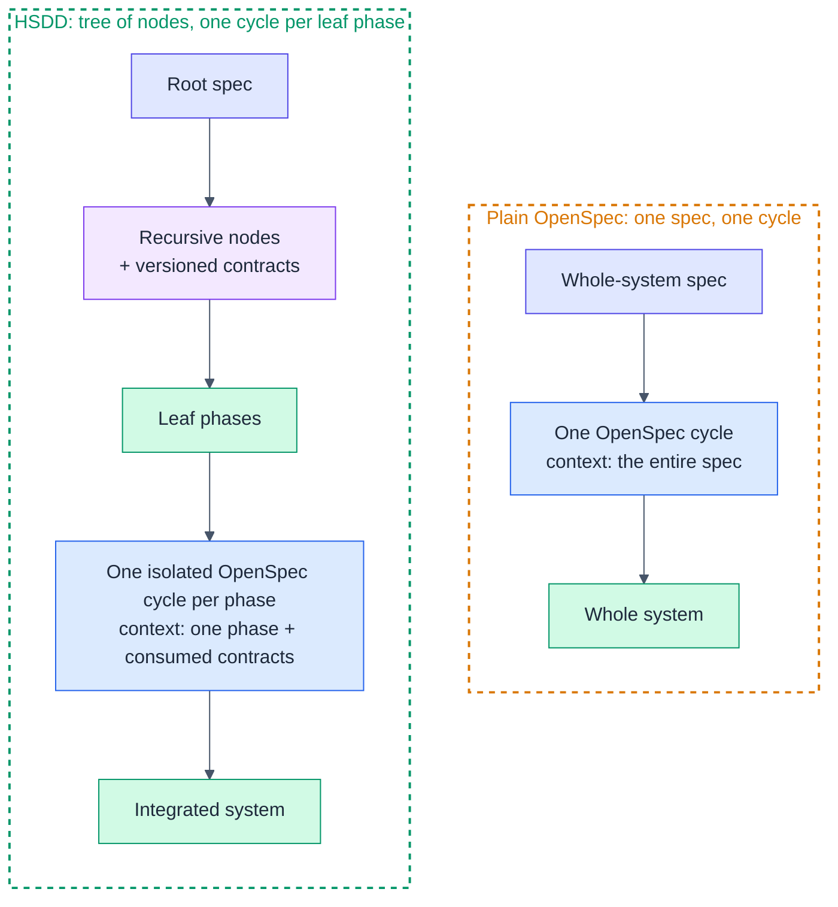
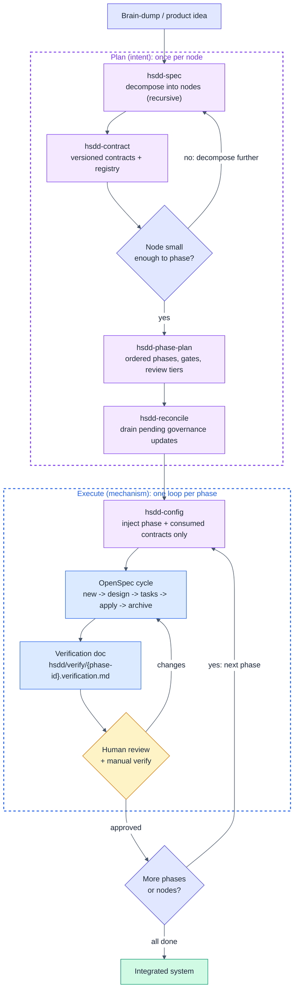
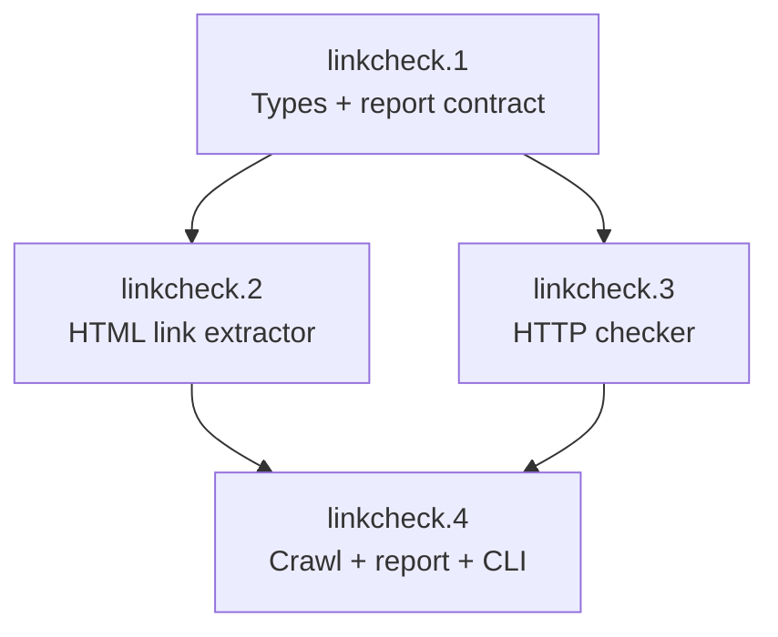
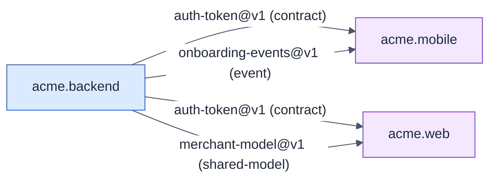
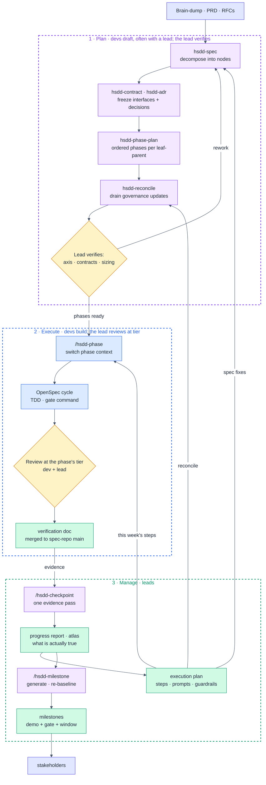

# HSDD User's Guide

This guide shows HSDD on three worked examples, then covers running a
project week to week. Each example goes prompt by prompt: what you type,
which skill answers, and the files it writes. The rules behind every step
are in the [methodology specification](../spec/hsdd-spec-v0_10.md), the
single current spec, with the [v0.11 delta](../spec/hsdd-spec-v0_11.md)
for unattended runs; the superseded delta series remains in `spec/` as
history. The [interactive guide](guide/index.html) draws the same examples
step by step, and the [tutorials](tutorial/) are complete recorded runs on
a real repository.

| If you | Start with |
|--------|------------|
| are new to HSDD | [How HSDD works](#how-hsdd-works), then [Example 1](#example-1-a-simple-project-single-level) |
| are planning a system several teams build | [Example 2](#example-2-a-multi-level-system) |
| are bringing an existing codebase in | [Example 3](#example-3-a-brownfield-system-adopt-intake-promote) |
| lead the project once implementation starts | [Running the project](#running-the-project) |
| want the planning chain to run without you | [Unattended runs](#unattended-runs) |
| have a project that drifted outside the method | [Outside the loop](#outside-the-loop) |
| are upgrading a project to a newer release | [Upgrading](#upgrading) |

## Before you start

Install the twelve skills (see the [README](../README.md)) and, ideally,
[Obra's superpowers](https://github.com/obra/superpowers) plugin. HSDD
composes with its test-driven development, verification and code-review
skills instead of re-implementing them. The HSDD loop, in one line:

> decompose -> contract -> phase-plan (parallel across leaf-parents) ->
> reconcile -> configure -> one coding cycle per phase (OpenSpec or
> superpowers) -> human review -> repeat.

One principle is worth taking in early: **depth and ceremony are costs.**
Use exactly as many levels and artifacts as the system needs, and no more.
In Example 1 the root is its own leaf-parent; Example 2 needs two levels of
nodes under its root. Each is right for its system.

---

## How HSDD works

*In the interactive guide:* [Why HSDD](guide/index.html#why-1) · [Decompose](guide/index.html#tree-1)

### Plain OpenSpec vs HSDD

Plain OpenSpec drives the whole system from one spec through one cycle, so every
session carries the entire spec as context. HSDD decomposes the system into a tree
of nodes coupled by versioned contracts, then runs one isolated OpenSpec cycle per
leaf phase. Each cycle sees only its phase plus the contract interfaces it
consumes.



The OpenSpec cycle itself is unchanged. HSDD only decides what each cycle sees and
in what order cycles run. The same holds for superpowers, the other coding method:
HSDD writes the phase context, and the method's own skills plan and build the phase
(Example 2, Step 5).

### The HSDD workflow

The one-line loop above, drawn out. Planning is done once per node and rarely
rewritten. Execution repeats once per phase: switch the context, run the cycle,
generate the verification doc, and pass a human review gate before moving on.



The single amber node is the human review gate. Every leaf phase ends there, at a
depth set by its review tier (`gate-only`, `spot-check`, or `full-review`).

### Review tiers

`hsdd-phase-plan` assigns one tier per phase, based on risk rather than size. The
tier sets how much attention the gate gets **and** the artifact profile of the
cycle: a `gate-only` phase skips `design.md` and gets a slim verification doc;
a `spot-check` phase skips `design.md` unless the phase settles a real design
decision, and gets a short verification doc; a `full-review` phase produces the
full set. Every phase still ends at the gate and still produces a verification
doc. Only the depth scales with the tier.

- **`gate-only`** is for scaffolding, types and boilerplate. A wrong turn here
  is cheap and mechanical to catch, so the automated gate (e.g. `cargo test`)
  passing is enough: you're notified and move on without reading the diff.
  Examples: `linkcheck.1` and `acme.backend.auth.1`, both "Types + contract"
  phases with no logic yet to get wrong.
- **`spot-check`** is for well-constrained phases with a clear contract, where
  the output's shape is easy to eyeball without tracing every line. Glance at
  the diff, confirm the gate passed, proceed. Examples: `linkcheck.2`, a pure
  `HTML -> [Url]` extractor, and `acme.backend.auth.3`, the session store,
  both narrow, single-purpose and easy to sanity-check at a glance.
- **`full-review`** is for orchestration, business logic, integrations and
  security, where mistakes are expensive and not obviously visible in a diff.
  Read the diff, run the manual verification steps from the phase's
  verification doc, and think through edge cases before approving. Examples:
  `linkcheck.3`, the HTTP checker with retries and timeouts, and
  `acme.backend.auth.2`, token issuance, whose manual verification runs
  before sign-off in Step 6 of Example 2.

See the [methodology spec](../spec/hsdd-spec-v0_10.md), chapter 7 for how the
tier interacts with the review sitting and the sizing floor, and chapter 10
for the tier-scaled artifact profile.

### Where everything lives

Every HSDD artifact lives under one root directory, `hsdd/`, with singular
directory names; only OpenSpec's own files and the per-phase contexts stay
outside it. This is the default layout the skills emit (override it in
`hsdd/conventions.md`; spec §14.1 has the full tree):

```text
hsdd/conventions.md                        naming, layout, and process conventions
hsdd/spec/{node-id}.md                     node specs and phase plans
hsdd/verify/{phase-id}.verification.md     per-phase verification docs
hsdd/contract/{slug}.md + INDEX.md         first-class contracts (registry generated)
hsdd/contract/schema/, hsdd/contract/fixture/  executable validation; a contract is stable only with one of these
hsdd/adr/{nnn}-{title}.md + INDEX.md       cross-cutting decisions (hsdd-adr, registry generated)
hsdd/scripts/gen-registry.mjs              registry generator (copied from hsdd-contract)
hsdd/scripts/seams/                        seam extractor (copied from hsdd-adopt; adopted trees only)
hsdd/scripts/summary/                      hsdd-summary's scripts (copied verbatim)
hsdd/scripts/auto/                         hsdd-auto's scripts (copied by its first setup step; unattended runs only)
hsdd/templates/verification.md             verification-doc template, copied from hsdd-config
hsdd/management/                           management layer (progress reports, execution plans, milestones, intake records, atlas), written only by hsdd-checkpoint, hsdd-milestone and hsdd-intake (intake records)
hsdd/management/archive/                   sealed milestone documents (closed campaigns)
hsdd/summary/                              optional reading aids (hsdd-summary): summary.html, checkpoint.html
hsdd/auto/, hsdd/judgement/                an unattended run's records and its decision ledger (hsdd-auto)
openspec/                                  config.yaml + one change per phase (OpenSpec method)
hsdd-context/{phase-id}.md                 generic phase context, written by /hsdd-phase before each phase
hsdd-context/superpowers/{phase-id}.md     the same context as a spec for superpowers' writing-plans (superpowers method)
```

**Where to run `openspec init`:** once, at the repo root (the directory that
holds `hsdd/`). One HSDD tree has one OpenSpec project. Every phase, across
every node, is a change under that single `openspec/changes/`; phases are
kept apart by the per-phase context switch (`hsdd-config`), not by separate
projects. A project on the superpowers method has no OpenSpec project to
initialize.

When the code lives in several repositories, the tree still has one home.
The standalone-spec-repo profile keeps one HSDD tree in its own repo,
mounted at `hsdd/` in each implementation repo, and `openspec init` runs
once per implementation repo. Never give a second repo its own
`hsdd/spec/`; one project has one tree (see
[Multi-repo projects](#multi-repo-projects)).

---

## Example 1: A simple project (single level)

*In the interactive guide:* [Decompose](guide/index.html#tree-1) · [Plan phases](guide/index.html#phases-1)

Sometimes the whole system is small enough that there is nothing to decompose:
the root node is already a leaf-parent, and you go straight to phases. HSDD does
not force a tree on you.

**The project:** `linkcheck`, a CLI that crawls a site and reports broken links.

### Step 1: Spec it

```text
You: "Write a high-level spec for linkcheck, a CLI that crawls a site and
      reports broken links."
```

`hsdd-spec` runs at the root. It recognizes the project is one coherent
responsibility that fits a handful of phases, so it marks the root a
**leaf-parent** rather than inventing sub-nodes. `hsdd/spec/linkcheck.md`:

```markdown
# linkcheck: Broken Link Checker CLI

- **Kind:** leaf-parent
- **Purpose:** crawl a site, check every link, report the broken ones
- **Consumes:** none
- **Produces:** [linkcheck-report@v1]
- **Decomposes into:** phases (see phase plan)
- **Isolation strategy:** pure HTML parsing and pure report formatting are testable
  with fixtures; the HTTP checker is mocked in tests.
```

For a project this small there is just one outward contract (the report format).
The "contracts" between phases are simply the domain types defined in phase 1.

### Step 2: One contract

```text
You: "Define the linkcheck-report contract."
```

`hsdd-contract` writes `hsdd/contract/linkcheck-report.md` with frontmatter plus the
report schema (JSON shape and exit codes), and the contract's executable
validation artifact, `hsdd/contract/schema/linkcheck-report.schema.json`,
from that Interface. Then it regenerates the registry:

```bash
node hsdd/scripts/gen-registry.mjs
```

### Step 3: Phase-plan

```text
You: "Write the phase plan for linkcheck."
```

`hsdd-phase-plan` orders the phases by the project's ordering policy (`interfaces-first` unless `hsdd/conventions.md` says otherwise), each one PE (<= 8 OpenSpec tasks), opening
with the phase summary table:

| Phase | Name | Tier | Size | Depends on |
|------:|------|------|------|------------|
| linkcheck.1 | Types + report contract | gate-only | small | - |
| linkcheck.2 | HTML link extractor | spot-check | small | 1 |
| linkcheck.3 | HTTP checker | full-review | medium | 1 |
| linkcheck.4 | Crawl + report + CLI | full-review | medium | 2, 3 |

and the dependency graph as a Mermaid flowchart:



Phase 1 produces `linkcheck-report@v1`, so its Gate includes the contract
replay: the phase's real output must validate against the schema
`hsdd-contract` wrote in Step 2, and the contract can only become `stable`
because that artifact exists. Read the schema before you plan on it:

```bash
$EDITOR hsdd/contract/schema/linkcheck-report.schema.json   # the JSON shape the report emits
```

The contract's `## Validation` section names that path. A phase never
writes it; a schema that turns out wrong is caught by the replay and fixed
at the root through `hsdd-contract`.

The plan ends with a `## Governance updates (pending reconcile)` section
(confirming the `linkcheck-report@v1` phase ids). Even serial, finish planning
with a quick reconcile:

```text
You: "Drain the pending governance updates."
```

`hsdd-reconcile` applies the confirms, flips the contract to
`phase_ids: final` and `status: stable`, and regenerates the registry. With
one node this takes a minute; the same step is what makes parallel planning
safe in Example 2.

### Step 4: Configure, run, review

```text
You: "Set up OpenSpec config for this project."
You: "/hsdd-phase linkcheck.1"      (switch context, then run the cycle)
You: "opsx: new ..."                 (proposal -> design -> tasks -> apply -> archive)
```

At `apply`, the agent writes `hsdd/verify/linkcheck.1.verification.md`. Because
phase 1 is `gate-only`, you confirm the gate passed and move on. Phase 3 (the HTTP
checker) is `full-review`: you read the diff and run the manual verification
before approving. Repeat for `.2`, `.3`, `.4`.

**That is the whole project.** No internal nodes, one contract, four phases. The
methodology stayed out of the way.

---

## Example 2: A multi-level system

*In the interactive guide:* [Decompose](guide/index.html#tree-1) · [Contracts](guide/index.html#contracts-1) · [Plan phases](guide/index.html#phases-1) · [Execute a phase](guide/index.html#execute-1)

**The project:** `acme`, a full-stack merchant onboarding platform with a
backend, a mobile app and a web console, built by separate teams. This one
needs the tree.

The root splits by stack because each stack has its own team. That is the
decomposition-axis rule ([spec §2.5](../spec/hsdd-spec-v0_10.md)): the axis
follows ownership, which is why `acme` does not decompose into
`auth-end-to-end` / `billing-end-to-end` slices spanning both stacks.

### Step 1: Decompose the root

```text
You: "Write a high-level spec for acme, the merchant onboarding platform in
      docs/onboarding-prd.md, with a backend, a mobile app, and a web console."
```

`hsdd-spec` splits the root into three internal nodes and names the contracts
between them. Because the input is a document, `hsdd/spec/acme.md` records it
in a `## Sources` section, and each node it governs carries a
`- **Sources:** docs/onboarding-prd.md (§...)` line. Sources trickle down at
every split, so a later phase planner reads the original instead of trusting
the summary ([spec §2.6](../spec/hsdd-spec-v0_10.md)). The root spec also
includes this typed dependency DAG:



Because the edges are `contract`, `shared-model`, and `event` (not `hard`), the
mobile and web teams can build against mocks as soon as the contracts are
`stable`. They do not wait for the backend implementation.

### Step 2: Recurse into the backend

```text
You: "Break down @hsdd/spec/acme.backend.md into auth, billing, and catalog subsystems."
```

`hsdd-spec` runs again, now for an internal node, producing
`acme.backend.auth.md`, `acme.backend.billing.md`, `acme.backend.catalog.md`. The
`auth` node is small enough to phase, so it is marked `leaf-parent`. If `billing`
were too big, you would recurse once more (insert an internal node) rather than
forcing a flat phase split.

### Step 3: Contracts and a decision

```text
You: "Define the auth-token contract: auth produces it, billing and mobile consume it."
```

`hsdd-contract` writes `hsdd/contract/auth-token.md` (frontmatter + interface +
guarantees + `v1`) and, as in Example 1, its executable validation artifact:
`hsdd/contract/schema/auth-token.schema.json` from the Interface, and example
payloads under `hsdd/contract/fixture/auth-token/`, the fixtures billing and
mobile will build against. The choice of auth provider affects more than one
node and must outlive the auth subsystem, so `hsdd-spec` proposes an ADR and
hands it to `hsdd-adr` to materialize:

```text
You: "Write the ADR for the auth provider decision."
```

`hsdd-adr` writes `hsdd/adr/001-auth-provider.md`. The frontmatter mirrors a contract,
so the same generator projects it into `hsdd/adr/INDEX.md`:

```markdown
---
id: ADR-001
status: accepted
affects: [acme.backend.auth, auth-token@v1]
date: 2026-07-02
---

# ADR-001: Auth provider

## Context
Login must work across mobile and web, and key material must rotate.
## Decision
Use provider X with rotating asymmetric keys.
## Consequences
- token verification needs the public JWKS endpoint
- key rotation is a hard dependency for auth.2
```

It also sets `Governed by: [ADR-001]` on `acme.backend.auth` and `auth-token@v1`,
then regenerates the registry (`node hsdd/scripts/gen-registry.mjs`). The ADR is a
file, not a section in the node spec, so `hsdd-config` can later inject only its
Decision and Consequences into the `auth.2` phase context.

### Step 4: Phase-plan the leaf-parent

```text
You: "acme.backend.auth is small enough to phase. Write its phase plan."
```

| Phase | Name | Tier | Size | Depends on | Collides with |
|------:|------|------|------|------------|---------------|
| acme.backend.auth.1 | Types + auth-token contract | gate-only | small | - | - |
| acme.backend.auth.2 | Token issuance (provider X) | full-review | medium | 1 | - |
| acme.backend.auth.3 | Session store | spot-check | small | 1 | 4 |
| acme.backend.auth.4 | Auth API + wiring | full-review | medium | 2, 3 | 3 |

The plan ends with a pending-governance section; drain it with a quick
reconcile before configuring, as in Example 1. The contract can become
`stable` there because its schema and fixtures already exist (Step 3).

### Step 5: Configure and switch phase context

```text
You: "Set up OpenSpec config for this project."
You: "/hsdd-phase acme.backend.auth.2"
```

The phase switch injects only what `auth.2` needs. The OpenSpec session for
`auth.2` never sees the billing spec, the web spec, or sibling phases:

```yaml
  <!-- hsdd-phase-context:begin -->
  # Current Phase: acme.backend.auth.2 - Token issuance (provider X)

  ## Goal
  Issue JWTs on login via provider X; sign, set claims, handle errors.

  ## Where it sits
  - Node: acme.backend.auth · Sign merchants in and issue the tokens other nodes verify.
  - Owns: login, token issuance, sessions
  - Does not own: merchant profiles, billing
  - Isolation strategy: provider X's sandbox and auth-token@v1 fixtures

  ## Phase
  - **Consumes:** none
  - **Produces:** auth-token@v1
  - **Governed by:** ADR-001
  - **Scope:** Issue JWTs on login via provider X; sign, set claims, handle errors.
  - **Size estimate:** ~6 files (~400 lines), <= 6 OpenSpec tasks
  - **Gate:** `cargo test` plus contract replay for auth-token
  - **Verification:** a sandbox login returns a token whose claims match auth-token@v1
  - **Review tier:** full-review
  - **Dependencies:** acme.backend.auth.1 (the auth-token types)

  ## Contracts
  ### auth-token@v1 · produces · stable
  **Interface**
  A signed JWT with the claims `{ sub, exp, iat, scopes }`.
  **Guarantees**
  - `exp > iat`
  - `sub` never changes for a merchant.
  **Validation**
  - schema: hsdd/contract/schema/auth-token.schema.json
  - fixture: hsdd/contract/fixture/auth-token/

  ## Decisions
  ### ADR-001: Auth provider · accepted
  **Decision**
  Use provider X with rotating asymmetric keys.
  **Consequences**
  - token verification needs the public JWKS endpoint
  - key rotation is a hard dependency for auth.2

  ## Discipline
  - Test-first: write each behavior's failing test, and see it fail, before
    the code that makes it pass.
  - Governance freeze: change nothing under hsdd/ except this phase's
    verification doc; contracts, ADRs, specs and conventions change only
    through hsdd-contract, hsdd-adr and hsdd-reconcile.
  - Consume contracts only: build against the Interface and Guarantees of
    each contract above that this phase consumes or produces, test against
    the fixtures their Validation names, and never build against another
    node's internals.
  - Contract wrong mid-phase: pause at a task boundary; write the gap, in
    request or amend wording, under the verification doc's Outstanding and
    stop; the human records it in the node's plan, renegotiates at the root
    through hsdd-contract, and propagates the change into this phase's branch;
    re-run the phase switch; resume. Never improvise around the contract.
  - Verification doc: hsdd/verify/acme.backend.auth.2.verification.md from
    hsdd/templates/verification.md at full-review depth. Every Learning
    carries one disposition before sign-off; "- none" is valid, silence is not.
  - Contract replay: the gate validates this phase's real output against the
    schema and reproduces the fixtures of auth-token@v1.

  ## Links (spec 4f2a9c1)
  - Phase section: hsdd/spec/acme.backend.auth.md, heading "### acme.backend.auth.2: Token issuance (provider X)"
  - Node spec: hsdd/spec/acme.backend.auth.md
  - auth-token@v1: hsdd/contract/auth-token.md
  - ADR-001: hsdd/adr/001-auth-provider.md
  - Conventions: hsdd/conventions.md
  - Verification template: hsdd/templates/verification.md
  <!-- hsdd-phase-context:end -->
```

The same switch writes `hsdd-context/acme.backend.auth.2.md` first: the
method-neutral phase context that the `config.yaml` block above is copied
from, word for word. A team on superpowers instead of OpenSpec runs:

```text
You: "/hsdd-phase acme.backend.auth.2 --method superpowers"
```

and starts the phase's session with
`Use superpowers:writing-plans to plan hsdd-context/superpowers/acme.backend.auth.2.md`.
The file's header names the execution skill by review tier:
`subagent-driven-development` here, a full-review phase, and
`executing-plans` at gate-only and spot-check. Its Global Constraints carry
`test-driven-development`, the task cap, the gate, the verification doc,
`verification-before-completion` and `systematic-debugging` into every task
the plan runs.
Set `**Coding method:** superpowers` in `hsdd/conventions.md` to make it the
default.

### Step 6: Run, verify, parallelize

```text
You: "opsx: new ..."   (proposal -> design -> tasks -> apply -> archive)
```

`apply` writes `hsdd/verify/acme.backend.auth.2.verification.md`. The phase is
`full-review`, so you read the diff and run its manual verification before you
sign. The doc's `## Learnings` section carries anything the gate taught you
about the tree, each line with a disposition (`spec-updated`,
`contract-bumped`, `adr-proposed`, `dropped`), or `- none`; the gate is not
passed while a line lacks one.

Meanwhile, in a separate session or by another teammate, the web team starts
`acme.web.dashboard` against the `auth-token@v1` mock, and billing starts
against the same contract. Three teams, three small contexts, one shared
contract.

### Step 7: Parallel leaf-parents, worktrees, reconcile

When two leaf-parents are independent (their only edges are contracts), plan
them concurrently, one git worktree per node:

```bash
git worktree add ../acme-auth plan-auth
git worktree add ../acme-billing plan-billing
```

Run `hsdd-phase-plan` in each worktree. Under the governance freeze, neither
run edits `hsdd/contract/`, `hsdd/adr/`, or `hsdd/conventions.md`; each emits its
intended changes into its own plan file, so the branches touch disjoint files.
Billing's section might read:

```markdown
## Governance updates (pending reconcile)

> Emitted by hsdd-phase-plan on 2026-07-05. Drained by hsdd-reconcile;
> do not apply by hand.

- confirm `auth-token@v1` consumers: [acme.backend.billing.2]
- request `auth-token@v1`: which fixture do consumers mock against?
  - assumption: `hsdd/contract/fixture/auth-token/`
  - contingent phases: acme.backend.billing.2
```

Merge both branches (clean by construction), then at the root:

```text
You: "Reconcile the worktrees."
```

`hsdd-reconcile` drains both sections: applies the `confirm` ids, resolves the
fixture `request` with you, flips `auth-token@v1` to `phase_ids: final` and
`status: stable`, and
regenerates the registry. Only then do billing's per-phase OpenSpec cycles start.

### Step 8: Execute phases on branches

Planning worktrees (Step 7) keep governance frozen while node specs are built.
Execution has its own branch discipline, one level down. Each node gets one
**integration branch**. The phase branches of `acme.backend.auth`,
`acme.backend.auth.1` through `.4`, merge into `integration/acme.backend.auth`
as each phase's OpenSpec cycle lands; `acme.backend.billing`'s phases merge
into their own `integration/acme.backend.billing` the same way. Node
integration branches then merge into the root branch. A node's plan file
(`hsdd/spec/acme.backend.auth.md`) is written on exactly one lineage and is
never re-planned or copied onto a diverged sibling lineage. `hsdd-reconcile`
runs once, at the root, after the node's integration branch lands there,
never per worktree or per phase.

```bash
git checkout -b integration/acme.backend.auth main
git merge acme.backend.auth.1
git merge acme.backend.auth.2
# ... one merge per phase, in dependency order
git checkout main
git merge integration/acme.backend.auth
```

`openspec/config.yaml`'s `## Current Phase` block is rewritten by every
`/hsdd-phase` switch, so a merge conflict on it carries no information: take
either side and re-run `/hsdd-phase {next-phase}` before starting the next
cycle. If `acme.backend.auth.2` and `acme.backend.auth.3` land on
`integration/acme.backend.auth` in either order, do not hand-merge their two
`Current Phase` blocks; pick either one, then switch. Set
`openspec/config.yaml merge=ours` on integration branches in `.gitattributes`
to skip the conflict prompt entirely.

Not every pair of a node's phases parallelizes cleanly. If
`acme.backend.auth.3` (session store) and `acme.backend.auth.4` (auth API +
wiring) both touch the same router file, the phase plan says so with
`- **Collides with:** [acme.backend.auth.4]` on `.3`'s section, and the
summary table from Step 4 shows the column. Colliding phases execute serially
on the node's integration branch; spawn a worktree per phase only where the
table shows no collision between them, the same way Step 7 spawned one
worktree per non-colliding leaf-parent.

Finally, name the OpenSpec capability each phase's proposal targets after a
stable feature area of the node, such as `auth-sessions` or
`auth-token-issuance`, not after the phase (`acme-backend-auth-3`). A phase-named capability has nothing
left to say once that phase archives; a feature-area name keeps accumulating
requirements as later phases, or future changes, touch the same area. Accept
that phases sharing a capability serialize their archive; the phases that
collide on files usually collide on capability too.

### The resulting tree

```text
hsdd/
  conventions.md
  spec/
    acme.md  acme.backend.md  acme.mobile.md  acme.web.md
    acme.backend.auth.md  acme.backend.billing.md  acme.backend.catalog.md
  contract/
    INDEX.md  auth-token.md  merchant-model.md  onboarding-events.md
  adr/
    INDEX.md  001-auth-provider.md
  verify/
    acme.backend.auth.1.verification.md  ...  acme.backend.auth.4.verification.md
  scripts/
    gen-registry.mjs
  templates/
    verification.md
hsdd-context/
  acme.backend.auth.1.md  ...  acme.backend.auth.4.md
openspec/
  config.yaml  changes/...
```

---

## Example 3: A brownfield system (adopt, intake, promote)

*In the interactive guide:* [Adopt a codebase](guide/index.html#adopt-1) · [Route every change](guide/index.html#change-1)

**The project:** `legacy-pay`, a production payments service built long
before HSDD: no specs, some tests, three teams in `CODEOWNERS` (payments,
treasury and platform). A PRD arrives: merchant payout scheduling. Instead of speccing the PRD as its
own project, adopt the system once, route the PRD into the tree, and promote
only the node the change lands on. Cost scales with the number of seams
(routes, topics, tables, owners), never with lines of code: the skill
extracts structure by script and reads nothing else.

This example adopts a whole repository. The same steps, scoped to named
modules, adopt the code around an already governed tree; see the end of the
example.

### Step 1: Extract the seams

```text
You: "Adopt this codebase into HSDD."
```

`hsdd-adopt` first copies its scripts verbatim into `hsdd/scripts/seams/`
(the same precedent as the registry generator) and adds `.hsdd-seams.json`
to `.gitignore` and commits that line, then runs the extractor:

```bash
node hsdd/scripts/seams/extract-seams.mjs extract -o .hsdd-seams.json
```

The model records what tooling can see, stamped with the commit it looked
at: manifests (`package.json`, `go.mod`), modules (`src/billing`,
`src/payouts`, `src/merchant`, `db`, `cmd/server`), route registrations
with their `file:line`, schemas (`src/payouts/openapi.yaml`,
`src/merchant/schema.graphql`), migrations and the tables they create,
topics produced and consumed, `CODEOWNERS`, and which directories change
together in git history. Routes and topics are regex candidates; the model
says where each came from. `.hsdd-seams.json` is scratch and is never
committed.

### Step 2: Confirm the tree before any node spec or contract is written

The skill proposes a shallow tree on the seams that exist and stops:

```text
legacy-pay                     (root, internal)
  legacy-pay.billing           leaf-parent, as-built   src/billing   @payments-team
  legacy-pay.payouts           leaf-parent, as-built   src/payouts   @payments-team (+ @treasury)
  legacy-pay.merchant          leaf-parent, as-built   src/merchant  (no CODEOWNERS entry)
  (db/ and cmd/server are shared infrastructure, folded into the nodes that own their tables and entry point; @platform owns cmd/)

unknowns so far: settlement retry logic (no tests); merchant has no owner line
```

`CODEOWNERS` answers "who builds what?", so the mandatory axis stop becomes
a confirmation. Treasury co-owns `src/payouts/` in `CODEOWNERS`, but a node
has exactly one owning team: payments owns it, treasury is recorded as a
stakeholder in the node's Purpose. You confirm, or move a module, and only
then does the skill write node specs and contracts. Depth is 1 to 2;
nothing below what the first change will need.

### Step 3: As-built node specs

The tree has no `hsdd/conventions.md` yet, so once you confirm, the skill
seeds it from `hsdd-spec`'s template and copies the registry generator. Then
one file per node. `hsdd/spec/legacy-pay.payouts.md`:

```markdown
# legacy-pay.payouts: Payouts (as built)

- **Kind:** leaf-parent
- **Purpose:** schedule and settle merchant payouts, as currently deployed;
  treasury signs off on settlement runs
- **Team:** payments-team
- **Owns:** payouts and payout_batches tables, the settlement job, GET and
  POST /v1/payouts
- **Does not own:** invoicing (legacy-pay.billing), merchant profiles
  (legacy-pay.merchant)
- **Consumes:** [kyc-verified-events@v0]
- **Produces:** [payouts-api@v0, payout-settled-events@v0]
- **Sources:** none
- **Adopted:** as-built
- **Decomposes into:** phases (only when this subtree changes)
- **Isolation strategy:** exercised today through tests/payouts/ and the
  staging environment; the settlement job has no tests

## Observed surface

- extracted: 2026-10-10 @ 9f3c2ab  (hsdd/scripts/seams/extract-seams.mjs)
- modules: src/payouts/
- routes: 2  (GET /v1/payouts, POST /v1/payouts)
- tables: none found
- topics: produces payout.settled; consumes kyc.verified
- owners: @payments-team, @treasury
- unknown: settlement retry logic (no tests, no docs)
- unknown: who consumes payout.settled outside this repository
- unknown: the payouts and payout_batches tables live in db/migrations, outside this module; tooling did not attribute them
```

The split is per section. The bullet header claims intent and is yours.
`## Observed surface` claims only what tooling saw: the skill pastes the
output of `node hsdd/scripts/seams/extract-seams.mjs render --prefix
src/payouts` verbatim and never edits a bullet by hand. Its `modules:` line
records that prefix, which is exactly what the checkpoint re-extracts later;
an unprefixed render records `./`, the whole repository. That is why `Owns`
names the two tables while the surface says `tables: none found`: the
migrations live under `db/`, outside the module, so the extractor
attributes no table to it, and the third `unknown:` line says so. The
`unknown:` lines are yours again, and they are required: a node with none
is a node nobody looked at. `Isolation strategy` says how the node is
tested today, not how you wish it were.

### Step 4: Contracts at v0, with what the fixtures do not reach

Each seam between two nodes becomes a contract at `version: v0`: the
interface as the system already implements it, warts included. The schema
comes from the code or the OpenAPI file; the fixtures are lifted from
existing tests or captured payloads, so the contract is `stable` from day
one and the code gains a validation harness it never had.
`hsdd/contract/payouts-api.md`:

```markdown
---
id: payouts-api
version: v0
status: stable
kind: api
owner: legacy-pay.payouts
compatibility: additive-only
produced_by: [legacy-pay.payouts]      # the as-built node; a phase id once promoted
consumers: [legacy-pay.merchant]
external_consumers: [treasury-ledger]
phase_ids: provisional
---

# Contract: payouts-api

## Interface
GET /v1/payouts?merchant_id=   -> 200 [{ id, merchant_id, amount, status }]
POST /v1/payouts { merchant_id, amount } -> 201 { id, status: "scheduled" }
Errors use the { error: { code, message } } envelope from src/payouts/openapi.yaml.

## Guarantees / invariants
- A payout id is never reused.
- status moves scheduled -> settled -> paid and never backwards.

## Versioning
- v0 is observed behavior. Additive changes keep v0; a redesign mints v1
  with a migration note.

## Validation
- schema: hsdd/contract/schema/payouts-api.schema.json
- fixture: hsdd/contract/fixture/payouts-api/

## Observed completeness
- covered by fixtures: happy path, 4xx envelope, pagination
- NOT exercised: partial-batch failure, idempotency-key replay
- inferred from code, never observed in traffic: retry-after semantics
```

Until promotion gives an adopted node phases, `produced_by` and
`consumers` name node ids and `phase_ids` stays `provisional`; the first
phase plan on each side confirms them through `hsdd-reconcile` as usual.
`## Observed completeness` is required on every `v0` contract and is
maintained: a fixture added later through `hsdd-contract` updates the
block in the same edit, and a block left stale while fixtures arrive is a
checkpoint finding. `v0` is permanent: extension under `additive-only`
never exits it; only a genuine redesign mints `v1`.

### Step 5: Prove the tree, and stop

```bash
node hsdd/scripts/gen-registry.mjs
```

The registry lists two `v0` contracts, and `kyc-verified-events@v0`
consumed from outside the tree; every other id in `Consumes` and
`Produces` resolves; every `## Observed surface` written from this
repository carries its sha. The skill stops here: no phases, no
decomposition below what the first change needs. What you review at the
stop: the tree shape (minutes, it mirrors the code you already know), the
`unknown:` lines, and each contract's `## Observed completeness`. Commit
`hsdd/`; `.hsdd-seams.json` stays uncommitted.

### Step 6: Route the PRD through intake

```text
You: "Here's the payout-scheduling PRD, docs/prd-payout-scheduling.md.
      Where does it go?"
```

`hsdd-intake` reads every open intake record first (none yet), reads the
tree, and finds the landing: `legacy-pay.payouts`, which is as-built. That
is not a routing class of its own; the node is promoted first (Step 7),
and the change is then `local` to it. The record is written before any
handoff, at `hsdd/management/2026-10-10-intake-payout-scheduling.md`:

```markdown
# Intake: Merchant payout scheduling

- **Date:** 2026-10-10
- **Request:** docs/prd-payout-scheduling.md (draft)
- **Class:** local
- **Lands on:** [legacy-pay.payouts] · **Contracts:** [payouts-api@v0]
- **Promotes:** [legacy-pay.payouts]
- **Collisions:** none
- **Status:** open

## Request
Merchants choose a payout schedule (daily, weekly, on a date). Payouts are
batched per schedule. Treasury wants a preview of tomorrow's batches.

## Routing
local, after promoting legacy-pay.payouts. The PRD lands in that node's
Sources. Handoff: "/hsdd-spec promote legacy-pay.payouts using
docs/prd-payout-scheduling.md", then "/hsdd-phase-plan legacy-pay.payouts per
hsdd/management/2026-10-10-intake-payout-scheduling.md".
payouts-api@v0 gains an optional schedule field (additive, no bump).

## Produced
(hsdd-checkpoint appends phases from Scope citations; grafts and bumps may
be appended by hand)

## Change log
- 2026-10-10: created, routed local
```

The PRD never becomes a root; the tree stays the system's. The record is
dated and never superseded; after five change requests there are five
records, and that is the rule that replaces "wipe `hsdd/` and rebuild".
A second request touching `payouts-api` would be serialized here, named
under `**Collisions:**` in both records.

### Step 7: Promote the node, then phase-plan it

`hsdd-spec` runs in promotion mode: the node's `## Observed surface` and
the PRD are both primary sources, the decomposition is drawn as in Example
2, and the skill stops for your confirmation before the promoted spec is
authoritative, the same shape as the "who builds what?" stop. After you
confirm, the header reads `- **Adopted:** promoted` and the
`## Observed surface` section stays as provenance. Promotion happens once:
a later change to the same node consumes the promoted spec.

Then `hsdd-phase-plan`, reconcile, phase context, cycles and gates, exactly
as Example 2. Phase 1 confirms `payouts-api@v0`'s `produced_by` as
`legacy-pay.payouts.1`; the contract keeps `v0`. Each phase names the
intake record in its Scope, and the PRD stays in the node's Sources.
The weekly checkpoint finds those Scope citations and appends the phases to
the record's `## Produced` ledger; when every listed phase has its
verification doc on main, it ticks the record `**Status:** closed`.

### Step 8: Living with a mixed tree

`payouts` is promoted and governed; `billing` and `merchant` are still
as-built. That is normal and permanent, not a transitional embarrassment.
Every `/hsdd-checkpoint` on a tree that has an `## Observed surface`
re-runs the extractor per node and diffs it against what was recorded
(`node hsdd/scripts/seams/extract-seams.mjs diff hsdd/spec/legacy-pay.billing.md`);
a difference such as `routes.count changed 2 -> 3` is a finding with a plan
step, never an error. On an as-built node such as `billing` the step is a
reviewed re-render (`hsdd-adopt` renders the same prefixes again and keeps
the `unknown:` lines); on the promoted `payouts`, code that no phase covers
is a backfill. A `v0` contract whose fixtures grew while its
`## Observed completeness` stood still is a finding too. The atlas marks
each node `(as-built)` or `(promoted)`. A tree with no `## Observed surface`
never runs the extractor.

### The other way in: a governed tree with unadopted surroundings

A project built with HSDD from day one usually still has code around the
tree that was never in it. Run `/hsdd-adopt` naming those modules
(`"Adopt src/legacy and cmd/batch into the tree"`): the same eight steps,
scoped to those paths, graft as-built nodes beside the governed ones. Where
an as-built node and a governed node exchange a contract, that is exactly
where an integration node earns its place.

[Adopting on a project already underway](#adopting-on-a-project-already-underway),
under Running the project, is a different thing: the first checkpoint on a
project that already uses HSDD. It adopts documents, not code.

---

## Running the project

*In the interactive guide:* [Evidence and milestones](guide/index.html#manage-1)

Planning artifacts tell you what to build; the **management layer** tells you how
it is going. Once implementation starts and more than one person is involved, add
a weekly rhythm on top of the loop you already have.

### Two roles

HSDD work splits across two roles. The split is real but not clean. On a small
team one person wears both hats, and the handoffs matter more than the labels:

| | **Developer** | **Lead / manager** |
|---|---|---|
| **Plan** | drafts the decomposition, contracts, and phase plans (`hsdd-spec`, `hsdd-contract`, `hsdd-adr`, `hsdd-phase-plan`), often sitting *with* a lead for the axis call | **verifies** the result: is the ownership axis right, are contracts frozen where they must be, are phases sized to the window? Arbitrates `hsdd-reconcile` |
| **Execute** | owns it: phase context switch, OpenSpec cycle, TDD, gate, verification doc | reviews at the tier the phase declares; full-review phases get real attention |
| **Manage** | supplies the evidence, because a phase is done only when its verification doc is merged to main | owns it: `hsdd-checkpoint` weekly, `hsdd-milestone` at generation and re-baseline; carries the stakeholder conversation |

The one hard rule in that table: **the lead verifies the decomposition before
phases open.** A wrong ownership axis reworks every node beneath it, and it is
cheapest to fix on the day it is drawn.



Read the two edges out of the management band as the loop that keeps the project
honest. Evidence flows **up**: a phase is done when its verification doc is on
main, and nothing else counts. Work flows **back down** as named steps, into
execution *and* into the spec tree when the review found drift.

### The weekly checkpoint

Before the team sync, the lead runs:

> `/hsdd-checkpoint` full checkpoint before Monday's sync. Repos:
> `~/git/acme-be`, `~/git/acme-fe`.

The skill makes one evidence pass over the spec repo and every implementation
repo, then writes four outputs:

- a dated **progress report**: what is actually done, velocity, ranked
  blockers, and a findings register;
- a dated **execution plan** that supersedes last week's: a plan graph of the
  week's shape; a section for each sync the week depends on, with its entry
  criteria, the decisions it settles, its exit criteria and what it unblocks
  per lane; step tables where every step carries a detail block; external
  tracks; and append-only guardrails;
- a regenerated **atlas**, `hsdd/management/atlas.md`, with the tree and its
  phase status, the contract graph and the ADR coverage map;
- ticked **milestone gates**.

Pass the repo paths in the prompt. They differ per machine, and the skill asks
if you leave them out. Every finding becomes a plan step or an explicit
waiver: the review compiles into next week's work, it never just advises.

The plan is written for its readers, not its author. Agent-run steps (🤖/🤝)
carry the exact prompt to paste and a *Validate:* line. Human-only steps (👤)
carry a *Why / Do / Done when* briefing, the fullest write-up in the plan
rather than the tersest, because an agent mid-task can be re-prompted while
the human at Monday's sync has only what the plan gave them.

**When new context lands mid-week** (a PRD revision, a design drop, a decision):

> `/hsdd-checkpoint` scoped. New context landed in commits `abc1234` and
> `def5678`; check spec integrity against it and revise the plan.

The pass narrows to the touched artifacts plus their closure, and patches the
plan the same day instead of letting drift pile up until Friday.

### Reading aids

Two optional pages, both one offline HTML file under `hsdd/summary/`, both
derived and never edited:

- **The plan page** (`summary.html`): the tree from the root's parts down to
  each phase's card, with What to check at every level, for a reviewer, a
  stakeholder or an implementer. Render it after a spec level or a phase
  plan, so the reviewer opens it in the same MR:

  > `/hsdd-summary` render the plan page.

- **The checkpoint page** (`checkpoint.html`): the newest progress report
  and execution plan laid out for the sync. The lead sees the read, the
  gates and their movement, the syncs, the plan graph, the blockers, and
  how long each finding has been carried; each executor picks a lane and
  works its steps in order, copying prompts from the page; stakeholders see
  the verdict and the milestones in plain words. Once `hsdd/summary/`
  exists, every checkpoint renders it at step 7, before the commit lands.

`/hsdd-summary` check lists any page or prose that has gone stale.

### Milestones

Once every leaf-parent in the campaign's scope is phase-planned, which is
the first moment total scope is computable, generate the stakeholder
document:

> `/hsdd-milestone` generate the milestone document.

Each milestone is a **demo** (something a stakeholder can watch work) plus a
**gate** (yes/no checkboxes). Externally-gated phases go to the **contingent
tail**: excluded from the launch gate, each with a pre-agreed degradation path,
so an external team's silence is a plan rather than a slip. The weekly
checkpoint ticks the gates. `hsdd-milestone` runs again only to re-baseline,
on a gate red two checkpoints running or a scope change the dates cannot
absorb, and a re-baseline states the old window and the new one together, so
slips stay visible.

### Open questions

Open questions get the same discipline as contracts: minted once in the owning
spec (`OQ{n}` at the root, `OQ-B3`-style in nodes, prefixes declared in
`conventions.md`) with a status table (`OPEN` / `PARTIAL` / `RESOLVED (date)`);
every other artifact cites the ID. Phase plans mark contingent phases
`contingent (OQ-…)`, and both the milestone tail and the checkpoint's health
pass are built from those markers. An ID that is cited but never defined, the
classic `OQ-B3` phantom, is a finding, not a typo.

### Multi-repo projects

When backend and frontend live in separate repos, keep the HSDD tree in its own
**spec repo** and mount it as a git submodule **at `hsdd/`** in each
implementation repo (`Profile: standalone-spec-repo` in `conventions.md`).
Because the mount point is `hsdd/`, every path you already know, such as
`hsdd/spec/…`, `hsdd/contract/…` or `hsdd/management/…`, stays literally
correct, and no skill needs a profile-specific path.

What the profile does change is **where you run**: every `/hsdd-*` skill runs
from an implementation repo, never from a standalone clone of the spec repo. A
standalone clone is a third working copy whose edits leave every submodule
pointer behind, and a session without the code cannot verify what it asserts.
Governance edits are committed and pushed *inside* the submodule, then each
implementation repo's pointer is bumped.

Four rules keep the truth unforked, each one written after an incident:

1. Submodule pointers only ever reference spec-repo main commits.
2. A phase is done when its verification doc is on spec-repo main, the same
   day as sign-off, not parked on a branch.
3. Branch pairs spanning an implementation repo and the spec repo land together
   or are discarded together, never one side alone.
4. Never squash-merge a multi-phase epic: per-phase history is your velocity
   data and your audit trail.

### Adopting on a project already underway

The first `/hsdd-checkpoint` is an **adoption run**. Existing management
documents become the head of the supersedes chain, existing numbered guardrails
keep their numbers, nonconformances become findings with migration steps rather
than errors, and the first atlas is generated however messy the tree is.
Historical documents are never rewritten; conformance starts from the next
document forward. To move the project itself to a newer release, see
[Upgrading](#upgrading).

---

## Unattended runs

*In the interactive guide:* [Run unattended](guide/index.html#auto-1)

`/hsdd-auto` plans the tree, or routes one change request into it, without
you at each ask point. It dispatches one fresh subagent per skill
invocation, gates and commits every step, and records every decision. It
never implements a phase, never runs `hsdd-config` and never passes a review
gate. Your review moves from each ask point to one sitting over the
decisions afterwards. The [meeting-rooms tutorial](tutorial/meeting-rooms/)
is a recorded intake run: 31 steps, 231 decisions, no stop, and the owner's
review in one sitting.

Start it from a clean working tree in the repository that holds `hsdd/`,
with Node.js 20 or later and the six planning skills installed.

### First run

With no `hsdd/auto/run.yaml` on any local branch, `/hsdd-auto` asks ten
questions in one batch, each with a proposed default:
the run's name, root, branch, base and skills directory; who builds what;
the sources; read-only and out-of-bounds paths; owner facts; toolchain
prefixes; stop policy and stop set; owner files; prose rules; commit
trailers. The proposals come from
`node hsdd/scripts/auto/state.mjs defaults` plus the root spec's
`## Sources`, `hsdd/conventions.md` and your agent instruction files. It
writes the answers to `hsdd/auto/run.yaml` and never asks again. Answer
"decide" to who builds what and the root step decides the axis itself and
records it with `would_have_asked: true`. Later configuration changes are
`setup` decisions of a new segment. `run.yaml` lives on the run branch: run
`/hsdd-auto` from another branch and it names the branch that holds the file
and asks you to check it out, instead of asking the questions again.

### Plan and intake segments

A run is made of segments. Each one is opened by one instruction from you,
runs in one mode under one stop policy, and ends with one report.

A **plan segment**, `/hsdd-auto`, plans an empty tree through reconcile: the
root decomposition, the ADRs and contracts it names, each mid-level node,
each leaf-parent's phase plan, the consistency items, an align, and the
report.

An **intake segment**, `/hsdd-auto intake {request path}`, routes one change
request: `hsdd-intake` writes the record, then one step per handoff the
record names, then the consistency items, an align and the report.
`--authority accepted-rfc|approved-prd|draft|ticket|incident|braindump`
states how much the request binds (default `draft`). It never closes the
intake record; the checkpoint does, as for any intake.

`/hsdd-auto status` shows where the run is and changes nothing.

### The stop policy

You choose it per segment with `--stop-policy stop|decide-and-record`.
Under `stop`, a stop-set condition (`axis`, `shape`, `promotion`,
`breaking-amend`, `collision`, `external`, `gate-twice`) ends the run with
`hsdd/judgement/STOP.md`. Under `decide-and-record` the run decides it and
records the decision with `would_have_asked: true` and the class. Either
way, `external` with no in-repository alternative, a second `gate-twice`
and three other hard stops end the run with `STOP.md`. When a segment will
meet one class many times (an intake that breaks several stable contracts),
decide it once, under `decide-and-record` only: the decision goes into
`predecided` in `run.yaml` and every later prompt carries it. A predecided
answer never covers a breaking change to a `frozen` or `v0` contract. A
`breaking-amend` answer, predecided or given to `STOP.md`, names the
migration mode, `coexisting` or `lockstep`; when it names none, the step
decides the mode and records the decision for your review.

### Answering STOP.md

`hsdd/judgement/STOP.md` holds the stopped step, the stop class, the
question verbatim, the options with a recommendation, what the stop
blocks, and how to resume. A bare `/hsdd-auto` is refused while it exists.
Answer in one message and run `/hsdd-auto` with it: the answer opens a new
segment, is recorded as an owner decision, and the stopped step continues
with it.

### Reviewing a segment

The review is one sitting over the segment's records:

1. Read `hsdd/auto/report/{segment id}.md`. The report's "Decisions to look
   at first" section lists every answer the run gave on your behalf (the
   `would_have_asked` decisions); the other sections cover the steps, the
   assumptions about your intent and what the generated record leaves out.
2. For each decision you disagree with, or that the run should have asked
   you, append a line to `hsdd/judgement/decision-reviews.jsonl`:
   `decision`, `at`, `review` (`agree`, `disagree` or `should-have-asked`)
   and a `reason` for the last two. The run never writes this file.
3. Guidance: to reverse a decision, write the reversal as a short request
   document and route it with `/hsdd-auto intake {path}`, or run the owning
   skill yourself.
4. `/hsdd-summary` re-renders the reading aids afterwards; the run does not
   drive it.

### Isolation on Claude Code

On Claude Code, the first `setup` installs permission deny rules and a Bash
hook that keep a run inside its declared inputs. Hosts read them at session
start, so they apply from the next session; the setup records that as a
decision. The adapter stays installed after the run:
`node hsdd/scripts/auto/adapter.mjs uninstall` removes exactly what install
added. For the strongest memory isolation, start the session with
`CLAUDE_CONFIG_DIR` set to a directory used only for the run.

---

## Outside the loop

Four situations recur on real projects, and the loop above does not name
them: a stakeholder wants a size before any spec exists; the team keeps a
knowledge base the spec should draw on; a launched system takes small fixes
faster than phases can be planned; and a released tree has gone stale and
nobody will verify it phase by phase. Three of them run on the skills as
they are: what changes is the prompt, and in two cases a section you add
to `hsdd/conventions.md`, the file every skill reads first. The fourth has
a skill of its own, `hsdd-seal`, because it is clerical work a script does
better than a model.

### Estimating in PE before the first spec

Stakeholders ask for a size before anyone has run `hsdd-spec`, and the only
input is the PRD. A plain agent that has heard of HSDD will produce a number.
What it will not do is condition the number on the assumption that moves it
most, the ownership axis: a stack split across teams adds contract phases and
integration nodes that one full-stack owner never pays for. The estimate is
a dry run of `hsdd-spec`'s process, steps 1 to 5 (normalize the input and
inventory the sources, identify children by contract boundary, name
contracts by id, map the typed DAG, decide recursion per child), with the
axis turned from a stop into a table dimension, followed by
`hsdd-phase-plan`'s sizing rules per leaf-parent. Nothing under `hsdd/` is
written; there is no tree yet.

```text
Read hsdd-spec/SKILL.md and hsdd-phase-plan/SKILL.md from the directory the
skills CLI installed them to (.claude/skills/ in this project, or the
user-level skills directory) as reference. Write nothing under hsdd/.
Estimate @docs/prd-fieldlog.md in Phase Equivalents.
1. Normalize the input as hsdd-spec step 1, but do not stop at "who builds
   what?": make the axis a table dimension, one column per plausible
   ownership shape (one full-stack owner; backend and frontend split across
   teams; a third only if the PRD implies one).
2. Per column, decompose to leaf-parents as steps 2 to 5 would, listing each
   by id with one line, integration nodes included where children exchange
   contracts.
3. Per leaf-parent, count phases under hsdd-phase-plan's sizing rules,
   interfaces-first, one PE each, with the tier mix and the assumption
   behind the count in a few words.
4. Total PE per column with a band of plus or minus one phase per
   leaf-parent, and the three assumptions that move the number most.
Output: one table, leaf-parents by columns, with totals; the assumptions;
the Sources list with each document's authority. Under 60 lines.
```

Keep the output beside the PRD, `docs/estimates/YYYY-MM-DD-{slug}.md`, not
under `hsdd/management/`, which only the three management skills write.
When the project starts, the root spec lists it under `## Sources` as
"informative only, not decomposed", so it stays reachable. After the first
checkpoint, compare its leaf-parent and phase counts with the progress
report's, by hand. That comparison is the only thing a dedicated skill
would add, and after three projects it is also the only thing that makes
the fourth estimate better than a guess.

### A knowledge base beside the tree

Karpathy's [LLM Wiki](https://gist.github.com/karpathy/442a6bf555914893e9891c11519de94f)
is a local git repository with immutable source documents under `raw/`,
pages an agent writes and maintains under `wiki/` with an `index.md` and a
`log.md`, and a `CLAUDE.md` that is the wiki's schema: how pages are
organized and how the three operations run, ingest, query and lint. In HSDD
terms a wiki page is a derived source: a synthesis of raw documents,
maintained by an agent, dated. The provenance model already has the slot. A
page enters `Sources` like any document, the raw documents it drew on enter
beside it under their own authority, and the rule that a summary indexes a
source and never replaces it applies to the page as to everything else.
What needs care is how the query runs, because the wiki's `CLAUDE.md` is
instructions for working in the wiki, the repo's `CLAUDE.md` is instructions
for working in the repo, and a session that loads both follows a mixture.

**Setup.** Clone the wiki outside every implementation repo. A submodule
inside the repo puts the wiki's `CLAUDE.md` where the harness loads it for
coding sessions, and the seam extractor would walk it. Allow the agent to
read the clone's path by rule rather than adding it as a second working
directory, for the same reason. Then declare it at the root, in
`hsdd/conventions.md`; every skill reads this file first, so the protocol
reaches every session without a skill change:

```markdown
## Knowledge base
**Knowledge base:** git@github.com:acme/wiki.git (schema: `CLAUDE.md`; raw
sources under `raw/`, pages under `wiki/`, filed answers under
`wiki/queries/`)

The knowledge base is upstream context, never an HSDD artifact. When the
invoking prompt names a local clone:
- Query only through a filed answer. A session working inside the clone
  runs the wiki's own query operation and files the answer under
  `wiki/queries/` with the raw documents it drew on. The HSDD session reads
  the filed page, never the wiki at large.
- A filed answer enters Sources as `{clone}/wiki/queries/{page}.md @ {wiki
  sha}` with authority `draft (LLM Wiki answer, derived)`; the raw documents
  it cites enter Sources beside it with their own authority.
- Never inline wiki text into a phase context. A coding session reads wiki
  text only through a Source named by section, like any other document.
- After reconcile or a checkpoint, ingest the changed ADRs, contracts and
  intake records back as pointer pages: a page about this system links the
  `hsdd/` path and never restates a decision, an interface or a phase.
```

**Query, then spec.** Before `hsdd-spec` at the root or in promotion mode,
run the query in a fresh session or subagent whose working directory is the
clone, so the wiki's `CLAUDE.md` governs it and nothing else does:

```text
You are working inside the LLM Wiki at this directory; follow its CLAUDE.md.
Run a query for an HSDD decomposition of the merchant onboarding platform
described in ~/git/acme/docs/prd-onboarding.md. Answer, each with the wiki
pages and raw documents you drew on:
1. Which existing systems, services or teams does this touch, and who owns
   each?
2. Which terms in the PRD already have a definition here, and what is it?
3. Which past decisions, incidents or constraints bear on it?
4. What does the wiki not know that the decomposition will need?
File the answer under wiki/queries/ per the wiki's conventions, with a
Sources section naming every raw/ document used. Reply with the filed
page's path, the wiki's commit sha and whether the tree is dirty, and the
raw documents with one line each on what it governs. Nothing else.
```

The reply is one bounded document. Hand it to `hsdd-spec` as a source, with
the raw documents beside it:

```text
Write a high-level spec for the merchant onboarding platform. Sources:
- docs/prd-onboarding.md (approved PRD): product scope, v1 features
- ~/wiki/wiki/queries/2026-11-02-onboarding-decomposition.md @ 3f9c2a1
  (draft; LLM Wiki answer, derived): systems touched, owners, prior
  decisions
- ~/wiki/raw/rfc-017-merchant-identity.md (accepted RFC): the identity
  model the platform consumes
- ~/wiki/raw/incident-2026-06-kyc-timeout.md (incident): the KYC vendor's
  timeout behavior
Who builds what: take the ownership the wiki answer records and show it to
me at the axis stop; I will confirm or correct it.
```

The axis stop stays a stop: the wiki supplies the fact, and you confirm it.
Promotion, intake and phase planning take the same shape. Run the query
with the question set that step needs (for intake, which services and
owners the request touches; for phase planning, which constraints and
incidents bear on this node), then name the filed page and its raw
documents in the prompt. The skills do the rest under the trickle-down
rule: the sources a node needs land in its `Sources`, and the phase context
later carries the sections the phase cites. Nothing reaches a coding
session by any other path.

**Ingest back.** After `hsdd-reconcile` or a checkpoint, run inside the
clone:

```text
You are working inside the LLM Wiki at this directory; follow its CLAUDE.md.
Ingest the HSDD governance that changed in ~/git/acme since 2026-10-26:
hsdd/adr/, hsdd/contract/ (contract files only, not fixtures) and the
intake records under hsdd/management/. Treat them as sources that live
outside this wiki: create or update entity pages for the system, its nodes
and its contracts as pointer pages, each saying what the artifact is and
linking its path, never restating a decision, an interface or a phase. If
the wiki's conventions require a copy under raw/, copy with the repo commit
sha in the filename and keep the pointer rule for the page. Update index.md
and log.md. Reply with the pages touched.
```

Three failure modes to watch. A wiki page can lag the raw document under
it; that is why the raw document sits in Sources too, where a version move
is a citation touch. A session that reads the wiki at large instead of a
filed answer pulls an unbounded amount of text into its context; the
filed-answer rule exists for that. And a public tree over a private wiki
leaks nothing as long as Sources lines stay one line and a pointer, which
is what the rule already says.

### Small fixes and small requests on a launched system

After launch most changes are small, and the planning chain costs the same
for a twenty-line fix as for a feature. Two lanes keep the tree honest
without paying that cost twice. Both apply only after launch. Before it, a
fix belongs to the phase it fixes, on that phase's branch, and backfill does
not exist yet.

The dividing line is the contract surface, not the diff size. A change that
moves no route, schema, topic or table is invisible to every other node by
construction, so the tree needs one thing from it: which node it happened
in. A change that moves one is not small whatever its line count; it goes
through `hsdd-intake` and a contract bump.

**Which node?** When you do not know:

```text
Read hsdd/management/atlas.md (hsdd/spec/ if there is no atlas). Which node
owns these paths: src/payouts/schedule.ts,
src/payouts/__tests__/schedule.test.ts? Use each node's Isolation strategy,
its phases' Scope lines, and any `modules:` line under an Observed surface.
Answer with one node id and the phases whose Scope names these files, or
say the paths span two nodes and name both. Write nothing.
```

Two nodes is the first sign the change is not small.

**A request** (a ticket, a product ask) goes through intake as always; the
saving is in what you ask the next skills for. Route it:

> `/hsdd-intake` route `docs/tickets/PAY-412.md` (ticket): merchants want
> the payout preview to show the fee line. Small, inside payouts.

The record lands as class `local` with the handoff prompt written in it.
Run it, asking for the smallest phase the rules allow:

```text
/hsdd-phase-plan acme.backend.payouts per
hsdd/management/2026-11-02-intake-pay-412.md: append the phases this ticket
needs. I expect one, review tier spot-check, gate "npm test -- payouts",
Verification: the preview shows the fee line for a scheduled payout. If you
need more than one phase or a contract change, say why before writing.
```

Then `/hsdd-reconcile acme.backend.payouts` drains the pending section (a
lone appended phase with no governance updates makes this a few seconds),
`/hsdd-phase acme.backend.payouts.9` writes the context, and the fix runs as
a cycle or by hand. However it was made, the phase is done when its
verification doc is on main:

```text
Write hsdd/verify/acme.backend.payouts.9.verification.md from
hsdd/templates/verification.md for the fix in commit 8c1e4f2: the commands
that prove it, what you observe when you run them now (dated), Outstanding
for anything you could not run here, Learnings or "- none". Sign-off:
Claude for {owner} (delegated), tier spot-check. Run the commands; do not
invent an observation.
```

The next checkpoint appends the phase to the record's `## Produced`, ticks
the record closed, and lists the delegated sign-off for the owner to
ratify. To spend no attention on the chain at all, run it unattended and
review the segment report's decisions in one sitting:

> `/hsdd-auto intake docs/tickets/PAY-412.md --authority ticket --stop-policy decide-and-record`

**A fix already made** (a hotfix, a QA finding fixed on the spot) is the
legal bypass the spec names: ship it, and the next checkpoint's code-vs-plan
pass files a backfill finding whose plan step appends a retro phase.
Waiting for the checkpoint is allowed. Appending the retro phase yourself
the same day is cheaper, because the checkpoint then finds nothing to file:

```text
/hsdd-phase-plan acme.backend.payouts: add a retro phase for the hotfix in
commit 5d2b9a0 (preview rounded the fee to the wrong currency unit). The
Scope cites the commit and says there is no checkpoint finding yet. Review
tier gate-only. If the diff moved a route, schema, topic or table, stop and
tell me; that is an intake, not a retro phase.
```

Then its verification doc, marked retroactive:

```text
Write hsdd/verify/acme.backend.payouts.10.verification.md from
hsdd/templates/verification.md for the retro phase. Commands to run: the
test that covers the fix. Observed: run it now, dated, and open with
"Retroactive: written after the fix shipped in 5d2b9a0". Outstanding and
Learnings per the template. Sign-off: Claude for {owner} (delegated), tier
gate-only.
```

**Make attribution cheap.** The code-vs-plan pass has to decide which
commits have a phase and which do not. A project convention tells every
later checkpoint where to look, since every skill reads `conventions.md`
first:

```markdown
## Manual lane (project convention)
After launch, a fix that moves no contract surface (route, schema, topic,
table) may ship before its phase exists. Every such commit carries the
trailers `HSDD-Node: {node-id}` and `HSDD-Kind: fix | chore | docs |
refactor`, and its retro phase is appended the same day
(`/hsdd-phase-plan {node}: add a retro phase for commit {sha}`) with a
retroactive verification doc. The checkpoint's code-vs-plan pass
attributes unphased commits by trailer first; a commit with no trailer is
scope creep as the spec defines it. A fix that moved a contract surface is
not in this lane: route it through hsdd-intake.
```

With the trailer in place, run `/hsdd-checkpoint` scoped after a batch of
fixes, naming the commits, and full only before a release. The spec's own
cadence rule allows it: weekly is a convention, not a mechanism.

### Sealing a released tree

This is for a system that shipped, that QA verified, and whose tree then
went stale: verification docs unsigned, phases planned and never built,
intake records open, an execution plan full of syncs nobody will hold.
Rebuilding the history is the expensive path, one retro phase per manual
change, and reviewing what it generates is harder than the work it records.
Sealing costs one script run and spends your attention only where the next
change will look: which phases shipped, and the contracts and ADRs.

Everything the seal needs is already admissible. A sign-off an agent takes
for a named person counts as done, and the next checkpoint lists those
sign-offs in one finding for that person to ratify. An Outstanding item may
be waived with a reason. A verification doc written after the fact is the
retroactive doc the spec's bypass rule names. An intake record closes when
its produced phases are done. A campaign whose gates are all green is
sealed and archived. And a protocol stated in `conventions.md` reaches every
skill. One thing is missing: the method has no status for a phase that was
planned and never built. The seal adds one as a project convention,
`- **Status:** dropped (date, reason)` on the phase record, mirroring node
retirement. Until a spec version names it, every later checkpoint prompt
has to restate that dropped phases are out of scope, or the pass counts
them as not done.

Nothing in a seal needs judgment except which phases shipped, and that is
your knowledge, not a model's. So the seal is the `hsdd-seal` skill's
script: it computes a plan from the tree, you edit one field, it applies
the plan, and no model reads a file. On a project billed per token that is
the difference between a seal and a week of review. Copy the skill's
`scripts/` directory verbatim to `hsdd/scripts/seal/` (Node 20), then plan:

```bash
node hsdd/scripts/seal/seal.mjs plan --release 2.4.0 --date 2026-09-15 \
  --owner "Dewi Lestari" --evidence "QA regression 2.4.0, Jira PAY fix version 2.4.0" \
  --catchup a1b2c3d..f4e5d6c
```

`--catchup` names the commits an earlier catch-up attempt made (a revspec,
`since:YYYY-MM-DD`, or comma-separated shas), so the plan can tell which
verification docs and OpenSpec change directories were invented after the
fact. The value is checked before anything is read, and under the
standalone-spec-repo profile only `since:` reaches both the implementation
repo and the submodule. The command writes `hsdd/management/{today}-seal-plan.json`
and a markdown rendering, with a default class per phase: `done` (a signed
doc), `sign` (the newest progress report counts it done, its phase context
exists, an OpenSpec change names it, or a doc existed before the catch-up),
`drop` (nothing else), `skip` (already dropped, or a retired node). When
in doubt the default is `drop`: a built phase wrongly dropped is re-planned
by a later intake; an unbuilt phase wrongly signed makes the contracts
claim behavior the code lacks. Read the markdown once, edit the `class`
field in the JSON where the default is wrong, and leave everything else:
the script re-derives every path at apply time and refuses one that leaves
the project root. Then:

```bash
P=hsdd/management/2026-11-03-seal-plan.json
for step in sign drop prune close; do
  node hsdd/scripts/seal/seal.mjs apply $step --plan $P                   # dry run, read it
  node hsdd/scripts/seal/seal.mjs apply $step --plan $P --write --commit  # apply, commit "seal: $step"
done
node hsdd/scripts/seal/seal.mjs report --plan $P --write --commit
```

- `sign` writes a retroactive doc for every `sign` phase whose doc is
  missing or was added by the catch-up: Observed reads "Not observed by
  this run. Released in 2.4.0 on 2026-09-15. QA evidence: ... Retroactive
  (spec §11.8)", Sign-off reads `Claude for Dewi Lestari (delegated), {today}`,
  Outstanding is waived. A doc with a real run keeps its body and gets only
  its Sign-off rewritten; Learnings it already carries are sealed as
  `dropped (sealed at release 2.4.0; not actioned)` and the report lists
  the phase, because the seal never claims a disposition nobody made.
- `drop` adds the Status line after each dropped phase's `Review tier` and
  the convention paragraph under `## Phase design` in `hsdd/conventions.md`.
- `prune` deletes each `openspec/changes/` directory whose every file the
  catch-up added; they record cycles that never ran, and the retroactive
  docs carry the honest record. `openspec/specs/` is never touched.
- `close` re-scans, closes intake records whose produced phases are all
  done, ticks every gate whose phases are done or dropped, records the
  dropped ones in the milestone's change log as an absorb, and when every
  gate is ticked adds `- **Sealed:** {today}` and moves the document to
  `hsdd/management/archive/`.
- `report` appends a `## Result` to the plan markdown with the counts and
  a **Needs the owner** list: `request` entries for `hsdd-reconcile`, gates
  still open, records still open, Learnings to read, catch-up docs left on
  dropped phases, unparsed items. That list is the whole of what you act
  on afterwards.

Every step is a dry run until `--write`, is idempotent, and with `--commit`
commits only the paths it touched (under the profile: inside the submodule,
then the pointer bump; it refuses to write while `hsdd/` has a detached
HEAD). One decision before you run it: everything in the campaign must end
up done or dropped, because `hsdd-milestone` keeps one unsealed document at
a time. Work you want to keep for later (`--keep`) holds its gate red and
belongs in a new campaign generated after the seal; the simpler path is to
drop it and let it re-enter through `hsdd-intake`.

What you have afterwards is a tree whose ledger is complete and honest:
every shipped phase has a doc that says it was not individually observed
and why that was accepted, every unbuilt phase says it was dropped, the
campaign is in the archive, and your remaining work is the Needs the owner
list. No checkpoint ran: the expensive evidence pass was paid for before the
seal and nothing in the code changed. The first checkpoint after it, scoped
to the seal commits, supersedes the pre-seal execution plan, lists the
seal's delegated sign-offs in one finding for you to ratify, and carries the
standing decision that every finding except a contract or ADR item is
waived "sealed at release 2.4.0". A reconcile runs when the first intake
needs one. New work enters through the lanes of the previous section; a
feature large enough for several phases enters through `hsdd-intake` and
opens a new campaign.

---

## Tips

- **Size to the window.** If a phase will not fit one ~5h review window (AI run
  plus your review and verification), it is too big. Ask `hsdd-phase-plan` to
  split it. Too small is also a smell: merge adjacent phases under the sizing
  floor's conditions (same tier, same consumed contracts, no third phase
  depends on one without the other, still fits the window) rather than paying
  a full cycle for a phase that will not earn it.
- **Switch context before `opsx:new`, every time.** This is the one easy-to-forget
  step. `/hsdd-phase {phase-id}` exists for exactly this.
- **Config conflicts are noise.** A merge conflict on `openspec/config.yaml`'s
  `Current Phase` block carries no information, because the block is ephemeral
  per-session working state. Take either side and re-run `/hsdd-phase {next-phase}` before
  the next cycle.
- **Add a level, do not widen.** When a leaf-parent grows past a handful of
  phases, insert an internal node ("feature") instead of piling on phases.
- **Split where ownership splits.** Decompose along team, owner, or
  deploy-target boundaries first (backend vs. mobile vs. web); capability
  slicing over technology buckets applies only within one owner's territory.
- **Point at the doc, don't paste it.** When the spec is generated from PRDs
  or RFCs, the root's `## Sources` section and each node's `Sources` field
  keep them reachable. A summary thins at every level; the pointer does not.
  Phase planning reads the node's sources, not just the node spec.
- **Keep `hard` edges rare.** They are the critical path. Prefer `contract`,
  `event`, and `shared-model` edges so teams parallelize.
- **Plan against frozen governance.** `hsdd/contract/`, `hsdd/adr/`, and
  `hsdd/conventions.md` are read-only during phase planning, even at the root.
  Changes ride the plan's pending-governance section until `hsdd-reconcile`
  applies them; never resolve a contract gap by editing the contract mid-plan.
- **Regenerate the registry** after any contract or ADR change:
  `node hsdd/scripts/gen-registry.mjs`. Never hand-edit `INDEX.md`.
- **Materialize ADRs as files, not prose.** A cross-cutting decision belongs in
  `hsdd/adr/{nnn}-{title}.md` with frontmatter (via `hsdd-adr`), so the registry and
  the phase context can find it. A decision internal to one node stays a `D{n}` in
  that node's spec.
- **Match review depth to risk.** Reserve `full-review` for orchestration,
  business logic, integrations, and security. Let scaffolding be `gate-only`.

---

## Upgrading

Upgrades are additive: reinstall the skills, and nothing already written is
rewritten. Each release's entry in the [changelog](../CHANGELOG.md) has the
full list of changes. The notes below say what changes for a project in
flight, newest release first.

### From 0.10.2 to 0.11.0

Reinstall the twelve skills. Nothing else changes unless `/hsdd-auto` runs:
the skills' new `## Unattended runs` sections are inert unless a skill is
invoked with `--unattended`. A `hsdd/judgement/decisions.jsonl` written by a
hand-built unattended run continues under `hsdd-auto`; its lines read as
legacy lines, with one warning.

### From 0.10.1 to 0.10.2

Nothing is rewritten: reinstall the skills. The change flow gains the rules
the second tutorial found missing:

- A later contract version is its own file, `{slug}.v{n}.md`, beside the
  first.
- A breaking change's migration note names its mode, and a `lockstep` bump
  (one endpoint, one shape) deprecates the old version at once.
- The checkpoint finds consumers that migrated and reconcile moves them to
  `former_consumers`, so `consumers` means live.
- Reconcile, not append mode, writes a new version into the node headers
  and the root spec.
- A phase line carries the detail it relies on, not a pointer to a source,
  and the phase context now carries the node decisions (`D1`) a phase
  cites.
- A sign-off an agent takes for you names you, counts as done, and comes
  back to you at the next checkpoint to ratify.
- The superpowers derivative names the skills it relies on:
  `test-driven-development` on every task, `verification-before-completion`,
  `systematic-debugging`, and the execution skill by review tier.

Absent fields keep the 0.10.1 behavior; the spec's §15.1 has the table.

### From 0.10.0 to 0.10.1

No artifact changes: reinstall the skills, and the next phase switch adds
each contract's Validation section and any `referenced` contract to the
phase context. A superpowers phase already in progress keeps the context it
started with.

### From 0.6.1 or later to 0.10.0

The upgrade is additive and nothing is rewritten. The first checkpoint
after upgrading runs the upgrade behaviors, although the project already
has a checkpoint chain; you can tell it is the first because its newest
progress report has no grandfathered-contracts row. Each new rule states
its effect in the spec's upgrading chapter: absent fields default to the
old behavior, and `Learnings`/`Metrics` apply to future verification docs
only.

- **Ordering policy.** A conventions file that still carries 0.7.1's
  `FP ordering:` bullet keeps `fp-progression`; add
  `**Ordering policy:** fp-progression` to say so, or remove the bullet to
  take `interfaces-first`.
- **Executable validation, grandfathered and discharged on touch.** The one
  rule with teeth is that `stable` contracts need executable validation.
  The upgrade checkpoint lists every existing fixtureless `stable` contract
  and emits one plan step; `hsdd-reconcile` marks each
  `validation: grandfathered`; the set is closed. A phase that next touches
  such a contract cannot pass its gate until its schema or fixtures exist,
  written at the root through `hsdd-contract`; the next checkpoint then
  files a discharge finding and reconcile removes the mark.
- **Counting down.** Every progress report shows the remaining count next
  to the previous one and cites the upgrade step that names the set. A
  contract carrying the mark that the step does not name is a High finding.
  A checkpoint that runs before anyone has executed the marking step
  carries the step forward unchanged.
