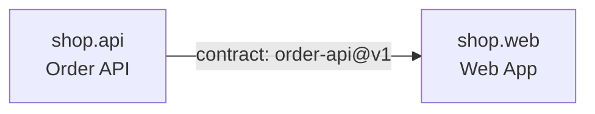

# shop: Shop

## Node

- **Kind:** internal
- **Purpose:** sell products online through an order API and a customer web app
- **Owns:** the whole shop
- **Does not own:** payment processing (an external provider)
- **Consumes:** none
- **Produces:** none
- **Sources:** [ref/spec.md]
- **Decomposes into:** shop.api, shop.web
- **Isolation strategy:** each child builds and tests against the order API contract's fixtures

## Overview

Customers browse products, fill a cart and place orders; staff read the orders.
The shop splits along its one contract boundary: the order API on one side and
the browser front end on the other. One team builds both (owner fact), so the
axis is the deploy target, not team ownership.

## Sources

- `ref/spec.md` - accepted RFC - the shop: order API (§2), web app (§3), constraints (§4)

## Child nodes

| Node | Kind | Purpose |
|------|------|---------|
| shop.api | leaf-parent | create, read and list orders over HTTP |
| shop.web | internal | everything a customer sees in a browser |

### shop.api: Order API

- **Kind:** leaf-parent
- **Purpose:** create, read and list orders over HTTP
- **Owns:** order storage, order id minting, the order endpoints
- **Does not own:** the web front end, payments
- **Consumes:** none
- **Produces:** [order-api@v1]
- **Governed by:** [ADR-001]
- **Sources:** [ref/spec.md (§2, §4)]
- **Decomposes into:** phases (see hsdd-phase-plan)
- **Isolation strategy:** in-memory order store; replay the order API fixtures against the handlers

### shop.web: Web App

- **Kind:** internal
- **Purpose:** everything a customer sees in a browser
- **Owns:** the customer-facing web front end
- **Does not own:** order storage, order ids
- **Consumes:** [order-api@v1]
- **Produces:** none
- **Sources:** [ref/spec.md (§3, §4)]
- **Decomposes into:**
- **Isolation strategy:** build against the order API fixtures; no running backend

## Dependency DAG

| From | To | Type | Via |
|------|----|------|-----|
| shop.api | shop.web | contract | order-api@v1 |

## Dev flow

shop.web starts as soon as the order API contract is stable, building against
its fixtures; shop.api and shop.web then proceed in parallel. There is no
`hard` edge.

## Contract matrix

| Contract | Producer | Consumers |
|----------|----------|-----------|
| order-api@v1 | shop.api | shop.web |

No integration node: the children exchange one contract, and the consuming
phases replay its fixtures; an end-to-end slice is a phase of shop.web once it
is decomposed.

## Open questions

| ID | Question | Status | Waits on | Affects |
|----|----------|--------|----------|---------|
| OQ1 | Do unpaid orders expire? | OPEN | ext: product owner | shop.api |

### OQ1: Unpaid order expiry

The source does not say whether an order left in `placed` expires. Until it is
answered, orders never expire.
