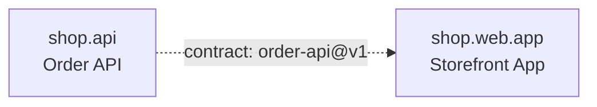

# shop.web: Web App

## Node

- **Kind:** internal
- **Purpose:** everything a customer sees in a browser
- **Owns:** the customer-facing web front end
- **Does not own:** order storage, order ids
- **Consumes:** [order-api@v1]
- **Produces:** none
- **Sources:** [ref/spec.md (§3, §4)]
- **Decomposes into:** shop.web.app
- **Isolation strategy:** build against the order API fixtures; no running backend

## Overview

The web app is everything a customer sees in a browser. The source starts it
as one storefront app (§3), so this level has one child; a second app (staff
tools, say) would be grafted beside it.

## Child nodes

| Node | Kind | Purpose |
|------|------|---------|
| shop.web.app | leaf-parent | the storefront: product list, cart, checkout, order history |

### shop.web.app: Storefront App

- **Kind:** leaf-parent
- **Purpose:** the storefront: product list, cart, checkout, order history
- **Owns:** storefront screens, the cart, the order API client
- **Does not own:** order storage, order ids, payments
- **Consumes:** [order-api@v1]
- **Produces:** none
- **Sources:** [ref/spec.md (§3, §4)]
- **Decomposes into:** phases (see hsdd-phase-plan)
- **Isolation strategy:** an order API client tested against the order-api fixtures

## Dependency DAG

| From | To | Type | Via |
|------|----|------|-----|
| shop.api | shop.web.app | contract | order-api@v1 |

## Dev flow

shop.web.app starts once order-api@v1 is stable and builds against its
fixtures; it never waits for shop.api to ship.

## Contract matrix

| Contract | Producer | Consumers |
|----------|----------|-----------|
| order-api@v1 | shop.api | shop.web.app |

No integration node at this level: there is one child and no sibling exchange.
