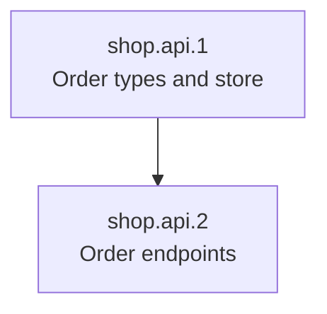

# shop.api: Order API

## Node

- **Kind:** leaf-parent
- **Purpose:** create, read and list orders over HTTP
- **Owns:** order storage, order id minting, the order endpoints
- **Does not own:** the web front end, payments
- **Consumes:** none
- **Produces:** [order-api@v1]
- **Governed by:** [ADR-001]
- **Sources:** [ref/spec.md (§2, §4)]
- **Decomposes into:** phases (see hsdd-phase-plan)
- **Isolation strategy:** in-memory order store; replay the order API fixtures against the handlers

## Overview

The order API is the shop's only backend surface: create an order, read one
order, list a customer's orders. It mints order ids as ADR-001 fixes them and
keeps totals in integer cents. Whether unpaid orders expire is open (OQ1,
defined in the root spec).

## Phase Plan

**Default gate:** `npm test`

| Phase | Name | Tier | Size | Depends on |
|------:|------|------|------|------------|
| shop.api.1 | Order types and store | gate-only | ~4 files, <= 4 OpenSpec tasks | none |
| shop.api.2 | Order endpoints | full-review | ~6 files, <= 7 OpenSpec tasks | 1 |

Ordering policy: interfaces-first. Types and the store come first; the
endpoints that produce the contract come last.

### shop.api.1: Order types and store

- **Consumes:** none
- **Produces:** none
- **Governed by:** [ADR-001]
- **Scope:** order and line types, ULID order id minting, an in-memory order store with create, get and list-by-customer
- **Size estimate:** ~4 files (~200 lines), <= 4 OpenSpec tasks
- **Gate:** node default
- **Verification:** ids minted in one run never repeat; a stored order reads back unchanged
- **Review tier:** gate-only
- **Dependencies:** none

### shop.api.2: Order endpoints

- **Consumes:** none
- **Produces:** [order-api@v1]
- **Scope:** the three HTTP endpoints, the error envelope and the 422 and 404 cases, over the shop.api.1 store
- **Size estimate:** ~6 files (~350 lines), <= 7 OpenSpec tasks
- **Gate:** node default plus contract replay for order-api
- **Verification:** creating an order and reading it back returns the same body; a missing id gives the error envelope
- **Review tier:** full-review
- **Dependencies:** shop.api.1 (types and store)

## Governance updates (pending reconcile)

> Emitted by hsdd-phase-plan on 2026-10-21. Drained by hsdd-reconcile;
> do not apply by hand.

- confirm `order-api@v1` produced_by: [shop.api.2]
  - the provisional guess was shop.api.1; the endpoints land in phase 2
