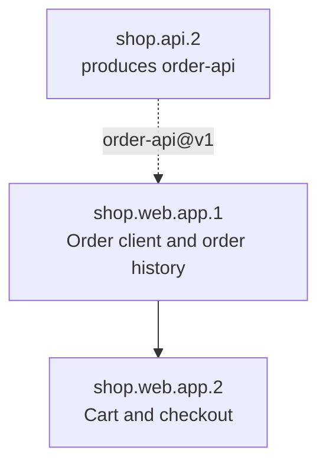

# shop.web.app: Storefront App

## Node

- **Kind:** leaf-parent
- **Purpose:** the storefront: product list, cart, checkout, order history
- **Owns:** storefront screens, the cart, the order API client
- **Does not own:** order storage, order ids, payments
- **Consumes:** [order-api@v1]
- **Produces:** none
- **Sources:** [ref/spec.md (§3, §4)]
- **Decomposes into:** phases (see hsdd-phase-plan)
- **Isolation strategy:** an order API client tested against the order-api fixtures

## Overview

The storefront is the customer's whole journey: browse products, fill a cart,
check out and read order history. Checkout creates the order through
order-api@v1; order history lists the customer's orders through it. Totals are
shown from `total_cents` and never recomputed.

## Phase Plan

**Default gate:** `npm test`

| Phase | Name | Tier | Size | Depends on |
|------:|------|------|------|------------|
| shop.web.app.1 | Order client and order history | spot-check | ~5 files, <= 5 OpenSpec tasks | none |
| shop.web.app.2 | Cart and checkout | full-review | ~6 files, <= 7 OpenSpec tasks | 1 |

Ordering policy: interfaces-first. The order API client comes first, tested
against the contract's fixtures; the screens that compose it come after.

### shop.web.app.1: Order client and order history

- **Consumes:** [order-api@v1]
- **Produces:** none
- **Scope:** a typed order API client, its tests replaying the order-api fixtures, and the order history screen
- **Size estimate:** ~5 files (~250 lines), <= 5 OpenSpec tasks
- **Gate:** node default
- **Verification:** order history shows a customer's orders newest first, with totals from `total_cents`
- **Review tier:** spot-check
- **Dependencies:** none

### shop.web.app.2: Cart and checkout

- **Consumes:** [order-api@v1]
- **Produces:** none
- **Scope:** product list, cart and checkout; checkout creates the order through the shop.web.app.1 client and handles the 422 case
- **Size estimate:** ~6 files (~380 lines), <= 7 OpenSpec tasks
- **Gate:** node default
- **Verification:** checking out a two-line cart shows the created order with the total the API returned
- **Review tier:** full-review
- **Dependencies:** shop.web.app.1 (order client)

## Governance updates (pending reconcile)

> Reconciled 2026-10-22 by hsdd-reconcile. Drained entries are in git history.
